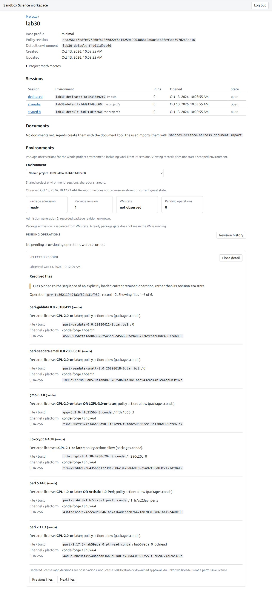
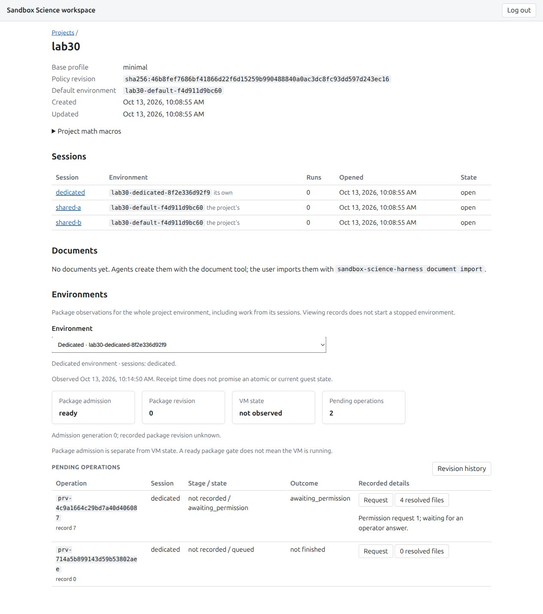
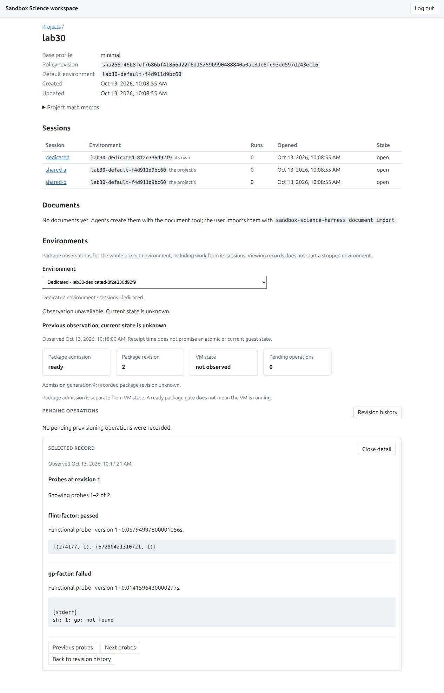

# OpenShell v0.1.3 Lab30: read-only provisioning observations

The first provisioning viewer passed independent corrected-source review, fresh combined Python gates and root-owned real-worker/native-browser acceptance on signed clean `220cddd80f217288959890cb35779bc5c6a4948d`. Its helper SHA-256 is `d72cb2695047b41d6d872935803784878ff5b1fb2d06366ed903e93276079829`. The actual run is `a8bdc1c866394d78a1673453cc072f1b`. All owned runtime/private state was removed at 14:21:57Z; independent current cleanup cleared at 14:24:45.935296Z on 2026-10-13. Fresh delivery CI and merge remain separate.

The [exact archive](babbage-openshell-lab-30-evidence-2026-10-13.json) retains **393 UTF-8 records**, 1,722,979 original text bytes, and ten separately stored JPEG images. Each record has an origin, exact byte count and SHA-256. The archive is 1,930,821 bytes, SHA-256 `b23873c28a8eacc4122007122bed05bbd7b8ed0977e80709dcf9a3fe4610c8f2`. It preserves the failed and corrected sources, actual unsuccessful invocations, dated predecessor readiness, combined gates, public runtime evidence and cleanup. Counts from different invocations are not added together.

## Actual runtime and browser coverage

Production `ProjectStore`, `create_app`, authenticated `WorkerClient` and worker observation routes ran against two owned OpenShell VMs. Canonical shared-a/shared-b sessions used the same environment; the dedicated session used its own. A separate unserved project/environment and wrong operation scope returned explicit refusal. The lab used host Python 3.13.15, OpenShell 0.1.3, the configured minimal image profile and two vCPUs/1200 MiB/8192 MiB disk per VM. Guest interpreter and image digest were not independently remeasured in this run. Its provider was explicitly synthetic; no external model or credentialed provider request was made.

| Actual case | Observed result |
| --- | --- |
| Initial shared/dedicated selection | Worker and GUI typed observations agree; empty queue and unknown revision remain literal; foreign/unserved scope is refused |
| Shared GP installation | Completed revision 0 to 1; six exact resolved files; retained GP factor probe passed |
| Post-install overview | Both routes and the native browser show recorded ready generation 2, null owner, current revision 1 and empty queue |
| Selected records | Exact current operation, sequence-pinned files, revision history and raw-pinned probes agree across worker/GUI; stale selections return 409 and foreign operations 404 |
| Dedicated permission queue | Flint awaits request 1 with four exact files while its GP sibling remains queued; the browser shows both operations |
| Separate decisions | Root reviews and approves only request 1's four files, then separately request 8's five sibling files, each with a 15-minute files grant through the existing operator CLI |
| Dedicated completion | Flint advances 0 to 1 with passing flint-factor; GP advances 1 to 2 with passing gp-factor. Recorded ready generation 4 and empty queue agree with retained history |
| Historical probe labeling | Revision 1 still shows the sibling's pre-install GP failure alongside Flint's pass; the later GP pass belongs to revision 2 |
| Worker offline | Two GUI summary reads return 503 with unchanged bounded SQL; browser says current state is unknown and retains its dated prior observation |
| Idle suspension | Worker suspend-after 3 seconds stops both exact original VMs; 60 paired samples produce 120 worker/GUI GETs without SQL changes. Fresh root gateway proofs before and after reads/browser activity show the same VMs Stopped |
| Sign-out and teardown | Native sign-out succeeds; owned tab, login inode, runner, listeners, VMs, units and lab paths are removed |

The live browser rendered all six GP files and four escalated Flint files with their exact hashes, declared license text and recorded allow/escalate decisions. The sibling's five-file count and separate waiting request were visible; its complete typed file page was checked by the helper. None of these observed package licenses was AGPL, so the AGPL flag remains focused synthetic frontend coverage. The browser does not certify licenses, approve downloads or infer VM health from a ready package gate. No install, answer, cancel, rebuild or recovery control is present.

Gateway proofs are dated root observations, not continuous VM-state proof. The independent reviewer checked their exact original IDs and chronology and the saved SQL/DTO evidence without making independent runtime RPCs. The 30-loop no-wake check is 60 environment samples, each paired across worker/GUI, rather than 120 pairs.

## Corrections and local gates

The integrated original viewer preserves independently reviewed worker/contracts `52e3cdd`, workspace API/client `ca44fa4` and GUI `9ac79f6` source, with kernel main `cef64a0` ancestry. Earlier worker JSON ambiguity/duplicate-key and API canonical-path replacement findings were corrected before integration; original probes remain intact. API author-prefixed corrected manifests distinguish the original six-path author freeze from generic scratch metadata that collided with a two-module review record.

The original combined gate at `69a1a3b` passed 10,768 Python/43 opt-in skips/two existing warnings and 746 web/24 post-build math cases. Its GUI/Math build inputs remain exact through the current reader correction: 109 tracked web inputs and all 70 GUI/six math assets were explicitly checked. That supports reuse of the original 746 web/30-file, zero check errors/warnings, both production builds, 24 post-build math and npm license evidence; it is not a fresh web rerun.

Fresh corrected full Python on `220cddd` passes **10,778 tests, 43 opt-in skips and two existing forged-artifact serializer warnings in 386.28 seconds** (389.424-second process). Whole-repository Ruff format/style, Pyright zero errors, locked dependencies, Python 3.13.15, generated protocols and all 75 installed Python license checks pass. All 737 corresponding inputs stayed exact through runtime and teardown; only the worker reader and its test differ from the original 69a gate.

The initial helper review corrected exclusive private-write ownership, fdopen failure drain, SQLite numeric prefetch, raw error-kind projection and stale/foreign gateway proofs. The timeout correction explicitly aligns each HTTP request with its outer budget: environment create 180 seconds, ordinary calls 12. Preliminary services were removed before any VM creation when that mismatch was found. Four actual mocked request-budget probes and 52 earlier guard/SQL/mocked cases are separately retained.

The first real attempt at `f964a050` successfully installed GP but failed its post-install summary: supported SQLite returns NULL for `substr(CAST('' AS BLOB),...)`, and the normal producer ready-operation value is empty TEXT. Worker correction `e7a927d` preserves that empty value only after checking its original SQL TEXT type. Actual NULL/BLOB/numeric/invalid/oversize values still refuse. Its 60 focused/330 affected cases include the real Store installing-to-finished producer, revision 0 to 1 and reopened observation. Independent exact-source corruption/bounds probes and helper full-method probes passed. The helper now requires the paired post-terminal ready overview, empty queue and exact current revision before exporting successful install/permission evidence.

One root permission-finish call was redundantly repeated while the sibling permission was already recorded; exclusive evidence creation refused without overwriting it. The original failure is preserved separately from the two explicit approvals and final completed stage. A predecessor cleanup TXT copied an old browser timestamp; its original JSON correctly recorded the fresh 14:23:10.169Z inventory. A distinct addendum corrects only that text bookkeeping; both captured versions remain exact in the archive and retained snapshots. Cleanup JSON/TXT subsequently gained public-coherence notes before final freeze, so their extended versions are retained separately. Final diagnostics also corrected the documentation index inventory hash; the original unsuccessful integrity outputs remain labeled bookkeeping.

## Evidence hygiene, cleanup and limits

Before private deletion, root checked public runtime records, logs and screenshots against the actual live worker/login credentials. The new synthetic-provider raw registration output was removed only by its recorded device/inode/owner/mode; it was never read or hashed. Private login values, worker configuration/HMAC bytes and raw gateway annotations are not archived. The archive literal bearer-fixture inventory is empty; this does not substitute for the separate exact live-secret exclusions.

Independent cleanup confirms seven units inactive/dead/PID0, seven original/restarted/workspace/bootstrap process identities absent, eight owned ports without listeners, both bind modes free, owned driver sockets absent, seventeen public record hashes exact and all 737 corrected inputs unchanged. Root admitted the all-workspace inventory as exactly its two original VM IDs before deletion. Initial post-teardown default binds briefly returned EADDRINUSE while reusable binds were free; later independent checks found no such state. The original transient cause was not captured and is not asserted.

Two-lockfile comparison remains a separate independently clear future union `dd5718f`: its fresh 10,878 Python/775 web/24 math gates do not establish runtime acceptance in this initial viewer lab. Full CP-26, operator-domain permission answers in the GUI, retention/recovery controls, automatic wake/replacement reconciliation, provider semantics and scientific computation remain outside this result.
