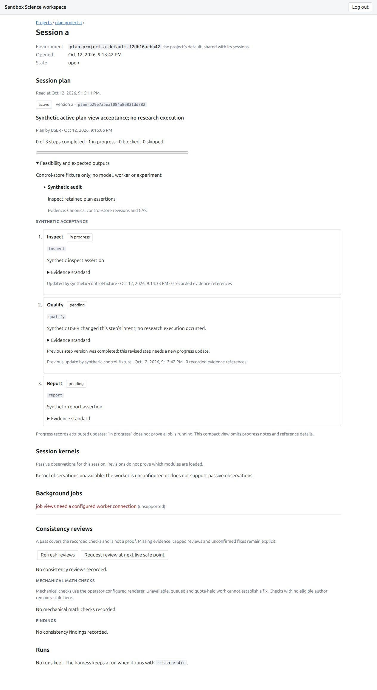
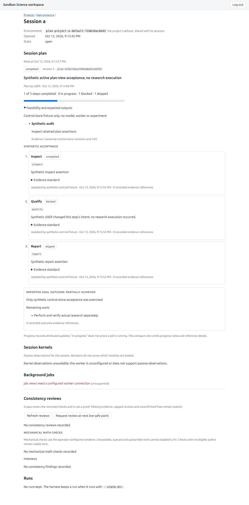

<!-- SPDX-License-Identifier: MIT -->
# Original MAIN planning and live progress acceptance

Date: 2026-10-12 local; browser acceptance ran on 2026-10-13 UTC. This slice
implements the requested planning phase and visible committed progress (D86),
using independently written prompts and code. It does not copy Claude Science
or OpenScience Desktop prompts, code or schemas.

## Source and scope

| Stream | Independently reviewed signed source |
| --- | --- |
| Immutable session plans and append-only progress | `4deb2dcf5909c4cf33620f059533c511cc5951a4` |
| Six MAIN tools and conditional original phase guidance | `f31ef29d2baf28af3d89508c4516c5985bdb708e` |
| Authenticated read-only workspace plan API | `7b774f6b1e30d4096f2da2e6b65b361532bd5131` |
| Live viewer and closed-history correction | `736b1ca09a6e14906aa3d1be5c66354a053c926e` |
| Positive test-type narrowing, with assertions preserved | `38a7be7894c6109f6c72c4e836741729ad71eaad` |
| Disposable synthetic browser fixture | `ad440edab38c54e0d97722edba6179ec9641d0ba` |

Root combined product source is `a52a747b13b01a0689855e929e50e7deae87f6c5`;
the reviewed test/docs union is `2b1b4071348a3e4c7fd09a4f568bb32ccb72b9f0`.
Signed clean runtime source `5259f6c7a61c2868e9101d5fefe3430a4e4e16ca`
adds only the reviewed helper and tracking updates. Product, frontend, scripts,
configuration and dependencies remain byte-identical to their reviewed freezes.
Actual delivered PR #101 main `91940ab` is integrated.

The [core](../../../docs/SESSION-PLANS.md) provides scoped immutable CAS versions,
stable IDs, explicit step fingerprints, attributed append-only progress,
bounded replay/history/quotas and qualified terminal goal outcomes. The
[MAIN integration](../../../docs/ORCHESTRATOR-PROMPTS.md#implemented-stateful-main-planning-tools)
offers `plan_read/create/revise/activate/progress/finish` only to a resolved
stateful MAIN run. Existing task authorization permits draft activation; this
does not grant permissions or introduce a mandatory approval gate. USER-edit
fences require a current read actually delivered to a successful model call
before new effects. Same-batch reads, stale CAS and historical replay cannot
clear that fence. Durable progress survives later model/save failure.

The [workspace API and viewer](../../../docs/SESSION-PLAN-WORKSPACE.md) read the
complete bounded current projection. Current-intent fingerprints, original
authors/times and explicit goal outcome remain visible. Polling owns one actual
request, fences late responses, stops on logout and makes one attempt for closed
history. Unknown state is distinct from no plan. This compact view uses escaped
prose and omits long progress notes/reference details.

## Local gates and independent review

Full Python gates on `a52a747` passed **10,312 tests, 43 opt-in skips and two
existing warnings** in 376.69 seconds. The full-repository static pass exposed
30 missing test-type narrowings; the signed test-only correction preserves
existing assertions and adds explicit positive checks. Root reran the corrected
**127 core/API tests**, full Pyright, Ruff/format, generated-code and installed
license checks successfully on the later union. The broad Python result remains
explicitly pinned to the original collected tests; unchanged product behavior is
not relabeled as a second broad run.

Final frontend validation on exact `736b1ca` passed **656 web tests**, including
**42 plan tests**, Svelte/TypeScript with zero errors/warnings, both production
builds and **24 post-build math cases**. Frontend/dependency/build inputs remain
unchanged in the runtime union. The helper passes twelve author guard probes
and nineteen independent disposable/mocked checks. No external-model behavior
or research result is inferred from these gates.

Independent review closed operation-replay and canonical-event attribution
findings in the core, copied-base/outcome-scope and missing-current-pointer
findings in the API, complete-response/closing-reread findings in the adapter,
closed-history failure retry in the viewer, and bounded/truthful cleanup findings
in the helper. Exact source/union ties and logs are retained in the
[evidence archive](session-planning-evidence-2026-10-12.json).

## Actual browser acceptance

Root served the production build on a disposable loopback aiohttp workspace,
using the canonical control store and the exact reviewed helper (SHA256
`111243129888a501612e9e6a1271be536ab8c1eb1dd998cb88ebe6291478a219`).
Startup and post-checks pin all **70 assets and eleven source inputs**. A
single-use loopback redirect kept the synthetic login value out of public
evidence. Every mutation was a synthetic control-store assertion through the
actual core/CAS API. No worker, model, VM or research execution was started.

The actual Codex browser showed:

- A's active version 1, stable `inspect/qualify/report` steps and one synthetic
  completed assertion; feasibility and expected outputs expanded correctly.
- `inspect` becoming in progress through a committed update, while no run was
  saved: one completed and one in progress.
- USER version 2 retaining all stable IDs but changing `qualify` intent. Its
  previous completed assertion remains labeled; current completion drops to zero.
- A completed workflow with **one completed, one blocked and one skipped** step,
  **partially achieved** goal outcome and explicit remaining work. The progress
  bar stays one-third, rather than displaying all-success.
- Project B's distinct unchanged active plan, with no A revision or outcome.
- Recorded closed-session history: one HTTP 200 plan read and no periodic reads
  over 28 seconds.
- A scoped browser URL block causing unavailable/current-unknown wording with a
  dated previous observation; clearing the block restores current observations.
- Normal sign-out removing the plan, with zero later plan requests during the
  observed 39-second window. The owned browser tab was closed.

Native visibility changes, a true unseeded no-plan session, failed logout POST,
late-response races and closed-history error retries remain focused-test evidence;
they are not claimed as exercised browser cases. Actual MAIN tool/model assembly
and mid-run durability are scripted host tests. Live external-model planning
quality, USER editor/approval routes, delegated runs, effect-to-step lineage,
general prompt-bundle provenance, questions, compaction and idle scheduling remain
separate. Existing role prompts are not replaced by every draft in the catalog.

Independent cleanup at **2026-10-13T01:22:48.894078Z** confirms the exact fixture,
private info file, helper PID and both loopback listeners are gone; the helper
receipt records one runner closed with no errors. Browser-tab closure and the
one-use bridge's earlier exit 0 are root observations; the bridge's absent
listener is independently checked. No unrelated services were stopped.

Fresh exact-head Python 3.12/3.13, web and security checks are required before
merge. The final PR result is a separate delivery gate from these retained local
and browser acceptance records.
