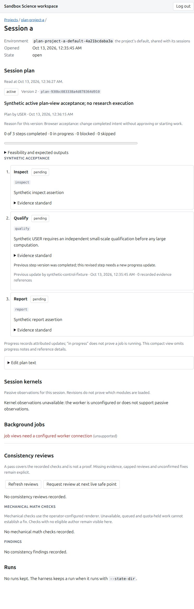
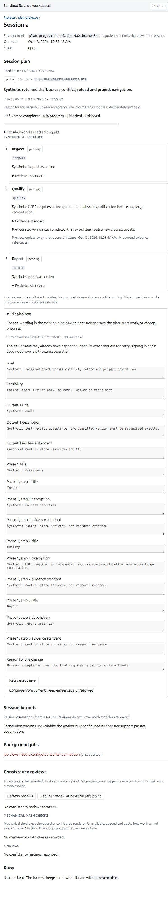

<!-- SPDX-License-Identifier: MIT -->
# USER plan-body text editing — 2026-10-13

Authenticated USER editing of existing session-plan wording passed independent
source review, combined local validation and native browser acceptance on signed
runtime source `30a3665ac0d6539a1e88a1f693c3eed6a85dc137`. The browser retained
conflicting drafts and reconciled a genuinely committed save whose response was
withheld, without creating an extra version. This is synthetic control-store
validation; it makes no scientific-result or research-execution claim.

## Exact source and validation boundaries

| Evidence | Pin and result |
| --- | --- |
| Backend | `528400932362df8ae9b856d34501b34f0568027d`; 51 focused/271 affected, scoped static/type/license checks; independent exact-source clearance |
| Frontend | `3633f1184e313a8ced94ed6f45b236caffabc250`; 80 focused (38 editor + 42 existing plan-view), check 0/0, both builds/licenses; independent exact-source clearance |
| Full Python | `af0d1857ea68a8514ce08ba138f89d51177db7a3`; 10,559 passed, 43 opt-in skips, two existing warnings, 380.93s. Explicitly reused for the runtime candidate only after exact Python product/test/config/dependency/build equivalence |
| Full web and math | `5147f418de950c4c2bfe09a35bb5bb449348a3b0`; 694 web tests/29 files, check 0/0, 24 post-build math cases, production builds and licenses. Web source remains byte-identical through `30a3665` |
| Final helper/rebuild | `30a3665`; 19 helper guard cases and scoped static checks; fresh GUI/math production rebuilds. Helper SHA256 `8da94eb369a576890cc99a97d8a45fac7941ba88a3af263ed95815bb898b43e7` |
| Runtime integrity | Independent review verified 16 actual source inputs and 70 build assets before/after acceptance and cleanup |

PR #107 is the actual merged baseline: main `7f8985310da5a431a90f1acef63d48ce5d65d5e7`,
reviewed signed `979b874c5ade57df36617290033ff1b354b82983`, all four fresh checks
successful in run `38343981986`. The exact delivery receipt is retained. The
new USER editor's final docs/archive review and fresh exact-head PR CI remain
the delivery gates before merge; this report does not claim they already ran.

## What the browser proved

Root served the production bundle through the actual workspace application in
an owned loopback fixture with synthetic projects A/B, an A closed-session plan
and a true no-plan scope. Its private login file was mode0600 and the fixture
root mode0700; public startup metadata retained source/build and process ownership
pins without the login value. No external model, provider, worker, VM or research
computation was started.

1. Saving USER wording created immutable version2, displayed USER attribution and
   the submitted reason, and reset a changed step's old completion to current
   pending. Stable step IDs and references were preserved.
2. A competing canonical version3 kept the editor's version2-based draft and reason.
   Reload and A→B→A navigation preserved that exact draft. Explicit current-base
   adoption saved version4; no automatic merge or overwrite occurred.
3. The helper allowed a real version5 commit, then replaced that successful response
   with one503. The editor showed an unknown outcome and held mutable intent.
   Reload retained the exact pending operation/body/base/reason. Exact retry under
   the same login reconciled the historical version5 receipt. Canonical history
   remained exactly versions1–5, with USER authors on2–5 and no version6.
4. ProjectB and the closed A history stayed at version1. Closed and terminal plans
   were read-only; the true empty scope offered no editor. A synthetic qualified
   terminal assertion showed one completed, one blocked and one skipped step,
   with `partially_achieved` and remaining work; it did not claim research success.
5. Normal logout showed the signed-out workspace. Long postlogout silence, failed
   logout requests and late ignored-abort races were not inferred from static
   browser observations.

The retained screenshots show USER version2 and the expanded uncertain-save view:

## MAIN steering and authority

The separately executed backend fixture
`test_actual_http_user_edit_requires_successful_main_current_read` uses an actual
in-process HTTP USER edit and the existing `run_task`/PlanTools boundary with a
scripted model and synthetic tool outcome. A same-batch current-plan read does
not release a following effect; only a current read included in a successful
model return releases the existing reread fence. Exactly one synthetic effect
then dispatches, and canonical current attribution is USER. Its exact frozen
function and51-pass author log are retained; this is focused host evidence, not
browser model execution or an external gateway result.

The editor changes only existing goal/feasibility/output/track/phase/step text.
It adds no creation, reorder, status/progress/outcome, approval, grant or execution
route. The server owns USER authorization and immutable CAS. A save receipt is
historical acknowledgment followed by GET; it never asserts current state,
approval or start. Session openness is checked logically at admission/commit;
no opaque cross-request open lifetime is claimed. New logins may have different
USER operation principals, so an operation string alone proves no cross-login
replay identity or earlier absence.

## Failures retained and qualification limits

The archive preserves original backend fixture/style/type failures, frontend
wrong-directory/no-file and callback-typing failures, and the old SSR no-button
expectation before it was changed to disabled edit controls. Helper formatting
failure and the independent concurrent503/503 reproducer remain distinct from
the corrected one-use200/503 proof. The worker's first runtime audit used the
wrong lowercase heading expectation; its failure and corrected result are both
retained. Root's AX summary selector correction and transient wrong-project
navigation snapshot are recorded separately, with no product source change.
None of these predecessors is labeled the accepted final gate.
The archived `user-plan-editing-final-integrity.py` is an unexecuted draft from
before the current consumer-document hashes were refreshed. The later executed
root audit separately permits exactly those documented index changes; the archived
draft is not presented as that completed gate or as the current scratch script.

Native hidden-tab behavior, cross-login reconciliation, explicit unresolved
predecessor continuation, late ignored abort and failed logout remain focused
source-test evidence. Storage failure retains memory and a visible warning,
without promising reload survival. One unresolved predecessor cannot be silently
evicted by a second unknown. Displayed progress and canonical save history are
workflow observations, not live research or mathematical verification. USER
approval, delegated lifecycle, durable repair spend/history, kernel MAIN notice
delivery, protected export staging/conversion and idle wake remain separate.

## Cleanup and exact archive

Root cleanup finished at `2026-10-13T04:41:46.547277+00:00`. Independent live cleanup
at `2026-10-13T04:43:06.765376+00:00` verified owned PIDs370883/371350 absent, ports34005/42731
free, fixture/private file absent, no cleanup errors and unchanged16 source/70
asset hashes. Tab21 absence is tied to root's filtered token-free CUA record;
unrelated tabs were not enumerated. Root reports exact disposable credential
exclusion from exported public records; reviewer did not read the credential.

[Exact public archive](user-plan-editing-evidence-2026-10-13.json): 137
UTF-8 records, each with original bytes/SHA256/text, plus two standalone JPEG
metadata records. Archive 544,946 bytes, SHA256 `8ddb6aa70a10eb4e4ccc15c75e6d684f7e71429238d32071436082fe3f5a78ee`. Selected JPEGs
retain original bytes and magic, with no conversion. Private login material and
raw credentials are excluded. Earlier accepted report/archive files are unchanged.
