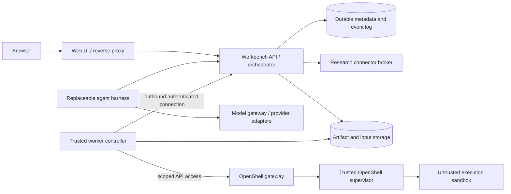

# Proposed architecture

Date: 2026-10-10. These are workbench design choices, not claims that OpenShell or OpenScience Desktop already implements them.

## Component boundary

The web UI, API/orchestrator, harness, and worker controller each have a container packaging boundary. The API and harness may initially ship as one control-plane container, provided their domain interfaces and persisted state allow a later split. Moving the combined orchestrator/harness is an MVP requirement; moving the harness separately is a supported architectural direction.

| Component | Owns | Access boundary |
| --- | --- | --- |
| Web UI/reverse proxy | Browser assets, runtime API configuration, authenticated browser routing | No model keys, worker enrollment keys, or container-engine access |
| API/orchestrator | Identity, projects, policies, approvals, sessions, jobs, placement, authoritative run events | Durable storage; no execution of model-generated shell commands |
| Agent harness | Model loop, conversation context, planning, tool requests, bounded delegation and reviewer coordination | Scoped project/tool API; no infrastructure administration |
| Worker controller | Worker enrollment, job leases, capability checks, input staging, sandbox dispatch, output capture, reconciliation | Credentials for its assigned OpenShell workspace/pool; no authority over other pools |
| OpenShell gateway/supervisor | Sandbox lifecycle and runtime policy boundary | Trusted infrastructure; operator-controlled compute-driver access |
| Execution sandbox | Generated code, batch notebooks, build tools, parsers, document renderers | Job-scoped inputs/workspace and narrowly mediated network access |
| Research connector broker | Approved remote MCP tools and isolated local MCP processes | Explicit connector permissions and endpoint-bound credentials |

Keep OpenShell inside the execution adapter, so its sandbox IDs, SDK types, and policy schema do not become the UI's or scientific workflow's permanent API. OpenShell documents a gateway, separate trusted supervisor, and workload boundary; the project-specific layers above are our design. [OpenShell architecture](https://docs.nvidia.com/openshell/latest/about/architecture)

## Execution and harness rules

All code execution tools submit a run through the workbench API. The harness may assemble tool arguments and read authorized results, but it cannot run a shell in the control-plane container. A model selecting `bash`, Python, a notebook cell, a parser, a compiler, or a reviewer does not change that rule.

For an external harness such as OpenCode, evaluate two integration modes before choosing one:

- Disable or replace every local execution/file tool and route it through scoped workbench tools. This requires proof that built-in tools, plugins, skills, and MCP subprocesses cannot bypass dispatch.
- Run the external harness itself as an untrusted sandbox workload with only project-scoped API authority. Its built-in tools then execute inside that boundary. Additional compute still goes through the scheduler. It receives no worker-controller or gateway administration credentials.

An adapter's convenience API is not sufficient evidence for the first mode. If neither mode supports the required workflow and state recovery, use a small owned harness with a deliberately narrow tool surface. Avoid building a general agent framework until the integration spike establishes what is missing.

Untrusted MCP subprocesses, package installation, file parsers, and document previews also belong in governed environments. A remote MCP service remains an external trust boundary; permission to call it does not establish its internal isolation.

## Placement and connectivity

“Local UI” and “remote UI” describe the server serving browser assets. The browser always runs on the user's device.

| Profile | UI server | Orchestrator/harness | Workers | Main constraint |
| --- | --- | --- | --- | --- |
| All local | Local container | Local container | Local pool | Separate persistent volumes and restricted trusted runtime access |
| Remote compute | Local container | Local container | Remote pools | Authenticated outbound worker connection plus deliberate input transfer |
| Hosted control, local compute | Local or remote container | Remote containers | Local pool | Local controller dials out; no publicly exposed local Docker API |
| Remote UI, local control | Remote container | Local container | Local or remote pools | Same-origin reverse proxy through an authenticated private tunnel to local API |
| All remote | Remote container | Remote containers | Remote pools | Identity, routable artifact storage, quotas, and private gateway networking |

All eight local/remote combinations of the three main layers are intended. Test the common profiles first, then the remaining combinations. The unusual remote-UI/local-control case needs a tunnel or VPN and an explicit API route; loading a remote page does not create reachability to a private local API.

Use a worker-initiated authenticated long poll or persistent channel for job leases and events. This permits local workers behind NAT with hosted orchestration. It is a workbench transport to be implemented, not a claim about OpenShell's gateway automatically solving NAT. The worker talks to a reachable gateway near its compute pool. Each pool advertises its backend, architecture, available resources, capabilities, and allowed data classes.

No peer resolves a path on another host. `localhost` always means the current network namespace. Build and publish immutable OCI images; remote workers pull them from an approved registry. A gateway can use the driver's explicitly supported remote configuration, but this is not the default portability mechanism.

## Storage and moving components

Use PostgreSQL for durable project/session/run/event metadata and the initial job queue. Keep the queue modest: transactional lease acquisition and an outbox/event cursor are sufficient for the first worker. Introduce a dedicated queue only when measured load or scheduling complexity justifies it. SQLite may be used for disposable spike tooling, not shared across hosts or replicas.

Use a storage interface for immutable inputs, code snapshots, output manifests, logs, and artifacts. The all-local implementation may use a private filesystem directory behind an authenticated storage API. Split deployments need a reachable storage service or an explicit transfer channel; an S3-compatible implementation is a candidate. S3 compatibility alone is not a requirement to transmit private data to a remote host.

Sensitive datasets can remain worker-local as enrolled, immutable dataset references. Resolve them only in their allowed pool and record the digest there. The control plane may still receive prompts, filenames, logs, summaries, and model context. “Compute stays local” must not be presented as “all data stays local.” Strict local projects require local orchestration, storage, connectors, and inference as appropriate, or a separately designed opaque coordinator.

To move the control plane: drain new submissions, checkpoint sessions, reconcile/fence old leases, back up metadata and required artifacts, redeploy pinned images and secrets, restore or reconnect storage, and verify project/run continuity. Do not run two unfenced schedulers against a copied database. Retain the old instance for rollback until verification passes.

To move a worker pool: enroll the new pool, verify images/capabilities/policy, restage permitted inputs, and dispatch new attempts there. Existing processes finish on the old pool or checkpoint explicitly. The UI service should need only a new API route and runtime configuration.

## Domain and adapter contracts

The public domain contract should identify a run independently of the sandbox backend. See [the illustrative request](../examples/run-request.json).

| Contract | Required fields/operations |
| --- | --- |
| Run specification | Project/session IDs, logical run ID, exact code/input references, environment profile revision and image digest, argv, relative working directory, resource/time/output limits, approved policy revision, placement constraints, seed/precision as relevant |
| Worker registration | Worker/pool ID, backend and release, CPU architecture, available resource reservations, permitted environments/datasets, capability probe evidence and freshness |
| Execution adapter | Describe capabilities, prepare inputs, create sandbox, wait ready, exec/stream, signal/cancel, query/reconcile, collect outputs, destroy; report unsupported features explicitly |
| Run events | Run ID, attempt ID, worker ID, lease generation, stable event ID, sequence, timestamp, type, bounded payload/artifact references |
| Completion | Exit code/signal, measured timings/resources if supported, effective environment/policy, output manifest, input/output hashes, final cleanup status |

The worker accepts only operator-approved image/policy/resource selections. Raw driver configuration, host paths, privileged flags, and unrestricted mount requests are not part of model tool arguments. Use argv and a staged script, not interpolated user text in an infrastructure shell command.

States: `queued → preparing → running → collecting → succeeded|failed`; an attempt may also become `cancel_requested`, `cancelled`, `timed_out`, or `lost`. Keep `blocked_policy` and `blocked_capability` distinguishable from computation failure. A run can have multiple immutable attempts.

Delivery is at least once. Deduplicate submission with an idempotency key; acquire leases transactionally; use a monotonic lease generation to reject stale completion updates; correlate a sandbox with the attempt ID before retrying creation. Preserve events through disconnects and replay by cursor. After a lost lease, reconcile the old sandbox before starting a replacement, or require operator resolution. Never claim exactly-once effects for external tools or blindly replay non-idempotent actions.

Cancellation is a recorded request followed by observed process termination or an explicit unresolved status. Apply a grace period, then kill the process tree/sandbox. Record partial output and cleanup failure. An unreachable worker is `lost` or `cancellation_pending`, not falsely cancelled. The worker must enforce a local wall-time/lease policy even when disconnected; verify that it prevents abandoned jobs from running indefinitely.

## Reproducibility and scientific correctness

Record image digest and architecture, environment lock/SBOM reference, package/tool probe results, code revision or snapshot, input digests, command, working directory, meaningful environment values, effective policy, seeds, precision, CPU/GPU details, model/provider/settings, tool-call linkage, outputs, and failed attempts. Do not record secret values. Protect manifests with access controls and, later, signatures if authenticity across administrators matters; hashes alone do not establish trustworthy provenance.

Metadata advertised by a package or host executable is a hint. A capability becomes runnable only after a functional check in the actual sandbox under its actual policy. Cache results by image/platform/policy/probe revision and expire or invalidate them when any of those change. Numerical results have tolerances and hardware effects; benchmark results require hardware context. Exact mathematics can still depend on randomized algorithms and software versions.

Batch scripts and notebook execution come first. A future persistent notebook kernel is pinned to a worker/session. Save notebooks and explicit checkpoints; portable process memory is not assumed. Reviewers get a fresh sandbox with read-only evidence and their own output location.

## Security and operations

Treat project text, research papers, generated code, tool responses, and artifacts as untrusted content. Infrastructure credentials and policy changes remain on the trusted side. Container isolation shares kernel risk; evaluate a VM boundary separately when the threat model requires it.

Restrict engine sockets and cluster credentials to the trusted infrastructure that needs them. Mounting a Docker socket in the gateway is an infrastructure privilege, even when its process is non-root. Avoid Docker-in-Docker as the default. Application containers have no host home-directory mount. Give every attempt its own workspace, limits, and narrow write scope.

The browser authenticates to the workbench, not directly to OpenShell. Prefer a same-origin API proxy with secure HttpOnly session cookies and CSRF checks; use scoped machine credentials for workers. Isolate HTML/SVG/notebook previews on a separate origin or restrictive sandbox, sanitize rich output, and restrict downloads and output paths, including symlinks and archive traversal. Artifact upload/collection must not follow a job-created symlink outside its workspace. Bound artifact size, count, logs, and retained storage.

Expose health/readiness separately, and attach project/run/attempt IDs to logs and metrics. Readiness checks include storage and runtime connectivity. Collect queue delay, preparation time, execution time, transfer bytes, cancellation time, failed policy/capability checks, and leaked resources. Enforce aggregate pool reservations as well as per-sandbox limits.

