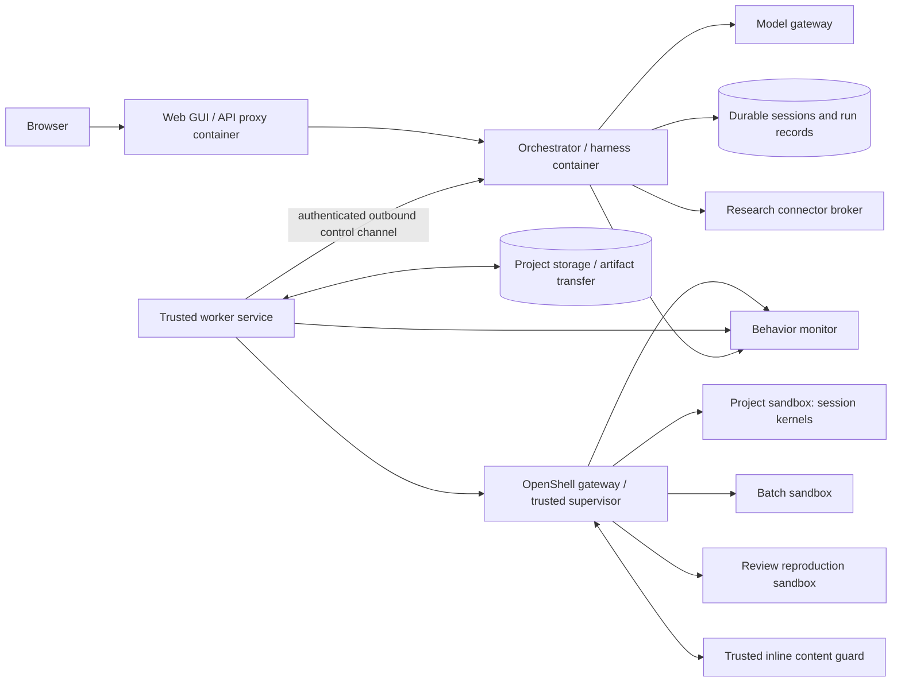

# Proposed architecture

Date: 2026-10-10. These are design proposals; no local or Kubernetes deployment has been tested.

## Component boundary

The GUI, orchestrator/harness, and compute pools have independent packaging and endpoint configuration. The harness initially remains with orchestration. Splitting the model loop into another service is not required to achieve execution isolation.

The orchestrator owns research coordination, skills, agent/reviewer roles, tool dispatch, permissions, and durable session history. The worker service owns execution preparation, kernel lifecycle, streaming, file exchange, runtime reconciliation, and measured capabilities. OpenShell supplies the backend sandbox lifecycle and policy mechanisms behind that service. [OpenShell architecture](https://docs.nvidia.com/openshell/latest/about/architecture)

Generated scientific code, shell commands, parsers, compilers, package operations, and document renderers execute on workers. Trusted infrastructure helpers need their own narrow authority; classify existing `repl` host APIs individually rather than blindly moving privileged orchestration operations into an untrusted Python kernel.

## CScience integration before a new harness

Trace local shell, Python/R, existing remote compute, environment provisioning, file operations, and MCP subprocess entry points. Look for a shared executor and filesystem interface. The retained runtime's current remote job path is useful evidence, but does not establish that ordinary local tools can be transparently redirected.

Use an adapter that preserves tool semantics: working-directory defaults, cancellation, stdout/stderr, structured outputs, persistent kernel identity, file handoffs, and errors. A tool that cannot be governed must report unsupported behavior rather than run beside the orchestrator.

Preserve work-organizing skills, main/delegated/reviewer model settings, and automatic review scheduling. Skills consume the same scoped tools. Reviews may request fresh reproduction workers; the orchestrator retains review records and author responses. Verify actual existing triggers and context before changing them.

If the pinned runtime cannot support the boundary at a maintainable cost, evaluate a compatible independent harness against the same behavior fixtures. Do not choose replacement frameworks before measuring this gap.

## Worker lifetimes and API

Recommended worker modes:

| Mode | Lifetime and ownership | State |
| --- | --- | --- |
| Project environment | Persists through an investigation; scoped to one project | Files and dependency installation history |
| Interactive kernel | Session-owned process inside an assigned project environment | Python/R memory until reset, failure, or explicit shutdown |
| Batch experiment | One recorded attempt with bounded resources | Staged inputs, immutable result manifest, partial output on failure |
| Review reproduction | Fresh environment from an evidence snapshot | Read-only source evidence and separate reviewer outputs |

Concurrent sessions do not automatically share kernel memory. Coordinate package mutations and workspace writes. Provide explicit environment revisions so a reviewer reproduces a known dependency state.

The versioned worker API needs operations to describe/probe capabilities; open/close environments; start/inspect/interrupt/reset kernels; execute cells and argv commands; stream/replay events; stage/read/write/collect scoped files; query/reconcile attempts; cancel; and release resources. The existing [batch request](../examples/run-request.json) illustrates only one part of this API.

Every request identifies project, session, environment revision, execution/attempt, scope, and limits. Worker routing uses capabilities and policy rather than an absolute executable path on the orchestrator. Host inventory remains diagnostic; functional probes run inside the selected worker policy.

## Local, remote, and Kubernetes placement

| Profile | GUI and orchestration | Compute |
| --- | --- | --- |
| All local | Separate containers on one machine | Local OpenShell-backed project/batch/review containers |
| Local control, cluster compute | Local containers | Worker service/gateway near Kubernetes execution resources |
| Hosted control, local compute | Remote containers or cluster services | Local worker service initiates authenticated connection outward |
| All cluster | Independently deployable GUI and orchestrator services | Kubernetes execution pools with persistent project storage |
| Remote GUI, private local control | Hosted GUI proxy with an explicit private route | Local or remote pools selected by the orchestrator |

All eight local/remote combinations of GUI server, orchestrator/harness, and workers remain intended. No deployment profile may rely on another peer's `localhost` or absolute filesystem paths. Worker-initiated transport is a project design to implement; OpenShell does not automatically provide connectivity through private NAT boundaries.

Use ordinary local container deployment for the single-machine profile. Kubernetes should not be required locally. Use OpenShell's selected compute driver and lifecycle on each pool; do not add a competing per-sandbox Kubernetes scheduler around it. Current documentation lists Docker, Podman, Kubernetes, and MicroVM drivers, with one driver per gateway. [Runtime documentation](https://docs.nvidia.com/openshell/latest/how-it-works/sandboxes/runtimes)

For a future direct Kubernetes backend, batch runs map conceptually to Jobs and persistent workers to managed long-running pods with appropriate storage. StatefulSets are useful when stable identity/storage is needed, but are not automatically required for every kernel. Kubernetes storage persistence does not preserve process memory. Control retries explicitly so the cluster and application do not silently duplicate research actions. [Jobs](https://kubernetes.io/docs/concepts/workloads/controllers/job/), [StatefulSets](https://kubernetes.io/docs/concepts/workloads/controllers/statefulset/)

## Storage, dependencies, and relocation

Preserve the existing session/state store during the adaptation spike. A single retained orchestrator can use its supported database on a private durable volume; shared multi-replica access and database migration require separate evidence. PostgreSQL is a candidate for a new distributed control implementation, not a prerequisite for proving the worker split.

Give each project an authoritative workspace and write owner. Use explicit snapshots and output publication for batch/review workers. Cross-host access requires authenticated transfer or reachable storage; never assume shared host mounts. Enrolled worker-local datasets remain confined to permitted pools. Record content hashes and file versions, and resolve publication conflicts deliberately.

Start from pinned OCI base images. Permit approved package installation into persistent project environments; capture package manifests, revisions, and installation events. Reproduction environments consume a captured specification or derived image. Writable roots, quotas, package/network policy, and snapshot behavior remain OpenShell feasibility checks.

To relocate orchestration, drain new work, preserve its database and required artifacts, reconcile active executions, and prevent two unfenced schedulers from acting on copied state. To relocate workers, enroll/probe the new pool, transfer permitted files/environment specifications, and resume through explicit checkpoints or replay. Existing live computations finish, stop, or checkpoint on their current worker. Preserve rollback until continuity is verified.

## Execution history and failure behavior

Use stable logical execution IDs, immutable attempt IDs, idempotent submission, and a monotonic ownership/lease generation. Replay events by cursor after reconnects. Correlate sandbox IDs before retrying creation. Reconcile uncertain old attempts before dispatching replacements. Neither transport delivery nor cluster scheduling guarantees exactly-once external effects.

Record queued/preparing/running/collecting and terminal outcomes, plus policy/capability blocking, kernel state loss, and cleanup failures. Cancellation is a request until termination is observed. An unreachable worker remains lost or cancellation-pending. Enforce local time/resource bounds even when orchestration disconnects; test this behavior.

Record code/input/output references, environment and policy revision, image/platform, seeds/precision, hardware where relevant, command/cell identity, kernel/session identity, model/skill/reviewer linkage, logs, timestamps, and reproduction results. Do not record secret values. Preserve failed attempts and findings as well as successes.

## Trusted monitoring and provisioning

Preserve automatic Conda tool installation inside workers. The package manager and install hooks receive the project environment policy; capture resolved dependencies and verify tools after installation.

Add an independently governed monitor that correlates supported network request/response inspection with trusted tool, process, file, and package events. OpenShell supervisor middleware is the first integration candidate; basic Kubernetes NetworkPolicy is only the reachability layer. Monitor orchestrator/model/connector traffic through their appropriate gateways as well. See [monitoring and provisioning](MONITORING.md) for coverage limits, response policy, and concrete tests.

## Permissions and operational boundary

Keep model/provider keys, worker enrollment authority, gateway administration, and engine/cluster credentials on their appropriate trusted services. Workloads receive only explicit data and endpoint-scoped access needed for the task. Reusable project grants should let ordinary research proceed without repeated command approvals.

Isolate untrusted parsers, renderers, local MCP processes, and rich artifact previews. Scope file operations and collection, including symlink/archive traversal, and bound outputs, storage, runtime, and resource use. Test enforcement on the actual kernel/runtime/CNI rather than treating accepted configuration as proof.

The browser authenticates to the workbench API. Use a deliberate proxy/authentication route for separate GUI hosting. Measure startup, queue delay, execution, transfer, cancellation, reconnect recovery, and leaked resources. The runtime must fail explicitly if it cannot establish the required sandbox boundary.
