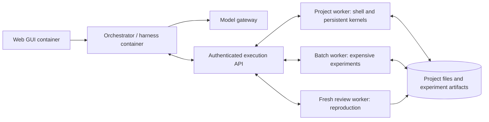

# Execution and deployment plan

Date: 2026-10-10. Requirements reflect the user's clarifications; implementation choices below are recommendations to validate.

## Problem to solve

CScience already provides useful research functionality. Its local execution and sandbox assumptions make it difficult to put the orchestrator in one container and code/data execution in other containers. Preserve the research experience, work-organizing skills, and automatic reviews while introducing an explicit worker boundary.

Three independently placeable layers are required:

The execution API can initially be part of the worker service. OpenShell's trusted gateway/supervisor sit behind that boundary. Agent roles, skills, and reviews are coordinated by the orchestrator. Worker allocation follows execution state and required resources; it need not mirror the number of model agents.

## What should remain familiar

- Skills guide planning, literature work, computation, analysis, figures, and reports. Their code and tool calls route through the worker boundary.
- Main agents, delegated agents, and reviewers retain role-specific model settings and scoped project context.
- Interactive Python/R state survives ordinary cells and model turns on its assigned worker.
- Research files, handoffs, artifacts, model routing, and approved research connectors remain usable.
- Conda can automatically install needed tools inside the project sandbox, with environment changes recorded.
- A trusted external monitor connects incoming/outgoing activity to execution and project policy; see [monitoring](MONITORING.md).
- Automatic review continues as part of the research workflow, with visible findings, responses, and unresolved limitations.

Persistent kernels and reviews are early compatibility requirements. A successful batch script alone does not establish functional parity.

## Evidence from the current project

The inspected source checkout is CScience `0.8.0`, HEAD `063919ffab886e6eb70f12dfda8168fec44d9d1a`, pinning upstream `0.1.60`. Its README and patches describe local tool working-directory handling, persistent Python/R kernel recovery, Conda provisioning, and capability discovery. The managed runtime guidance is injected into main, delegated, and reviewer prompts.

An already extracted Linux bundle for upstream `0.1.60` also contains SSH and BYOC/Modal compute machinery, job submission/result transfer, and compute provenance records. Its embedded remote-compute instructions distinguish dispatch through `repl` from local `python` cells. This cached distribution reports CScience `0.7.0`; it is evidence of the pinned upstream machinery, not proof that the latest checkout or a new worker backend works.

Therefore, investigate two paths: extending the existing compute/executor interfaces, and replacing local shell/kernel/provisioning adapters. An optional remote-job tool is insufficient if ordinary Python, shell, package installation, or document processing still launches beside the orchestrator. No runtime extraction, inspection download, or execution was performed during this pass.

## First decisions to discuss

### 1. Worker lifetime and ownership

**Recommended starting point:** a persistent project environment with session-owned kernels, plus disposable batch and review environments.

Keep files and approved dependencies with the project. Give each session its own kernel state, even if sessions share an environment. Serialize conflicting environment/package changes. Expensive experiments may request a different pool or resource shape without moving the orchestrator. Review reproductions start from an explicit code/input/environment snapshot, rather than inheriting the producing kernel's memory.

This preserves iterative cryptography work while allowing clean reproductions. Project isolation, kernel isolation, and fresh reproduction are separate decisions.

### 2. Project files and state

**Recommended starting point:** one authoritative project workspace, explicit input/output snapshots for batch and review jobs, and recorded file revisions.

A local pool can mount a private project volume. A remote pool needs a transfer protocol or reachable storage, with clear write ownership; it cannot resolve another machine's absolute paths. Multiple workers must not silently overwrite the same project files. Large or private datasets can remain pinned to an allowed pool.

Moving a worker means restoring files and its dependency specification, then restarting/replaying kernels where necessary. It does not automatically preserve live variables. Moving the orchestrator means preserving its session database and reconciling active executions.

### 3. Package and network permissions

**Recommended starting point:** reusable project grants for ordinary dependency installation and approved network destinations, enforced by the worker runtime and recorded with executions. Keep research work fluid within those grants.

Use pinned base images, project dependency manifests, and installation history. Support development environments that evolve during exploration and captured environments for reproduction. Determine whether OpenShell can express the required writable prefixes, persistent storage, network changes, and resource constraints before choosing their implementation.

Automatic Conda provisioning is a confirmed requirement. Package resolution, installation hooks, and subprocesses remain inside the same governed worker boundary.

### 4. Automatic review behavior

**Recommended starting point:** preserve CScience's existing review behavior where possible; document its actual triggers and context before changing it. Add explicit reproduction checks at meaningful experiment or report milestones if gaps are found.

A review should identify the claim, assumptions, method, evidence, and unresolved issues. Exact algebra, finite testing, numerical experiments, and proof have different evidentiary strength. Reviews can request worker execution and report inability to reproduce. Store findings and revisions without silently treating reviewer agreement as a mathematical proof.

Select separate reviewer models when desired. Distinct model identity alone does not establish independence; context, inputs, environment, and method also matter.

### 5. First deployment pair

**Recommended starting point:** an all-local container deployment, followed immediately by local orchestration with Kubernetes workers. Then validate hosted orchestration with local workers through an outbound authenticated connection.

This directly tests the desired separation. Independently hosted web assets remain required, but UI redesign and broader science features need not precede execution compatibility.

## Feasibility gate before implementation commitment

1. Trace each execution entry point: shell, Python/R kernels, compute providers, package/environment management, code-bearing MCP tools, parsers, and document/figure renderers.
2. Identify shared executor/transport hooks and which operations still require daemon-local filesystem or process access.
3. Prove shell execution, stateful cells, file handoff, capability probing, and fresh review execution in another container.
4. Repeat against a Kubernetes pool with unchanged research tool calls; measure cold/warm startup and data-transfer costs.
5. Record the patch surface and upstream-version sensitivity. Choose runtime adaptation or a compatible independent implementation using this evidence.

Preserving useful behavior is confirmed. Reusing the current pinned runtime unchanged, selecting a new harness, and choosing a new database are not yet settled.
