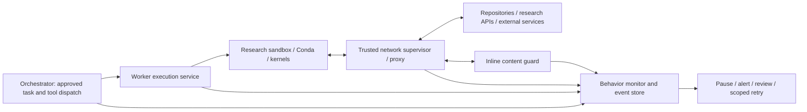

# Trusted monitoring and automatic provisioning

Date: 2026-10-10. Automatic tool installation and behavioral monitoring are user requirements. The implementation and response policy remain proposed; no runtime tests have been performed.

## Goal and boundary

Preserve the convenience of CScience selecting and installing needed tools with Conda. Run the solver, downloads, install hooks, pip/build steps, and installed code inside the authorized project execution environment. The orchestrator requests capabilities; it does not install scientific packages into its own container or the host.

A trusted monitor outside agent-controlled containers observes inbound/outbound activity and correlates it with execution context. It supplements network reachability policy with checks on what is being sent or received and whether it fits the authorized task. Monitoring is a further control, not a guarantee that all inappropriate behavior can be recognized.

## Proposed layers

1. **Reachability enforcement:** cluster/runtime network policy restricts destinations and service access. Kubernetes NetworkPolicy operates at IP/port level, depends on the CNI, and its standard API does not provide application-content inspection or network-security-event logging. Use equivalent controls in the local profile. [Kubernetes documentation](https://kubernetes.io/docs/concepts/services-networking/network-policies/)
2. **Inline request/response inspection:** a trusted proxy/middleware checks supported traffic before forwarding or delivery. Deterministic rules can block credential/private-data leakage, unauthorized API writes, unexpected upload paths, and oversized transfers. This path has bounded latency and never calls an unbounded model review.
3. **Contextual behavior monitoring:** a separate service correlates network events with project grants, executing processes, tool calls, package operations, file/output events where available, and agent/reviewer activity. It reports anomalies and can request a pause or quarantine through a narrow, authenticated runtime action API.
4. **Review and recovery:** persist the reason, evidence references, policy revision, operator/reviewer decision, and retry linkage. Approved research remains fluid within reusable grants.

Keep monitoring code/configuration, event storage, and enforcement credentials outside agent-writable mounts. Agent-supplied descriptions do not authorize activity. The monitor uses approved project policy and trusted dispatch/runtime observations. Scope the monitor's data and credentials per pool/project; it should not become a second unrestricted administration service.

## OpenShell fit: verified documentation and source

The current v0.1.3 middleware documentation describes checking allowed HTTP requests and responses, plus outgoing WebSocket text. Middleware runs after network policy and before provider credential injection; it can deny otherwise allowed traffic. Coverage excludes WebSocket binary/server messages, `tls: skip`, and bodies of compressed, partial, or no-transform responses. These are limits to test, not coverage we can assume. [Supervisor middleware](https://docs.nvidia.com/openshell/latest/extensibility/supervisor-middleware)

The pinned protocol includes `request_id`, immutable `sandbox_id`, and originating process information when available. Those fields provide correlation hooks. The application still needs a trusted mapping from sandbox/process to project, session, and tool execution; names and workload-supplied headers are insufficient. Persistent kernels and background subprocesses can make attribution ambiguous and must report that ambiguity. [v0.1.3 protocol](https://github.com/NVIDIA/OpenShell/blob/v0.1.3/proto/supervisor_middleware.proto)

Middleware has payload limits and bounded evaluation time; its default failure behavior blocks affected traffic. Ordinary human approval cannot wait inside that RPC. Deny/pause the logical operation, record a pending decision, and retry through an explicitly approved path. Mutating requests require confirmation that no effect occurred before replay. Availability and inspection requirements must be selected per traffic class. [Configuration](https://docs.nvidia.com/openshell/latest/extensibility/supervisor-middleware/configure)

Explicitly use enforcing request rules where blocking is required: the documented inspected-endpoint default is audit, which logs rule violations while allowing the request. Do not mistake audit findings for enforcement. [Network rules](https://docs.nvidia.com/openshell/latest/how-it-works/policies/network-rules)

These are documented/source capabilities, not a verified deployment. Confirm them on both local and Kubernetes drivers before adopting the design.

## Conda workflow to preserve

1. The agent requests a needed capability or package in its project environment.
2. The environment manager checks existing capabilities and project install/network grants.
3. Conda resolves/downloads/installs inside a worker with scoped writable prefixes and resources. Hooks and subprocesses receive the same restrictions.
4. Record requested packages/tool purpose, channels and resolved versions/builds/digests, environment revision before/after, install logs/errors, and any fallback to another package manager.
5. Probe the actual installed tool under the same worker policy, then let research continue.
6. Capture an environment specification or derived image for reviewer reproduction and relocation.

Allow approved channels and required repository/CDN paths without per-file prompts. Validate redirects, package-manager subprocess identity, TLS trust, signed metadata/hash verification where available, and package-manager compatibility with inspection. Large binary packages need an explicit transfer/inspection policy; do not assume the middleware buffers/scans every archive. Shared caches are optional and must not become an uncontrolled write or data-leak path.

## Concrete detection examples

| Activity | Desired interpretation |
| --- | --- |
| Conda fetches approved package metadata and archives during a recorded install | Permit within the project grant and record the resolved environment |
| An install hook contacts an unrelated upload endpoint | Block a clear violation; otherwise raise a contextual finding for review |
| Code sends private project material to a permitted general API | Apply payload/data-purpose checks; an allowed host alone is insufficient |
| A dependency or paper response includes instructions to disclose secrets or alter policy | Treat it as untrusted task data; preserve provenance and flag suspicious instructions |
| A process scans unrelated internal services or opens an unexpected listener | Use runtime/flow events to detect and enforce policy where supported |
| A cryptography experiment discusses attacks, keys, or ciphertext | Evaluate its authorized research purpose; keywords alone must not block legitimate cryptanalysis |

Incoming responses to permitted egress differ from new inbound connections. Workload listeners, orchestrator APIs, callbacks, and file-transfer endpoints need separate authentication/reachability controls. OpenShell worker egress inspection does not automatically cover the orchestrator's own model/MCP traffic; route those through an appropriate trusted gateway and correlate their audit events too.

## Response policy and tests

Proposed default pending user preference: block clear policy violations; pause high-risk uncertain activity and log lesser anomalies. Calibrate with legitimate crypto workflows to measure false positives. A model can help triage asynchronous findings but cannot widen hard policy or independently authorize a new data destination.

Test at least: permitted Conda install; transitive dependency and hook traffic; denied upload to an otherwise allowed host; private canary data in a harmless fixture request; hostile fixture response; worker attempts to disable monitoring or bypass the proxy; oversized/uninspectable content; middleware timeout/disconnect; persistent-kernel/background-process attribution; and interrupted approval/retry. Use synthetic secrets and data.

Measure monitoring overhead and show coverage gaps in the UI. Configure required-inspection traffic to block when inspection cannot be established; define explicit alternatives for indispensable protocols the backend cannot inspect. Preserve operation state and useful diagnostics so monitoring does not turn ordinary dependency installation into an approval loop.
