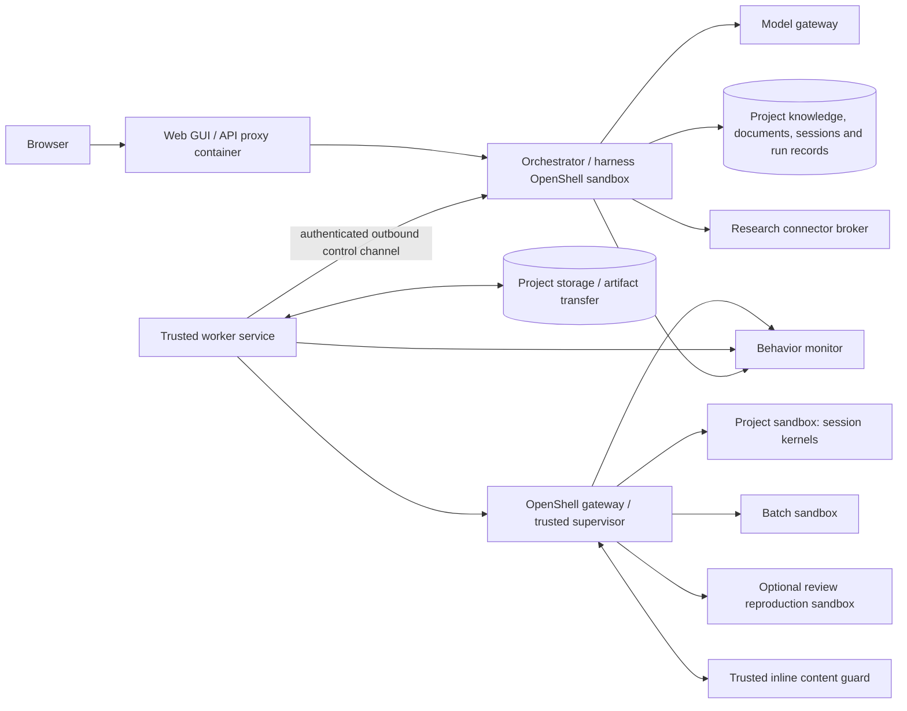

# Proposed architecture

Date: 2026-10-10. This is the design proposal, kept as written except where the repository has since settled a point. The parts built so far run all-local on babbage (phase 1) and are described in the as-built pages: [worker](WORKER.md), [workspace](WORKSPACE.md), [policy middleware](POLICY-MIDDLEWARE.md), [package cache](PACKAGE-CACHE.md), [event store](EVENT-STORE.md), [living documents](LIVING-DOCUMENTS.md) and [consistency review](CONSISTENCY-REVIEW.md). No Kubernetes or remote deployment has been tested.

## Settled architecture (2026-10-23)

Confirmed by the owner; mostly not built. The [decisions](DECISIONS.md) hold the detail, the [threat model](THREAT-MODEL.md#reads-and-effects) the security rule, and the [architecture audit](../.agents/docs/agent-reports/architecture-audit-2026-10-23.md) the state it starts from.

- **Threat model (D95):** protect the owner's systems, third parties and the research record; workflow confidentiality is out of scope. Reads are free and recorded, effects are gated.
- **Lockdown modes (D95):** per project, network `open-reads` or `allowlist` and MCP `declared` or `locked`, compiled into OpenShell rules and the middleware.
- **Effect classes (D96):** `read`, `write`, `communicate`, `browse`, `admin`, `unclassified`, from tool names, argument rules and, for unmentioned tools, MCP hints; browser automation off unless an admin enables it; admin-reviewed, model-drafted classifications with a drift test.
- **Approvals and grants (D97):** admin ceilings per class and server; persistent, revocable user grants per class, server and project; cards built from a call's significant arguments.
- **Research-code egress (D97, amended 2026-10-24):** packages through the cache; git and downloads from listed source hosts, by host, since OpenShell cannot attribute them by binary; everything else escalates.
- **MCP enforcement (D98):** the agent runtime's own client, through OpenShell native `protocol: mcp` rules and the supervisor middleware; the MCP proxy retired on 2026-10-26, and research code has no MCP access.
- **Delegated agents (D99):** fenced for outward effects only; their effect requests are cards in the session chat that the parent can withdraw.
- **Recovery (D100):** automatic bounded retries for transient failures; one Resume restarts the whole tree; only Stop, budget refusal, policy denial, an irreconcilable effect or a real context limit keeps a run stopped.
- **Deployment unit (D101):** worker, policy middleware and package cache run as one supervised unit with one configuration file; control and workspace stay separate for now.
- **Budgets (D102):** LiteLLM is the only cost enforcement; project and run budgets track; soft caps and loop heuristics trigger check-ins with the parent.
- **Telemetry (D103):** logs and OpenShell events into Loki through Alloy from the first cluster deployment; dashboards, alerts and detect-and-hold rules follow.
- **First cluster deployment (D92, D43):** Kata at tier 3 on amd64 with OpenShell 0.1.5, Garage artifacts and Longhorn snapshots, counted as deployed after three live proofs; job sandboxes (D93) and a second instance (D94) come later ([first deployment](KUBERNETES.md#first-deployment-scope-and-proofs)).

## Component boundary

**Implemented locally, 2026-10-17 (D47):** the normal launcher runs the agent-facing orchestrator in a restricted OpenShell sandbox separate from research workloads. Parent and child model loops, prompt assembly and model adapters share this orchestration sandbox. A trusted host control service owns durable state, scoped worker/tool capabilities and the environment leases; the worker controller, gateway and enforcement services stay outside both sandboxes. Fixed authenticated capabilities carry bounded requests and results, with no generic SQL, host filesystem or method-dispatch API. The UI and durable state survive orchestrator replacement; as built, interrupted trees require explicit Resume (automatic transient recovery and one full-tree Resume are decided in D100). See [orchestrator confinement](specs/orchestrator-confinement.md) and [research continuity](specs/research-continuity.md).

**MCP enforcement (D98, decided 2026-10-23; the proxy retired 2026-10-26):** the agent's MCP calls are made by the agent runtime's own client, from its sandbox, and decided by OpenShell's native `protocol: mcp` rules and the supervisor middleware, with the tool index, gates and approval waits on the control side ([MCP connectors](MCP-CONNECTORS.md#the-direct-path)). The MCP proxy, a service in a sandbox of its own that carried every MCP call before, is retired, and research code has no MCP access. Where this page names the proxy, read that history.

The GUI, orchestrator/harness, and compute pools have independent packaging and endpoint configuration. The harness initially remains with orchestration. Splitting the model loop into another service is not required to achieve execution isolation.

Logical modules share project/resource identity, immutable artifacts and revisions, typed anchors, durable event delivery, scoped permission decisions, and execution/environment adapters. Document, ledger, review and permission modules can initially live in the control application with its supported store. Share these mechanisms without merging scientific result status, review resolution and monitor verdicts. The [planning consistency review](../.agents/planning-consistency-review-2026-10-10.md) (historical) explains the reuse choices; the [implementation plan](IMPLEMENTATION-PLAN.md) defines ownership and ordered work.

The orchestrator owns research coordination, skills, agent/reviewer roles, tool dispatch, permissions, and durable session history. All server-side components are Python (D60).

**Model gateway (D61).** The orchestrator reaches models only through a LiteLLM proxy. The harness's model interface is provider-neutral, with a chat-completions client and, chosen per alias, clients for GPT's Responses API and Claude's Messages API ([context management](specs/context-management.md)). Each role (main, delegated, reviewer) names a model alias configured in LiteLLM. LiteLLM holds the provider keys; the orchestrator holds a LiteLLM virtual key whose spend limit implements the policy's model budget. Provider features differ (tool-call formats, thinking, prompt caching, citations), so the interface exposes capabilities rather than assuming the lowest common denominator. The worker service owns execution preparation, kernel lifecycle, streaming, file exchange, runtime reconciliation, and measured capabilities. OpenShell supplies the backend sandbox lifecycle and policy mechanisms behind that service. [OpenShell architecture](https://docs.nvidia.com/openshell/latest/about/architecture)

Generated scientific code, shell commands, parsers, compilers, package operations, and document renderers execute on workers. Trusted infrastructure helpers need their own narrow authority; classify existing `repl` host APIs individually rather than blindly moving privileged orchestration operations into an untrusted Python kernel.

## Reimplemented harness

The harness is new code (D11). CScience is the behavior reference; no Claude Science code, prompts, schemas or assets are used (D03, D56). Build it from MIT-compatible components (D55): a model-access library or gateway, the project's own small MCP client (the agent runtime's direct client, D98), and own code for skills, plans, delegation, review scheduling and findings. OpenScience Desktop upstream (MIT) and OpenCode (MIT) are reuse candidates. The Claude Agent SDK is not, because it drives the proprietary Claude Code CLI.

Because the harness is written against the worker API from the start, it has **no local execution path**. Shell, kernel, package-manager, parser, renderer and execution-bearing MCP tools are worker API calls. This removes the main risk of the adaptation approach, which was a forgotten code path still running beside the orchestrator.

Tool semantics follow the behavior specifications: working-directory defaults, cancellation, stdout/stderr, structured outputs, persistent kernel identity, file handoffs and errors. A tool that cannot be governed reports unsupported behavior.

Implement work-organizing skills, main/delegated/reviewer model settings and automatic review scheduling to their specs. Skills consume the same scoped tools. The default consistency reviewer has no execution privileges; a separate verification role may request fresh reproduction workers. The orchestrator keeps exact evidence versions, findings, author responses and confirmation states. [Source study](SOURCE-STUDY.md) records the observed triggers and context as behavior evidence.

The orchestrator never mounts worker workspaces directly. It reads results through the worker API and artifact repository, and treats them as untrusted input: no symlink following, size and type limits, and no in-process parsing or rendering of rich formats.

### The loop's composition points

The tool loop (`orchestrator/loop.py`) is composed of turn hooks (`hooks.py`) and wraps (`wraps.py`). A hook is one subsystem's part in a run; hooks run in a fixed order, which is the order their notices reach the model, and the loop alone applies the delivery rules. A wrap goes around one call and is given its next step, so it can act before and after it, try it again or answer in its place. The points, with the nearest middleware point of LangChain's Deep Agents for comparison:

| Point | When | Deep Agents |
| --- | --- | --- |
| `lease`, `notices("start")` | for the whole run; once before the first turn | `before_agent` |
| `turn_limit`, `halt`, `last_call`, `notices("turn")`, `consumption` | before each model call | `before_model` |
| `wrap_model_call` | around each attempt at a model call, retries and the report round's included | `wrap_model_call` |
| `model_returned` | after each successful model call | `after_model` |
| `wrap_tool_call` | around each tool call that runs, once its intent is saved | `wrap_tool_call` |
| `gate`, `gate_call` | inside the toolbox, before a tool runs: a refusal becomes its error | part of `wrap_tool_call` |
| `notices("tool")`, `observe_tool` | after each tool call, on its result | none |
| `closing`, `accept` | at a closing answer: accept, continue, respond, retry or stop | `after_model` with a jump |
| `finishing`, `summary`, `acknowledge` | after the loop ends; after the run's record is saved | `after_agent` |

The loop's own wraps hold its run's transcript and come outermost. Around a model call: `OverflowRetry`, which folds the conversation after a context error and tries again while a fold makes room (CM-43 to CM-45), then `ModelRefusals`, which ends the call without a reply on a context error or the gateway's budget refusal, the latter halting the run. Around a tool call: `Runaway`, the runaway guard (RS-6f), which so sees each outcome before notices ride on it. The hooks' wraps come inside these, the first hook outermost. Retries of a failed HTTP request stay in the model client (`GatewayModel`), a tool's own failures become its outcome in `Toolbox.call`, which first checks the call's `purpose_note` and passes the call on without it, so no gate or handler sees it ([tools spec](specs/tools.md#purpose-of-each-call)), and retrying a failed run is automatic recovery's (D100).

Wraps run where the loop runs. In a confined attempt the runtime's hooks are proxies over a channel that carries no wrap, so the host refuses a hook that overrides one rather than skip it. Still inline in the loop: the turn ceiling, the report round with its `not_run` results, the halt and out-of-room stops, closing decisions, and notice attachment ([backlog](../.agents/BACKLOG.md#loop-composition-2026-10-24)).

## Worker lifetimes and API

The user confirmed a persistent container per project, provisioned from a base image, with optional separate session/workbook containers and same-project data sharing. [Ownership details](PROJECTS-AND-SESSIONS.md).

Worker modes:

| Mode | Lifetime and ownership | State |
| --- | --- | --- |
| Default project environment | Project-owned persistent container provisioned from a base image; default for its sessions | Shared tool/dependency state and project data access |
| Dedicated session environment | Optional persistent container for one workbook, newly provisioned from the base image | Independent dependencies/processes, selected same-project data access |
| Interactive kernel | Session-owned process inside an assigned project environment | Python/R/Sage memory until reset, failure, or explicit shutdown |
| Batch experiment | One recorded attempt with bounded resources | Staged inputs, immutable result manifest, partial output on failure |
| Review reproduction (proposed extension) | Fresh environment from an evidence snapshot | Read-only source evidence and separate reviewer outputs |

Sessions/workbooks have separate kernel state even when they share the default project container. Those sessions share installed tools; coordinate package mutations. A dedicated session container has independent dependency state and separately granted project data access. Session directories inside one container are organizational, not automatically security boundaries. Provide explicit environment revisions so a reviewer reproduces a known dependency state.

As built, each sandbox's executor daemon outlives worker and bridge connections.
The worker reconciles the same attempts through bounded numbered replay and keeps
kernel globals in the surviving daemon. An authenticated new daemon incarnation
in a managed OpenShell VM requires a verified stop/start of that original VM
before replacement readiness, preserving disk while losing unknown outcomes and
kernel memory. [The worker](WORKER.md#sandbox-daemon-and-recovery) documents the
fence and availability limits; it was checked on OpenShell in [lab 20](../.agents/docs/agent-reports/babbage-openshell-lab-20-2026-10-12.md).

The versioned worker API needs operations to describe/probe capabilities; open/close project environments; create/bind/resume dedicated session environments; grant project data references; start/inspect/interrupt/reset kernels; execute cells and argv commands; stream/replay events; stage/read/write/collect scoped files; query/reconcile attempts; cancel; and release resources. The existing [batch request](../examples/run-request.json) illustrates only one part of this API.

Every request identifies project, session, environment revision, execution/attempt, scope, and limits. Worker routing uses capabilities and policy rather than an absolute executable path on the orchestrator. Host inventory remains diagnostic; functional probes run inside the selected worker policy.

## Local, remote, and Kubernetes placement

| Profile | GUI and orchestration | Compute |
| --- | --- | --- |
| All local | Separate containers on one machine, optionally in local Kubernetes | Local project/batch/review containers, including a local Kubernetes/OpenShell pool |
| Local control, cluster compute | Local containers | Worker service/gateway near Kubernetes execution resources |
| Hosted control, local compute | Remote containers or cluster services | Local worker service initiates authenticated connection outward |
| All cluster | Independently deployable GUI and orchestrator services | Kubernetes execution pools with persistent project storage |
| Remote GUI, private local control | Hosted GUI proxy with an explicit private route | Local or remote pools selected by the orchestrator |

All eight local/remote combinations of GUI server, orchestrator/harness, and workers remain intended. No deployment profile may rely on another peer's `localhost` or absolute filesystem paths. Worker-initiated transport is a project design to implement; OpenShell does not automatically provide connectivity through private NAT boundaries.

Concrete targets (D63): babbage (amd64, Ryzen 395, 128 GB, Ubuntu 26.04) first, using the OpenShell MicroVM driver with KVM for tier 3 isolation; then heterogeneous Linux ARM64/AMD64 Kubernetes clusters; later the M3 Max Mac (arm64). Image recipes target both architectures; native AMD64/ARM64 image builds have passed, while real Kubernetes deployment remains unqualified. Placement uses resource requests and trusted node selectors, so heavy work targets sufficient capacity independently of architecture. The first deployments must support hosted Kubernetes and local containers. Local candidates include Docker, Podman, other policy-capable container runtimes, and local Kubernetes on macOS/Docker Desktop or babbage (Ubuntu 26.04). A shared Kubernetes deployment may simplify packaging, but local Kubernetes is not required. Select the local backend after demonstrating execution/network isolation, monitoring and persistence on the actual target. Docker Desktop documents an integrated local Kubernetes cluster; this does not establish OpenShell compatibility on the actual machine. [Docker Desktop Kubernetes](https://docs.docker.com/desktop/use-desktop/kubernetes/)

The [Kubernetes delivery work](KUBERNETES.md) describes placement, S3-backed artifacts and PVC retention gates.

The [Apple Silicon qualification path](MAC-ARM64.md) starts with native ARM64 image builds, then portable host supervision and real OpenShell MicroVM acceptance. It also lists the shared-cluster gates; neither target has passed deployment acceptance yet.

Use OpenShell's selected compute driver and lifecycle on each pool; do not add a competing per-sandbox Kubernetes scheduler around it. Current documentation lists Docker, Podman, Kubernetes, and MicroVM drivers, with one driver per gateway. Its Kubernetes driver requires the Agent Sandbox controller. Validate backend requirements, image architectures, storage and confinement on each actual target before claiming local/hosted parity. [Runtime documentation](https://docs.nvidia.com/openshell/latest/how-it-works/sandboxes/runtimes)

The worker API expresses execution, filesystem and network policy independently of backend configuration. Map that policy to each runtime's actual controls and expose unsupported requirements. A local backend must enforce the required boundary and trusted monitor actions; accepted configuration or a running container alone is insufficient. No fallback may run research code beside the orchestrator or silently weaken policy. Engine/cluster administration remains with trusted services.

Record the isolation tier of every execution ([threat model](THREAT-MODEL.md), D43). Docker Desktop and Colima on macOS run all containers in one Linux VM. Unless workers use gVisor (`runsc`) or a VM separate from the orchestrator, gateway and monitor, an all-local Docker deployment shares one kernel between untrusted research code and every trusted service, and is tier 1. Hosted Kubernetes should run workers under a sandboxed RuntimeClass on a node pool separate from control services. Settled 2026-10-22 (D43): Kata, since OpenShell 0.1.x cannot run under gVisor ([Kubernetes isolation](KUBERNETES.md#sandbox-isolation)).

For a future direct Kubernetes backend, batch runs map conceptually to Jobs and persistent workers to managed long-running pods with appropriate storage. StatefulSets are useful when stable identity/storage is needed, but are not automatically required for every kernel. Kubernetes storage persistence does not preserve process memory. Control retries explicitly so the cluster and application do not silently duplicate research actions. [Jobs](https://kubernetes.io/docs/concepts/workloads/controllers/job/), [StatefulSets](https://kubernetes.io/docs/concepts/workloads/controllers/statefulset/)

## Storage, dependencies, and relocation

Authoritative project knowledge, board/ledger state, document revisions/comments, source references, and review history live outside research containers. They initially use the control application's single store (D12); a separate document/ledger service is a logical boundary, not a commitment to another deployment or database. Workers receive scoped snapshots/references and publish results through version-checked APIs. Browser callbacks cannot be the sole source of provenance.

Document edits name an expected revision and affected blocks/math nodes. Preserve user/agent attribution and stable anchors; reject or reconcile stale patches. Recompute dependent review/claim validity when assumptions or inputs change. Ledger and board are views over one coherent project record. Files exported into worker workspaces are snapshots, not an implicit replacement for authoritative history. See [research workspace](RESEARCH-WORKSPACE.md).

Start with one embedded store (SQLite) for the control application on a private durable volume, behind a repository interface (D12). As built, it is `control.sqlite3` in the harness's state directory, holding projects, sessions and run records, chat messages and run events, documents, comments, consistency review, math checks, artifacts, session plans and job control records ([living documents](LIVING-DOCUMENTS.md#the-control-store), D85). Move to PostgreSQL only when multi-replica control is needed; it is not a prerequisite for proving the worker split.

Give each project shared storage plus session workspaces. Separate session containers can share project data through scoped mounts/API references; container selection does not imply copying or abandoning that data. Use explicit write ownership/version checks and snapshots/output publication for batch/review workers. Cross-host access requires authenticated transfer or reachable storage; never assume shared host mounts. Enrolled worker-local datasets remain confined to permitted pools. Record content hashes and file versions, and resolve publication conflicts deliberately.

Start from pinned OCI base images. Permit approved package installation into persistent project environments; capture package manifests, revisions, and installation events. Reproduction environments consume a captured specification or derived image. Writable roots, quotas, package/network policy, and snapshot behavior remain OpenShell feasibility checks.

Proposed layout (D48, deferred by the user on 2026-10-11: sandboxes keep a writable root filesystem, and an idle environment keeps its whole VM disk): run research containers with a **read-only root filesystem** and a small set of declared writable volumes: the Conda environment prefix, `$HOME`, project shared storage, the session workspace, and tmpfs for `/tmp`. Idle preservation then becomes base-image digest + volumes + lockfile, which can be verified, and a malicious install hook cannot persist outside known locations. Provide a rebuild-from-lockfile action as the recovery path after a monitor quarantine. Runtime system-package installation (`apt`) is not supported; system dependencies need a base-image change. Two base profiles exist (D46). The published `minimal` image is thin and permissive-only. The `crypto-base` profile is a prepared, pinned cryptography environment with Sage ready at session start; its recipe is published under MIT, while the image is built privately and stored in a private registry because it contains GPL tools. Crypto projects normally select `crypto-base`; every new project or session container starts clean from the selected profile's recorded digest. Further tools are installed at runtime from conda-forge through the pull-through [package cache](PACKAGE-CACHE.md) (D71) into the environment volume.

Idle environments retain their concrete containers or a restorable record covering changed filesystem/image state, installed tools, configuration and durable volumes. Keep project documents/ledger/reviews outside their lifecycle. Restore the same logical environment with explicit kernel-state reporting and validate its state before releasing the only complete source copy. Newly created session environments continue to start from the base image. [Persistence contract](PROJECTS-AND-SESSIONS.md#provisioning-and-persistence).

The default cryptography profile must include functionally tested native Sage and PDF tools. Native Sage kernels and the worker's PDF tools are built ([worker](WORKER.md#pdfs), [images](IMAGES.md)). Sage kernels must preserve preparsing and exact mathematical types; PDF derivatives should be cached by source hash and parser version/configuration, with page/region anchors exposed to the GUI. TeX compilation and PDF parsing/rendering execute in workers. Preserve original mathematical source in all document and result representations.

To relocate orchestration, drain new work, preserve its database and required artifacts, reconcile active executions, and prevent two unfenced schedulers from acting on copied state. To relocate workers, enroll/probe the new pool, transfer permitted files/environment specifications, and resume through explicit checkpoints or replay. Existing live computations finish, stop, or checkpoint on their current worker. Preserve rollback until continuity is verified.

## Execution history and failure behavior

Use stable logical execution IDs, immutable attempt IDs, idempotent submission, and a monotonic ownership/lease generation. Replay events by cursor after reconnects. Correlate sandbox IDs before retrying creation. Reconcile uncertain old attempts before dispatching replacements. Neither transport delivery nor cluster scheduling guarantees exactly-once external effects.

Record queued/preparing/running/collecting and terminal outcomes, plus policy/capability blocking, kernel state loss, and cleanup failures. Cancellation is a request until termination is observed. An unreachable worker remains lost or cancellation-pending. Enforce local time/resource bounds even when orchestration disconnects; test this behavior.

Record code/input/output references, environment and policy revision, image/platform, seeds/precision, hardware where relevant, command/cell identity, kernel/session identity, model/skill/reviewer linkage, logs, timestamps, and reproduction results. Do not record secret values. Preserve failed attempts and findings as well as successes.

## Trusted monitoring and provisioning

Preserve automatic Conda tool installation inside workers. The package manager and install hooks receive the project environment policy; capture resolved dependencies and verify tools after installation.

Add an independently governed monitor that correlates supported network request/response inspection with trusted tool, process, file, and package events. OpenShell supervisor middleware is the first integration candidate; basic Kubernetes NetworkPolicy is only the reachability layer. Monitor orchestrator/model/connector traffic through their appropriate gateways as well. See [monitoring and provisioning](MONITORING.md) for coverage limits, response policy, and concrete tests.

The confirmed monitor response model is policy-based blocking, permission escalation, or alerting while continuing. Persist matched rules and operation state; hold permission-gated operations outside bounded middleware RPCs and resume/retry only from the scoped decision. Keep this action policy separate from scientific automatic review, which should preserve current Science behavior.

## Permissions and operational boundary

Keep model/provider keys, worker enrollment authority, gateway administration, and engine/cluster credentials on their appropriate trusted services. Workloads receive only explicit data and endpoint-scoped access needed for the task. Credentials reach workers as OpenShell provider placeholders that resolve only at bound endpoints (D57), and external services are mostly MCP endpoints with per-project tool allowlists (D58); see [monitoring](MONITORING.md#credentials-and-mcp-access). Reusable project grants should let ordinary research proceed without repeated command approvals.

The agent runtime is **semi-trusted** (D47): it reads untrusted papers and web content and acts on model output. Its OpenShell sandbox permits only the configured model gateway and scoped state transport. Trusted handlers validate tool requests and reach workers; the runtime's own MCP client reaches declared servers only through OpenShell's native rules and the policy middleware, with the providers' placeholders; no engine, cluster or worker administrative credential enters the runtime. Durable state stays in the trusted control service. The current launcher uploads the model gateway key into the sandbox by its configured file path; provider-injected placeholders are a future credential-hardening option. Connector fetches remain subject to their worker/proxy egress policies.

Each pool has a locally configured **policy ceiling** (D49): maximum egress destinations, mounts, resources and data classes. Remote control can narrow it but never raise it. Enrolling a local pool, or raising its ceiling, requires local user action. This bounds what a compromised hosted orchestrator can do on the user's machine in the hosted-control/local-compute profile.

Isolate untrusted parsers, renderers, local MCP processes, and rich artifact previews. Scope file operations and collection, including symlink/archive traversal, and bound outputs, storage, runtime, and resource use. Test enforcement on the actual kernel/runtime/CNI rather than treating accepted configuration as proof.

The browser authenticates to the workbench API; the [workspace](WORKSPACE.md#authentication) describes the first slice's login, origin checks and headers. Use a deliberate proxy/authentication route for separate GUI hosting. The GUI is both the approval surface and a renderer of untrusted content (D54). Serve artifact previews (SVG/HTML, notebook output, PDFs, agent-written Markdown) from a separate origin in sandboxed iframes with a strict CSP. Configure KaTeX with `trust: false` and macro limits, and PDF.js with scripting disabled. Approvals use risk-based re-authentication (re-entering the workspace's login token, D54): routine approvals work within the authenticated session with CSRF protection, while policy widening, credential or MCP-connection changes, exports of embargoed or restricted data, disabling monitor rules, and approvals after a configurable idle period require re-authentication with a short validity window. Build approval prompts from monitor-observed facts rather than agent-written justification. Measure startup, queue delay, execution, transfer, cancellation, reconnect recovery, and leaked resources. The runtime must fail explicitly if it cannot establish the required sandbox boundary.
