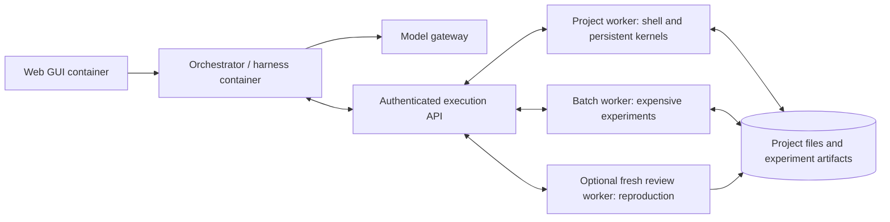

# Execution and deployment plan

Date: 2026-10-10. Requirements reflect the user's clarifications; implementation choices below are recommendations to validate.

## Problem to solve

CScience already provides useful research functionality, but its local execution and sandbox assumptions make it difficult to put the orchestrator in one container and code/data execution in other containers. It is also a patched proprietary runtime. The user has decided to reimplement the needed behavior (D11): a new harness built on an explicit worker boundary, keeping the research experience, work-organizing skills and automatic reviews.

Three independently placeable layers are required:

The execution API can initially be part of the worker service. OpenShell's trusted gateway/supervisor sit behind that boundary. Agent roles, skills, and reviews are coordinated by the orchestrator. Worker allocation follows execution state and required resources; it need not mirror the number of model agents.

## What should remain familiar

- Skills guide planning, literature work, computation, analysis, figures, and reports. Their code and tool calls route through the worker boundary.
- Main agents, delegated agents, and reviewers retain role-specific model settings and scoped project context.
- Interactive Python/R state survives ordinary cells and model turns on its assigned worker.
- Native Sage cells preserve preparsing and exact mathematics; PDF sources retain navigable page/region references.
- Research files, handoffs, artifacts, model routing, and approved research connectors remain usable.
- Living documents accept attributed user edits/comments; workbooks share a project board/ledger with LaTeX and versioned evidence.
- Conda can automatically install needed tools inside the project sandbox, with environment changes recorded.
- A trusted external monitor connects incoming/outgoing activity to execution and project policy; see [monitoring](MONITORING.md).
- Automatic review continues as part of the research workflow, with visible findings, responses, and unresolved limitations.

Persistent kernels and reviews are early compatibility requirements. A successful batch script alone does not establish functional parity.

The [feature plan](FEATURE-PLAN.md) and [source study](SOURCE-STUDY.md) incorporate the three source investigations. The [research workspace](RESEARCH-WORKSPACE.md) defines the complete PDF → Sage → shared claim → living document → user feedback → review scenario.

## Evidence from the current project

The inspected source checkout is CScience `0.8.0`, HEAD `063919ffab886e6eb70f12dfda8168fec44d9d1a`, pinning upstream `0.1.60`. Its README and patches describe local tool working-directory handling, persistent Python/R kernel recovery, Conda provisioning, and capability discovery. The managed runtime guidance is injected into main, delegated, and reviewer prompts.

Previously extracted upstream `0.1.60` assets contain SSH/BYOC compute machinery, job submission/result transfer, and provenance records. The extracted review runtime at `dist/review-0.1.60/runtime/` also establishes editable artifacts/annotations, PDF exploration, knowledge/claim schemas, and automatic consistency review. An older cached distribution reports CScience `0.7.0`; source evidence does not prove that the current checkout or new worker backend works.

This evidence now serves as behavior reference for the reimplementation (D51, D56), not as code to adapt. A reimplemented harness that only calls the worker API avoids the risk that ordinary Python, shell, package installation or document processing still launches beside the orchestrator. No runtime extraction or execution was performed during this pass.

## First decisions to discuss

### 1. Project/session ownership: confirmed; lifecycle details remain

**Confirmed ownership:** each project normally gets a persistent container provisioned from a base image. Sessions are workbooks and use that container by default, with an option for a separate session container. Both modes support sharing data within the project.

New dedicated session containers start from the base image, with independent installed-tool state. They do not inherit the default project's evolved container environment. Resuming an existing persistent session environment is a separate operation.

Recommended implementation: session-owned kernels in the selected container, persistent dedicated session environments by default, and disposable batch/review environments where needed. See [projects and sessions](PROJECTS-AND-SESSIONS.md).

Keep files and approved dependencies with the project. Give each session its own kernel state, even if sessions share an environment. Serialize conflicting environment/package changes. Expensive experiments may request a different pool or resource shape without moving the orchestrator. Review reproductions start from an explicit code/input/environment snapshot, rather than inheriting the producing kernel's memory.

This preserves iterative cryptography work while allowing clean reproductions. Project isolation, kernel isolation, and fresh reproduction are separate decisions.

### 2. Project files and state

**Confirmed requirement:** sessions can share data within their project, including sessions with separate containers.

Recommended starting point: a project shared area, per-session workspaces, versioned publication, and snapshots for batch/review jobs. Storage access is separate from container selection.

The user confirmed per-session working directories plus shared storage with deliberate shared writes and conflict detection. Idle projects preserve their containers or enough captured filesystem/tool/configuration/data state to recreate the same logical environments. Detailed suspend/restore mechanisms remain to validate.

A local pool can mount a private project volume. A remote pool needs a transfer protocol or reachable storage, with clear write ownership; it cannot resolve another machine's absolute paths. Multiple workers must not silently overwrite the same project files. Large or private datasets can remain pinned to an allowed pool.

Moving a worker means restoring files and its dependency specification, then restarting/replaying kernels where necessary. It does not automatically preserve live variables. Moving the orchestrator means preserving its session database and reconciling active executions.

Project state also includes the shared ledger, living documents/comments, source anchors, and review histories. Keep their authoritative revisions outside execution containers and make them available through scoped tools in every workbook. Preserve original LaTeX; parsers/renderers execute on workers while the GUI resolves stable document/source identities.

### 3. Package and network permissions

**Recommended starting point:** reusable project grants for ordinary dependency installation and approved network destinations, enforced by the worker runtime and recorded with executions. Keep research work fluid within those grants.

Use pinned base images, project dependency manifests, and installation history. Support development environments that evolve during exploration and captured environments for reproduction. Determine whether OpenShell can express the required writable prefixes, persistent storage, network changes, and resource constraints before choosing their implementation.

Automatic Conda provisioning is a confirmed requirement. Package resolution, installation hooks, and subprocesses remain inside the same governed worker boundary.

Monitor intervention is also confirmed: policy selects block, escalate for permission, or alert while continuing. Capture scoped pending decisions and continuation state without holding a middleware request open for human input.

### 4. Automatic review behavior

**Confirmed direction:** automatic review should work similarly to current Claude Science. Preserve its consistency reviewer, checkpoint/terminal scheduling and findings/confirmation lifecycle, using the actual active configuration as the initial baseline. Its default role traces recorded evidence without computation. A separate mathematical verification/reproduction role remains a proposed extension; it does not make every automatic review a fresh computation.

A review should identify its type, claim, assumptions, method, evidence, and unresolved issues. Exact algebra, finite testing, numerical experiments, source assertions, synthetic illustrations, and proof have different evidentiary strength. Verification reviews can request fresh worker execution and report inability to reproduce. Store findings and revisions, retaining claimed-fix confirmation and supersession history. Reviewer agreement is not mathematical proof.

Select separate reviewer models when desired. Distinct model identity alone does not establish independence; context, inputs, environment, and method also matter.

### 5. First deployment pair

**Confirmed targets:** hosted Kubernetes and local containers in the initial deployments. Local Kubernetes on macOS/Docker Desktop or babbage (Ubuntu 26.04) may simplify deployment; Docker or another container runtime is equally acceptable if execution and network policies can be enforced. Evaluate local candidates against the same policy/persistence/tool contract, without requiring Kubernetes. Validate hosted orchestration with local workers through an outbound authenticated connection as part of independent placement.

This directly tests the desired separation. Independently hosted web assets remain required, but UI redesign and broader science features need not precede execution compatibility.

## Feasibility gate before implementation commitment

The [detailed implementation plan](IMPLEMENTATION-PLAN.md) splits this gate into a small shell/Python worker slice followed by native Sage/PDF, policy and local/hosted integration. It also defines shared contracts so documents, ledger, reviews and monitoring reuse infrastructure.

1. Write behavior specifications for each execution-bearing tool: shell, Python/R/Sage kernels, package/environment management, code-bearing MCP tools, parsers, and document/figure renderers.
2. Implement them in the new harness as worker API calls only.
3. Prove shell execution and stateful Python cells first, then native Sage, PDF parsing, file handoff and capability probing in another container. Fresh verification execution is a separate proposed extension.
4. Repeat against a Kubernetes pool with unchanged research tool calls; measure cold/warm startup and data-transfer costs.
5. Run the behavior-spec fixtures against the new harness.
6. Exercise project ledger sharing, a PDF citation, a LaTeX living document, and concurrent user/agent editing through the new application services before declaring product parity.

Preserving useful behavior is confirmed, and so is reimplementing it (D11). The harness components and the store are chosen in W0 (D12, D55).
