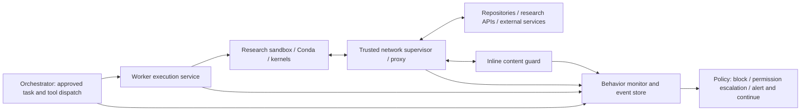

# Trusted monitoring and automatic provisioning

Date: 2026-10-10. Automatic tool installation and behavioral monitoring are user requirements. Policy-based blocking, permission escalation, and alerting while continuing are confirmed. Implementation details remain proposed; no runtime tests have been performed.

The inspected Claude Science runtime already has an action-level security classifier in approval processing, distinct from its scientific consistency reviewer. Preserve useful task-context checks alongside the trusted external monitor. That classifier does not establish packet/content inspection, and scientific review does not establish authorization. Exact source anchors are in [source study](SOURCE-STUDY.md).

## Goal and boundary

Preserve the convenience of CScience selecting and installing needed tools with Conda. Run the solver, downloads, install hooks, pip/build steps, and installed code inside the authorized project execution environment. The orchestrator requests capabilities; it does not install scientific packages into its own container or the host.

A trusted monitor outside agent-controlled containers observes inbound/outbound activity and correlates it with execution context. It supplements network reachability policy with checks on what is being sent or received and whether it fits the authorized task. Monitoring is a further control, not a guarantee that all inappropriate behavior can be recognized.

## Egress architecture comes before inspection

Proposed by the plan review (D44; [threat model](THREAT-MODEL.md) T1/T7). Content inspection alone cannot carry exfiltration control in this domain. Research output (keys, ciphertexts, hashes, random lattices) is high-entropy and cannot be distinguished from exfiltrated secrets by pattern or entropy heuristics. Code can also pin certificates, bring its own TLS stack, or use uninspected protocols. Reachability is therefore the primary control, and inspection is a secondary signal.

| Path | Policy | Notes |
| --- | --- | --- |
| Direct internet from research sandboxes | Denied | Sandboxes resolve no external DNS; the proxy resolves names |
| Package installation | Only through a trusted pull-through mirror restricted to allowlisted channels (conda-forge, PyPI); read-only; cache misses logged and rate-limited | Preserves automatic Conda provisioning (D16): the solver and hooks still run in the sandbox. Permissive candidates: devpi (MIT), quetz (BSD-3), caching Envoy/nginx. Package-name lookups are a residual covert channel; log them |
| Downloading code and papers | Read-only fetch path: GET/HEAD allowed broadly under the shipped permissive policy (D62), with a URL length limit; git smart-HTTP `git-upload-pack` allowed, `git-receive-pack` escalates | The git rule must be keyed on the service path, because fetch also uses POST. Deny API writes, gists and paste sites by default. Bound URL length and request rate |
| Granted research endpoints, mostly MCP | Explicit per-project grants; credentials as OpenShell providers bound to the endpoint; MCP tool allowlists | Inline inspection applies here; see Credentials and MCP access |
| Anything else (writes, unknown side effects) | As the project policy file decides; the shipped default escalates | Escalation timeout falls back to deny (configurable); see [policy](POLICY.md) |

The orchestrator's own connector fetches (web fetch, crawlers, paper search) follow the same allowlist and escalation rules (D47). A URL fetched by the orchestrator can carry data just as well as one fetched by a worker.

## Credentials and MCP access

Proposed by the plan review (D57, D58), following the user's requirement that a secrets manager limit direct access to API keys, and that most external services be reached through MCP.

**Secrets.** Use OpenShell providers ([v0.1.3 providers documentation](https://github.com/NVIDIA/OpenShell/blob/v0.1.3/docs/how-it-works/providers/overview.mdx)) for every credential a worker needs:

- The sandbox environment holds only opaque placeholders. The proxy substitutes the real value immediately before forwarding, and only when both the network policy (calling binary and destination) and the credential's endpoint binding (host, port, path) allow the request.
- An unbound destination, or an unknown or expired placeholder, fails closed with `credential_endpoint_mismatch` and a secret-free security finding.
- Gateway-managed refresh (OAuth2 refresh/client credentials, Google service accounts, AWS STS) keeps sandbox-visible tokens short-lived. Long-lived secret material stays in the gateway.
- Storage: the gateway encrypts credentials (AES-256-GCM) in its own database by default. Hosted gateways can use the `kubernetes-secrets` driver, or the `vault` driver. HashiCorp Vault is BUSL-1.1, so under the [licensing policy](LICENSING.md) prefer Kubernetes Secrets or OpenBao (MPL-2.0); OpenBao compatibility with the vault driver needs testing. Single-user babbage can start with the default encrypted store. Its key-encryption key is a file beside the database, so the whole gateway state directory is secret.

Limits to design around (as documented for v0.1.3):

- A placeholder lets the agent do *anything the token permits* at the bound endpoint. Restriction comes from least-privilege token scopes plus L7 method/path or MCP tool rules, not from the placeholder.
- Static placeholder resolution is endpoint-scoped, not binary-scoped. Any process in the sandbox can use it; binary-scoped injection is on OpenShell's roadmap.
- Credentials are rewritten only in headers, query parameters, URL paths, opted-in request bodies and WebSocket text. Cookies, unsupported bodies, binary frames, `tls: skip` and non-HTTP tunnels get no injection. Those protocols need a different design rather than a raw key.
- Responses are not rewritten, so an endpoint that echoes its credential would reveal it. Test each provider for this.

Observed on babbage ([lab 2](../.agents/docs/agent-reports/babbage-openshell-lab-2-2026-10-10.md)): the environment held only placeholders; substitution reached only bound endpoints, from any program; an unbound destination got `credential_endpoint_mismatch` and received nothing; and the policy middleware decided each request before substitution.

**MCP.** Authentication modes, the OAuth flow, the connector auth service and the MCP proxy (all MCP traffic, including from workers) are in [MCP connectors](MCP-CONNECTORS.md) (D66, D67). Declare each MCP server as a `protocol: mcp` endpoint with explicit method and tool-name allowlists (`allow_all_known_mcp_methods` off unless deliberately needed; extension methods need exact rules) and attach its credentials as a provider. Prefer read-only tools and tokens. A project grant then reads as "these tools on these servers", which is easy to review and to show in approval prompts.

The orchestrator also calls MCP servers and the model API. Evaluate running the orchestrator itself as an OpenShell sandbox with model and MCP providers attached, so that it too holds only placeholders and its egress follows policy (D47).

**Policy changes.** OpenShell's policy advisor lets an agent propose a new network rule; its prover flags risky changes such as new credentialed reach. Keep automatic approval **off**, route proposals into the shared permission workflow, and note that v0.1.3 does not yet run the prover automatically at sandbox startup. The v0.1.3 prover also reports any policy that uses a middleware or a `protocol: mcp` endpoint as unsupported, which covers every research sandbox and the MCP proxy. For those, the compiler and the orchestrator must check new credentialed reach themselves ([lab 2](../.agents/docs/agent-reports/babbage-openshell-lab-2-2026-10-10.md)).

## Proposed layers

1. **Reachability enforcement:** cluster/runtime network policy restricts destinations and service access. Kubernetes NetworkPolicy operates at IP/port level, depends on the CNI, and its standard API does not provide application-content inspection or network-security-event logging. Use equivalent controls in the local profile. [Kubernetes documentation](https://kubernetes.io/docs/concepts/services-networking/network-policies/)
2. **Inline request/response inspection:** a trusted proxy/middleware checks supported traffic before forwarding or delivery. Deterministic rules can block credential/private-data leakage, unauthorized API writes, unexpected upload paths, and oversized transfers. This path has bounded latency and never calls an unbounded model review.
3. **Contextual behavior monitoring:** a separate service correlates network events with independent runtime telemetry (eBPF process/exec/file/network events from Tetragon or Falco, both Apache-2.0, in addition to OpenShell observations). It correlates these with project grants, executing processes, tool calls, package operations, file/output events where available, and agent/reviewer activity. It reports anomalies and can request a pause or quarantine through a narrow, authenticated runtime action API.
4. **Review and recovery:** persist the reason, evidence references, policy revision, operator/reviewer decision, and retry linkage. Approved research remains fluid within reusable grants.

Keep monitoring code/configuration, event storage, and enforcement credentials outside agent-writable mounts. Agent-supplied descriptions do not authorize activity. The monitor uses approved project policy and trusted dispatch/runtime observations. Scope the monitor's data and credentials per pool/project; it should not become a second unrestricted administration service.

## OpenShell fit: verified documentation and source

The current v0.1.3 middleware documentation describes checking allowed HTTP requests and responses, plus outgoing WebSocket text. Middleware runs after network policy and before provider credential injection; it can deny otherwise allowed traffic. Coverage excludes WebSocket binary/server messages, `tls: skip`, and bodies of compressed, partial, or no-transform responses. These are limits to test, not coverage we can assume. [Supervisor middleware](https://docs.nvidia.com/openshell/latest/extensibility/supervisor-middleware)

The pinned protocol includes `request_id`, immutable `sandbox_id`, and originating process information when available. Those fields provide correlation hooks. The application still needs a trusted mapping from sandbox/process to project, session, and tool execution; names and workload-supplied headers are insufficient. Two workbooks may share a project container, so sandbox identity alone cannot identify the session. Include trusted session/kernel/execution bindings. Persistent kernels and background subprocesses can make attribution ambiguous and must report that ambiguity. [v0.1.3 protocol](https://github.com/NVIDIA/OpenShell/blob/v0.1.3/proto/supervisor_middleware.proto)

Middleware has payload limits and bounded evaluation time; its default failure behavior blocks affected traffic. Ordinary human approval cannot wait inside that RPC. Deny/pause the logical operation, record a pending decision, and retry through an explicitly approved path. Mutating requests require confirmation that no effect occurred before replay. Availability and inspection requirements must be selected per traffic class. [Configuration](https://docs.nvidia.com/openshell/latest/extensibility/supervisor-middleware/configure)

Explicitly use enforcing request rules where blocking is required: the documented inspected-endpoint default is audit, which logs rule violations while allowing the request. Do not mistake audit findings for enforcement. [Network rules](https://docs.nvidia.com/openshell/latest/how-it-works/policies/network-rules)

A middleware denial still blocks even when the endpoint is in audit mode. Implement alert-and-continue by explicitly allowing the operation and recording/notifying the finding. Middleware `on_error` selects fail-open/fail-closed behavior for middleware failure; it is not the matched policy action. Test these independently. [Middleware configuration](https://docs.nvidia.com/openshell/latest/extensibility/supervisor-middleware/configure)

These are documented/source capabilities, not a verified deployment. Confirm them on both local and Kubernetes drivers before adopting the design.

## Conda workflow to preserve

1. The agent requests a needed capability or package in its project environment.
2. The environment manager checks existing capabilities and project install/network grants.
3. Conda resolves/downloads/installs inside a worker with scoped writable prefixes and resources, fetching only through the package mirror. Hooks and subprocesses receive the same restrictions. GPL research tools are either part of the privately built `crypto-base` profile image or installed this way at runtime; neither is published by the project (D46, [licensing](LICENSING.md)). Record each package's license.
4. Record requested packages/tool purpose, channels and resolved versions/builds/digests, environment revision before/after, install logs/errors, and any fallback to another package manager.
5. Probe the actual installed tool under the same worker policy, then let research continue.
6. Capture an environment specification or derived image for reviewer reproduction and relocation.

Allow approved channels and required repository/CDN paths without per-file prompts. Validate redirects, package-manager subprocess identity, TLS trust, signed metadata/hash verification where available, and package-manager compatibility with inspection. Large binary packages need an explicit transfer/inspection policy; do not assume the middleware buffers/scans every archive. Shared caches are optional and must not become an uncontrolled write or data-leak path.

## Concrete detection examples

| Activity | Desired interpretation |
| --- | --- |
| Conda fetches approved package metadata and archives during a recorded install | Permit within the project grant and record the resolved environment |
| An install hook contacts an unrelated upload endpoint | Evaluate the matched rule and block, escalate for permission, or alert while continuing |
| Code sends private project material to a permitted general API | Apply payload/data-purpose checks; an allowed host alone is insufficient |
| A dependency or paper response includes instructions to disclose secrets or alter policy | Treat it as untrusted task data; preserve provenance and flag suspicious instructions |
| A process scans unrelated internal services or opens an unexpected listener | Use runtime/flow events to detect and enforce policy where supported |
| A cryptography experiment discusses attacks, keys, or ciphertext | Evaluate its authorized research purpose; keywords alone must not block legitimate cryptanalysis |

Incoming responses to permitted egress differ from new inbound connections. Workload listeners, orchestrator APIs, callbacks, and file-transfer endpoints need separate authentication/reachability controls. OpenShell worker egress inspection does not automatically cover the orchestrator's own model/MCP traffic; route those through an appropriate trusted gateway and correlate their audit events too.

## Response policy and tests

Confirmed behavior: intervention is selected by policy, with all three actions supported. Rules, precedence and the escalation timeout are defined in the project policy file ([policy](POLICY.md), D62):

| Action | Operation behavior | Recorded outcome |
| --- | --- | --- |
| Block | Reject or stop the affected operation | Rule, reason, evidence/context and blocked operation state |
| Escalate for permission | Hold the affected operation and present a durable permission request; approval resumes or safely retries it, denial blocks it | Request scope, requesting execution, policy revision, user decision and continuation/retry linkage |
| Alert while continuing | Notify and record the finding while the permitted operation continues | Rule, reason, evidence/context and explicit continued outcome |

Rules can use project policy, operation/destination, data scope and observed tool/process/package behavior. Define deterministic rule precedence and record the effective policy revision and matched rule. Agent-supplied explanations are context, not policy changes or permission grants. Permission requests bind to the affected operation and requested scope; they survive browser disconnection and route the verdict to the correct execution. Unrelated work need not pause unless the policy requires a broader hold.

Use the shared durable decision workflow and execution/event references from the [implementation plan](IMPLEMENTATION-PLAN.md). Install/tool permissions and monitor escalation should not create competing queues or continuation mechanisms. Scientific review verdicts remain different records and cannot grant action permissions.

Configure timeout, unavailable-monitor and uninspectable-traffic behavior explicitly per policy/traffic class. Alert-only rules cannot override an independent runtime/network denial. Calibrate rules with legitimate crypto workflows to measure false positives. A model can help triage asynchronous findings but cannot widen hard policy or independently authorize a new data destination.

Test each policy action against a harmless matched fixture: blocked execution, held permission request with approve/deny, and delivered alert with continued execution. Also test permitted Conda install; transitive dependency and hook traffic; denied upload to an otherwise allowed host; private canary data in a harmless fixture request; hostile fixture response; worker attempts to disable monitoring or bypass the proxy; oversized/uninspectable content; middleware timeout/disconnect; persistent-kernel/background-process attribution; and interrupted approval/retry. Use synthetic secrets and data. Keep these as a maintained **adversarial fixture suite**, not a one-off checklist: setup.py/post-link exfiltration, a typosquat package, DNS tunnelling, a prompt-injection PDF, a proxy-bypass attempt, a symlink escape, and a GUI-targeted script in an artifact. Run it against every certified backend and isolation tier on each change to policy, proxy or runtime configuration.

Measure monitoring overhead and show coverage gaps in the UI. Configure required-inspection traffic to block when inspection cannot be established; define explicit alternatives for indispensable protocols the backend cannot inspect. Preserve operation state and useful diagnostics so monitoring does not turn ordinary dependency installation into an approval loop.
