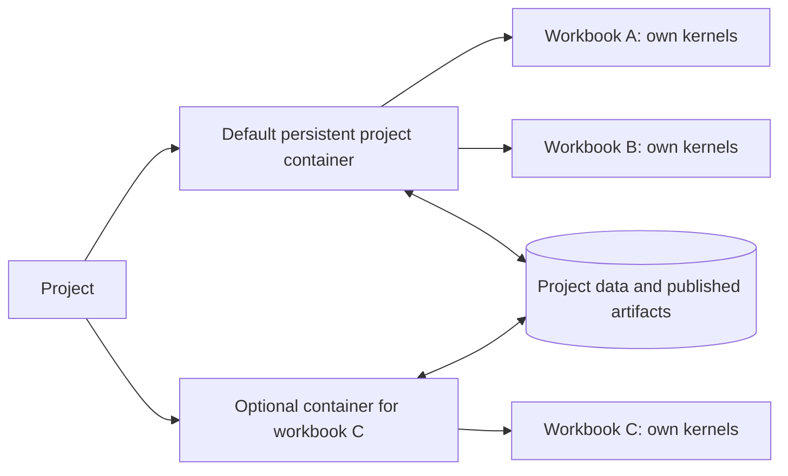

# Projects, sessions, and persistent containers

The ownership model is confirmed by the user. The sections up to [As built](#as-built-the-harnesss-project-records) describe the design; that section says what is built: project records with a default environment, dedicated session environments, shared project data kept in step across environments ([worker](WORKER.md#shared-data-across-environments)), recorded package provisioning ([worker](WORKER.md#provisioning-operations)) and idle suspension ([worker](WORKER.md#idle-suspension)). Its last list names what is not built.

## Confirmed model

A project normally receives its own persistent execution container, provisioned from a base image. A session is a workbook belonging to that project. Sessions normally use the project container, and may instead receive a separate container. Sessions in either mode can share data with other sessions in the same project.



The orchestrator/harness remains in a separate service container. These containers hold research execution, not copies of the entire orchestrator.

## Ownership and state

| Object | Owner and lifetime | Contents |
| --- | --- | --- |
| Project | Durable research boundary | Base-image selection, default environment, shared data/artifacts, policies, session index |
| Default project environment | Project-owned, persistent | Execution container binding, Conda/tool state, environment revision |
| Session/workbook | Belongs to one project | Conversation, plan, notebook/cells, reviews, execution history, workspace, environment binding |
| Dedicated session environment | Optional; session-owned and linked to the project | Separate container and dependency state; persist for continued workbook use by default |
| Kernel | Session-owned inside its selected environment | Live Python/R/Sage variables and process state until reset or failure |
| Shared project data | Project-owned, independent of any single session/container | Reusable inputs, sources, code, datasets, and published results |
| Research knowledge and documents | Trusted project state, independent of execution containers | Shared board/ledger, living documents, comments, source anchors, evidence/review histories |

Sessions in the default container share installed tools and dependency changes, but have separate kernel namespaces. Coordinate Conda mutations and report the environment revision each execution used. A separate session container provides independent process/dependency state while project data access is granted separately.

Logical environment IDs survive replacement of a concrete container. Record both identities in execution and monitor events. Switching a workbook to another container requires an explicit kernel reset, replay, or supported checkpoint; do not silently claim that live variables followed it.

## Data sharing

Use a project data namespace with session workspaces and a shared area. The paths are logical paths inside execution environments, not paths on the orchestrator host; the worker implements `shared/` and `sessions/<session-id>/`:

```text
project/
  shared/                 reusable sources, inputs, code, and published results
  sessions/<session-id>/  workbook files, intermediate work, and outputs
  documents/              living documents, kept by the platform at their current revisions
```

In the design, the `documents/` area holds each living document as a Markdown file, in every environment of the project; its history stays in the control store, and edits made to the files are merged into it ([living documents](specs/living-documents.md), D65). This is not built: an earlier, unwired document sync was removed from main and is kept on the tag `archive/document-sync-2026-10` ([archived pages](../.agents/docs/archive/README.md)).

A separate session container can access project data through scoped mounts, a storage API, or explicit transfer; the worker built the transfer option, copying `shared/` between environments at call boundaries (D79). The same API should resolve project references on local and remote pools. Cross-host sessions cannot assume access to a host-local volume. Kubernetes storage access modes and the selected storage driver constrain which mounts can be shared. [Persistent volumes](https://kubernetes.io/docs/concepts/storage/persistent-volumes/)

Confirmed access model: each workbook has its own working directory plus shared project storage. Read shared inputs, write the session workspace, and publish versioned results into the shared area. Support deliberate edits of shared files/directories with atomic publication or conflict/version checks; avoid silent last-writer-wins overwrites. Data sharing within the project's existing grant should not require approval for every file.

Session directories in a shared container organize work; they are not automatically security boundaries between sessions. Strong session separation requires an independently governed container and appropriately scoped data access. Different projects have no implicit data or environment sharing.

Verification reproductions can receive read-only snapshots of selected project/session evidence and a fresh output workspace, avoiding hidden state or concurrent changes in the producing workbook. The ordinary consistency reviewer uses recorded evidence without computation. Shared ledger/document tools resolve project references for either container mode; an agent edit still requires a valid document revision and appropriate project scope.

## Provisioning and persistence

Record the base profile (`minimal` or `crypto-base`, D46) and its image digest at project creation. Automatic Conda installation evolves the project's tool environment within its grants. Keep project data and managed dependency prefixes in durable storage; capture environment specifications and any necessary derived image or reprovisioning steps for other filesystem changes. Docker volumes have a lifecycle independent of the container, whereas removing a container removes its writable layer. [Docker volumes](https://docs.docker.com/engine/storage/volumes/)

A newly created dedicated session container starts from the project's recorded base image, as confirmed by the user. Record its base-image digest; do not seed it from the default project container's evolved environment. It can access shared project data while installing its own needed tools. Do not share a mutable Conda prefix between containers while claiming they have independent dependencies.

Resuming an existing persistent session environment retains that environment's recorded state. Creating a new session container and resuming an existing one are distinct lifecycle operations. Environment snapshots remain useful for explicit reproduction and recovery, rather than the initialization source for new dedicated sessions.

Confirmed idle behavior: preserve project and dedicated-session containers, or preserve enough state to recreate their environments. Retain project/session files, installed tools/dependencies, configuration, environment identity and durable research records. Keeping every container continuously running is not required. Idle timeout and resource-retention settings can be configurable. The worker implements the first option for OpenShell environments: with `suspend_after`, it stops an idle environment's sandbox, which keeps its writable disk, and starts it again on the next use ([worker](WORKER.md#idle-suspension)).

A restoration record identifies the base-image digest, platform, changed filesystem/image state, durable volumes/data versions, environment configuration and installed-tool state. The proposed read-only root filesystem with declared writable volumes (D48, [architecture](ARCHITECTURE.md#storage-dependencies-and-relocation)) reduces "changed filesystem state" to those volumes. Capture changes outside managed Conda prefixes as well. A package list alone is insufficient when other files/configuration changed. Verify a restored environment before discarding its only complete source state; failed capture/restore leaves a visible preserved or recovery-needed environment.

Use one environment manager for creation, provisioning, capability probes and capture/restore. Keep new-environment creation and restoration as distinct operations. Optional reproduction jobs can consume a captured specification through this same manager; they do not need another lifecycle implementation. Shared writable mounts require a managed write/lease or explicit conflict copies where revision-checked publication cannot cover mutations. See [implementation W3](IMPLEMENTATION-PLAN.md#w3--make-projectsession-state-durable-m2).

Closing the GUI does not terminate active computations or discard state. Live kernel recovery remains best effort, with explicit restart/state-loss reporting; stopping or recreating a container does not itself preserve process memory. A new session container still starts from the base image, while restoring an existing logical environment restores that environment's captured state.

## As built: the harness's project records

The harness keeps a record of each project in the control store of its state directory, `control.sqlite3` (`packages/orchestrator`, `projects.py`; [living documents](LIVING-DOCUMENTS.md#the-control-store)). A record holds:
- the project's base profile and policy revision;
- its default environment, `<project>-default-<tag>`, where the tag is random, so that no other project's client of a shared worker can predict the ID and take it first (D78); records made before keep their untagged IDs;
- its sessions, each with the environment it runs in and when it was last closed.

A separate versioned USER macro setting lives in the shared control store. It
supplies bounded definitions for Markdown/KaTeX, beneath a document's front matter;
it does not change environment packages or grant agents settings authority. Read
it with `sandbox-science-harness project macros --state-dir state --project p1`.
Writing requires `--macros-file`, exact `--expected` revision and a stable
`--operation-id`; the project GUI offers the same guarded action. See
[project macros](PROJECT-MACROS.md) for bounds, immutable historical/check pins,
lazy active-run refresh and held ambiguous finding contexts.

```bash
sandbox-science-harness project create --state-dir state --project p1 --profile minimal --policy sha256:...
sandbox-science-harness run --state-dir state --project p1 --session a ... "task"
sandbox-science-harness run --state-dir state --project p1 --session c --dedicated ... "task"
sandbox-science-harness session close --state-dir state --project p1 --session a --worker ... --token-file ...
sandbox-science-harness project revise --state-dir state --project p1 --policy sha256:... --worker ... --token-file ...
```

- **Running a session.** A session runs in the default environment, with its own kernels and workspace. With `--dedicated`, a new session gets an environment of its own, `<project>-<session>-<tag>`, from the same base profile. A session keeps the mode it started with.
- **Environments.** Before a session runs, the harness has the worker create its environment, or revise it to the project's current policy revision (D73). A worker that does not manage environments, such as the local one, takes the ID as it is.
- **Closing a session** stops its kernels; running it again opens it again. Files stay.
- **One run at a time.** A run with `--state-dir` holds its session's run lease from when its session is resolved until its record is saved; another run of the session, from the command line or the run service (`serve`), is refused while it does (`busy`), and the run service waits for it. A lease its holder stops renewing expires after a minute. The run delivers the user's chat messages to the session and writes its events as it goes ([workspace](WORKSPACE.md#chat)).
- **Run records.** The harness keeps each run of a session, the record `--transcript` writes, in the control store's `runs` table, named by its start time and run ID and written once. The [workspace](WORKSPACE.md#run-records) shows them.
- **Model limits.** The model client tries a gateway's rate limit (429) or unavailable upstream (502, 503, 504) again, up to three times, after the gateway's `Retry-After` in seconds or 2, 4 and 8 seconds; a `Retry-After` over a minute, and other errors, end the run at once. Before each call, a conversation longer than `--max-input-chars` (default 400,000 characters with the tool schemas, about 100,000 tokens) stops the run with `context_limit`, as does a gateway's context-length error; the run has no answer and the command exits 3 (compacting a long conversation is not built). An answer stands, though, when only a closing round would pass the limit, such as a review's findings to respond to: the round is not taken, as at the turn limit. The record's `usage` lists each answered call's tokens. A failed run logs its exception to standard error; the record keeps only the phase, and an error's text never quotes the gateway key.
- **Explicit artifact publication.** With a state directory, `publish` additionally retains verified immutable bytes/revisions in the [control inventory](ARTIFACTS.md). Tool/run records keep the worker snapshot and control receipt separately. A successful worker snapshot can remain available when control ingestion is held. Publishing attribution describes the actual run/tool action, with resolved model only when the gateway reports it; actual writer and observed inputs remain unknown.
- **Revising a project** records the new revision. With `--worker`, it also revises the project's environments at once; otherwise each is revised when a session next runs there.
- **Concurrency.** Each change is one transaction of the control store, so concurrent harness processes and the workspace keep each other's sessions. A plan change checks its session in its own transaction, so a close cannot land between the check and the change.
- **Earlier records.** Projects were JSON files, `<state-dir>/projects/<project>.json`, and runs were files under `<state-dir>/runs/`, before they moved into the control store. Such files are not read: a lookup of a project recorded only in a file says so, and the project is created again with `project create` (refactoring plan, decision 6).
- **Shared files.** A write to the shared area names the version it replaces (`expected_sha256`, or `create_only` for a new file). So of two sessions that read the same version, the second writer gets `conflict`, rereads and tries again; nothing is silently overwritten. The conformance suite checks this with two sessions.

- **Environment revisions.** The worker counts changes to an environment's installed packages, and every execution reports the revision it started and ended under ([worker](WORKER.md#behavior-worth-knowing)).
- **Shared data across environments** (D79). The worker keeps the project's `shared/` in step across its environments, before and after every call, so a dedicated session sees the shared results of the project's other sessions. Concurrent changes to one file leave a conflict copy beside it, and the agent is told ([worker](WORKER.md#shared-data-across-environments)).
- **Serialized, recorded package installs** (the Conda provisioning spec). Shell and kernel installs take turns through wrappers and each change is a revision with a lockfile ([package commands](WORKER.md#package-commands)); the provisioning tool installs a capability or packages on an agent's request, one operation at a time per environment, decided by the project policy, recorded and probed ([provisioning operations](WORKER.md#provisioning-operations)). Each environment, dedicated ones included, has its own queue and history.

Not yet built:
- restoring a revision after a failed install, and rebuilding an environment from a lockfile (Conda provisioning, CP-13, CP-20);
- capture and restore with a read-only root filesystem (D48, deferred by the user);
- the `documents/` area in environments (see [data sharing](#data-sharing));
- scoped grants of project data beyond the shared-area sync, and read-only evidence snapshots for verification reproductions.

## Backend feasibility checks

Verify local and hosted pools support persistent data and dependency state, idle suspend/restore, multiple sessions/kernels in the project container, dedicated session provisioning, scoped same-project sharing, concurrent file publication, and truthful restart/reset behavior. Local Kubernetes is an accepted initial execution path. Test monitor attribution when two sessions share one sandbox: sandbox identity alone cannot identify the requesting workbook.

The illustrative [project/session record](../examples/project-sessions.json) contains two workbooks sharing the default container and a third with its own persistent environment. It is not an implemented API or deployment manifest.
