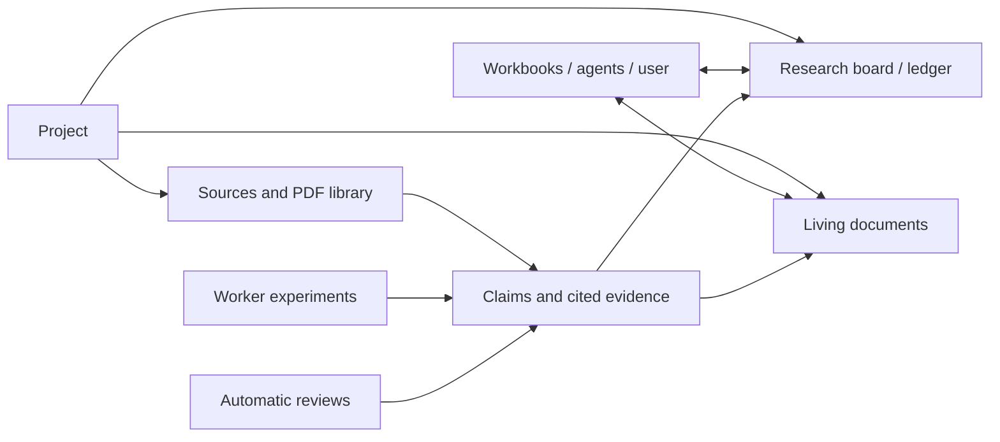

# Research workspace: documents, ledger, mathematics, and sources

Date: 2026-10-10. These are initial requirements and proposed contracts, not implemented features.

## Project-wide research state

The project owns shared research knowledge as well as shared files. Its workbooks can read and contribute to a research board/ledger and living documents, whether they share the project container or use dedicated containers.

The board is a current working view of questions, tasks, claims, experiments, decisions, and review findings. The ledger records their changes and evidence over time. Use one underlying set of versioned objects and links; a Kanban/task view and a claim/evidence view should not become unrelated stores.

The existing external crypto-analysis-skills pack already maintains project-shared knowledge and a board reduced from per-session event ledgers. Its research semantics inform a new platform contract; the user can update skill bindings and existing data can be imported deliberately. Exact file-format compatibility is optional. Keep one authoritative history and the pack's content external. See [external skills](EXTERNAL-SKILLS.md).

Record attribution to a person, agent, session, skill, execution, and review where relevant. Keep unresolved contradictions, negative results, failed reproductions, assumptions, and superseded conclusions visible. Separate evidence type (proof, exact computation, finite test, numerical experiment, source claim) from workflow status; a successful process exit or reviewer agreement does not automatically establish a theorem.

### Frontier results and published research

Confirmed definition: the frontier contains the best known results of each type, drawing from both published research and the project's own investigation. Categories and comparison criteria depend on the research target: for example attack costs, bounds, parameter regimes, or mathematical constructions. Open issues are another entry type in the same project ledger, linked to the relevant results and assumptions; issue and frontier views do not create separate authoritative stores.

Published results can enter the ledger and frontier from their sources without independent checking, reproduction, or proof audit. Retain the citation, result statement, applicable assumptions/parameters, reported measures, and publication/version date. Their origin is published research; they do not need a project verification badge to be eligible.

Project-generated results retain their evidence and review status. The proposed independent-check gate for newly derived project results is separate from recording published results. Keep provisional project candidates visible with their status rather than representing them as established frontier results.

Compare results within the relevant category and stated conditions. Where time/data/memory tradeoffs or different assumptions prevent a single ordering, retain multiple best-known entries with those differences. Preserve superseded results in history when a stronger applicable result becomes available. A frontier view should show the result, conditions, comparison measures, origin, evidence/status, and links to its source or project artifacts.

Authoritative board/document revisions live with trusted project state outside research containers. Workers receive scoped references, snapshots, and publication tools. File exports can accompany the project but must not silently replace the authoritative revision history. Same-project sharing follows the project grant, rather than requiring the user to point to every artifact in every workbook.

## Living documents and user feedback

Support project-wide and workbook-specific living documents: research notes, derivations, plans, reports, and an evolving manuscript. The user can edit directly, select content and comment, request an agent revision, and inspect who changed what. Automatic review findings link to the document version and affected content.

**Format (D65):** documents are Markdown with LaTeX math (`$…$` inline, `$$…$$` display) embedded in the Markdown. The stored source is the Markdown text itself, so it stays readable, diffable and copyable. The server parses with markdown-it-py and mdit-py-plugins; the browser with markdown-it and KaTeX (all MIT). Using the same parser family on both sides keeps block and math-span boundaries consistent for anchors. Exports to `.tex` and PDF run in workers; Pandoc (GPL) is runtime-installed and called as a separate program.

Use stable document/block/math IDs, attributed revisions, anchored comment threads, explicit resolution, and revision-aware edits. Block and math-span IDs are derived from the parsed Markdown and carried across edits, so a comment on an equation survives unrelated changes. An agent patch names its expected revision and affected blocks; concurrent user changes must trigger reconciliation rather than whole-document overwrite. Preserve comments on changed/deleted text with an explicit stale/orphaned anchor where reattachment is uncertain. Real-time multi-person collaboration is a later scaling choice; safe user/agent editing is an initial requirement.

Reuse the same artifact/revision and typed-anchor contracts for documents, PDF sources, ledger evidence and review locations. Share one math renderer across views, and publish changes through common durable events. Domain-specific schemas and lifecycles remain separate. See [shared contracts and work packages](IMPLEMENTATION-PLAN.md#shared-contracts-to-establish-first).

A comment routed to an agent becomes a scoped work request in the orchestrator. The agent can propose/apply a revision within the user's existing authority and explain it in the thread. Document content from papers or external services remains source data, not new permission to change infrastructure or disclose data.

## LaTeX throughout the interface and outputs

Keep LaTeX as editable, copyable mathematical source in conversations, workbook cells, living documents, comments, ledger claims, and review findings. Support inline/display equations, aligned derivations, matrices, finite-field notation, and references. Preserve source through Markdown/math and LaTeX exports and sandboxed PDF generation.

Living documents keep math as LaTeX spans inside Markdown (D65); other views (chat, ledger entries, review findings) use the same Markdown+LaTeX convention. Browser rendering is a view over that source. Reuse CScience delimiter/highlighting/regression lessons; scope macros and make rendering errors or repairs visible without silently changing the stored mathematical claim. KaTeX is an existing baseline candidate, not a commitment to every TeX package being supported. [Supported syntax](https://katex.org/docs/supported.html)

Equation/block identity and revision remain stable enough for comments, citations, and reviews. Compiling a full TeX document belongs in a worker with scoped inputs and explicit policy, just like other generated code.

## SageMath as a native research capability

Expose Sage as an explicit cell/tool language and session kernel, with proper Sage syntax/preparsing, highlighting, working-directory behavior, interruption, state recovery, and useful errors. Sage's preparser supports syntax beyond ordinary Python; routing a Sage cell to a generic Python kernel does not preserve those semantics. [Sage preparser](https://doc.sagemath.org/html/en/reference/repl/sage/repl/preparse.html)

The normal cryptography/math profile must provide a tested Sage execution path alongside PDF tooling. Record Sage version, image/environment revision, base rings/domains, precision/seeds where relevant, and execution evidence. Preserve exact symbolic/matrix results and their LaTeX representation when exporting. Missing Sage is an explicit capability/provisioning issue, not permission to silently substitute approximate Python arithmetic.

Automatic Conda provisioning still supplies additional tools. Test Sage startup and dependencies in the same local/Kubernetes sandbox policy used for real work.

## PDF parsing and navigation as a native source workflow

Keep the original PDF and its version/hash. The primary extraction library candidate is pdf_oxide (MIT OR Apache-2.0, D59), with pypdfium2 as fallback; PyMuPDF is excluded as AGPL. Its character-level positions, bookmarks and annotations are the basis for page/region anchors, and its optional rendering produces crops for checking equations. It parses untrusted input, so it runs in workers like any other parser. Its MCP server, if used, also runs in a worker sandbox, not beside the orchestrator. Derive reusable page text, outline/section structure, page renders/crops, tables/figures, and optional OCR/layout results in workers. Cache by document hash and parser configuration/version. Support page/section lookup, search or ranked page discovery, and exhaustive extraction as distinct operations.

The GUI needs an integrated PDF viewer with page labels, thumbnails/outline, search, selection/highlights, and direct navigation from citations, comments, ledger entries, and review findings. A source reference identifies document revision, physical page index, displayed page label, and region/text anchor when available. Preserve both page numbering forms so printed page numbers do not silently point at the wrong PDF page.

Keep extraction method and uncertainty visible. Equations, matrices, small figure labels, and scanned pages may need a rendered crop or human check; extracted text alone is not proof of faithful mathematical transcription. Agents should load relevant sections/pages together and reuse parsed results rather than repeatedly putting entire PDFs into context.

## First integrated acceptance scenario

1. Import a mathematical paper, navigate to an equation/theorem, and add an anchored source reference to the project ledger.
2. Run a Sage finite-field/matrix experiment from workbook A in the persistent project container.
3. In workbook B, using a dedicated container, read the same source and published result through project references.
4. Draft a living document with LaTeX equations/matrices and links to source pages and exact run artifacts.
5. The user edits an equation or assumption and adds a comment; the agent revises without overwriting concurrent edits.
6. Automatic consistency review checks the claim against recorded evidence and attaches findings to exact claim/document revisions. Exercise fresh computational reproduction separately if that proposed extension is enabled.
7. Update the project board with the result, limitations, and next question. Repeat against local and Kubernetes workers.

This is the initial product path. Living documents, the shared ledger, LaTeX, Sage, and PDF navigation must not be deferred to a generic later science expansion.
