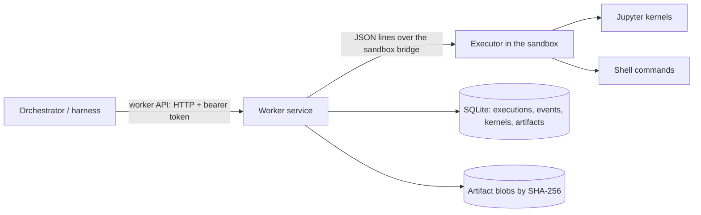

# Worker service

The worker service runs research code for the orchestrator. It is trusted infrastructure, one per worker pool, outside every research sandbox. It starts an executor inside each sandbox and talks to it. The orchestrator reaches it only through the worker API, so the harness has no local execution path ([architecture](ARCHITECTURE.md)). [Execution tools](specs/tools.md) defines the behavior. The code is in `packages/worker` (`sandbox_science.worker`), the shared types in `packages/contracts`, and the orchestrator's client in `packages/orchestrator`.

Contents:
- [Components](#components) and the [worker API](#worker-api), with [clients limited to projects](#clients-limited-to-projects) and [compatibility](#compatibility)
- [Behavior worth knowing](#behavior-worth-knowing), [background jobs](#background-jobs) and [leftover processes](#leftover-processes)
- Isolation and OpenShell: [isolation tiers](#isolation-tiers), [running under OpenShell](#running-under-openshell), [environments](#environments), [admission on demand](#admission-on-demand), [idle suspension](#idle-suspension)
- Data and packages: [shared data across environments](#shared-data-across-environments), [package commands](#package-commands), [provisioning operations](#provisioning-operations), [PDFs](#pdfs), [bounded artifact capture](#bounded-artifact-capture), [worker-local output observations](#worker-local-output-observations)
- The sandbox side: [executor protocol](#executor-protocol), [sandbox daemon and recovery](#sandbox-daemon-and-recovery)
- [Settings](#settings), [conformance suite](#conformance-suite), [not built](#not-built), and the parked [document catalog prerequisite](#document-catalog-prerequisite)

## Components



- **Worker service** (`app.py`, `manager.py`, with `usability.py` beside the manager): the HTTP API, idempotent submission, event numbering and persistence, cancellation, watchdogs, file operations and publication. `usability.py` keeps, for each environment, what stands in the way of using it: a daemon recovery, a fence until its sandbox is recycled, a release of its executor, sessions closing.
- **Provisioning** (`provisioner.py`, with `resolution.py`, `permissions.py`, `catalog.py` and the catalog `capabilities.toml`): operations that install a capability or packages into an environment on an agent's request, one at a time in each environment ([provisioning operations](#provisioning-operations)).
- **Executor** (`executor.py`, with `daemon.py`, `capture.py`, `pdfhelper.py` and `provisioning.py` beside it): five files that depend only on the standard library and, for kernels, `jupyter_client` and `ipykernel` (the PDF helper also needs pdf_oxide), so the worker can copy them into any sandbox that has Python. The OpenShell backend uploads them to `executor_dir`, with the scheduler shim `libsandbox-science-sched.so`, built from `shim/sched_self.c`, when `sched_shim` is on ([running under OpenShell](#running-under-openshell)). `daemon.py` keeps the executor alive across worker restarts ([sandbox daemon and recovery](#sandbox-daemon-and-recovery)), `capture.py` reads files for publication ([bounded artifact capture](#bounded-artifact-capture)) and `pdfhelper.py` runs [PDF operations](#pdfs). The executor runs shell commands in sessions of their own and kernels through the Jupyter protocol (D41), ends what a command leaves running ([leftover processes](#leftover-processes)), and handles the file operations. It offers each language whose kernelspec its interpreter's Jupyter installation finds: `python3` for Python and `sagemath`, SageMath's own kernel, for Sage. Platform code never imports Sage; Sage's kernel preparses Sage syntax itself. `provisioning.py` makes package commands take turns and records what they change ([package commands](#package-commands)).
- **Backends** (`backends.py`) start executors:
  - **`openshell`** copies the executor and its helpers into a configured sandbox with `openshell sandbox upload`, and runs it with `openshell sandbox exec --no-tty --no-login-shell`. Its required `isolation_tier` setting declares the tier the gateway's driver gives: 3 for the VM driver on babbage (D43).
  - **`local`** runs the executor as a plain subprocess of the worker. It has **no isolation**: it declares tier 0, and its probe shows why. It exists for development and tests, and the harness refuses it unless told otherwise (`--allow-unisolated`).
- **Other worker modules**: `store.py` (the SQLite state), `channel.py` (one executor connection), `environments.py`, `admission.py` and `suspend.py` (sandboxes the worker manages), `isolation.py` (the tier probe), `shared_sync.py` (shared data), `revisions.py` and `package_gate.py` (package revisions and the recovery fence), `artifacts.py` (artifact blobs), `package_clients.py` (package-cache configuration), the read-only views `provision_observations.py`, `lockfile_diffs.py`, `kernel_revisions.py` and `output_observations.py`, the provisioning records `installer_records.py` and `provision_events.py`, and the parked `documents_catalog.py`.

Environment lifecycle commands run through `OpenShellCli`. On timeout or caller
cancellation, cleanup tolerates a CLI process that has already exited and retains
its actual wait through repeated cancellation. The original caller interruption
is preserved; a CLI timeout remains `unavailable`. Reaping the CLI does not prove
that a gateway mutation had no effect, and does not authorize an automatic retry.

## Worker API

Every route needs `Authorization: Bearer <token>`: the pool's own token, which acts for every project, or a client's, which acts only for the projects its settings list ([clients](#clients-limited-to-projects)). Bodies are the JSON forms of the `sandbox_science.contracts` models. Errors return a `WorkerErrorResponse` carrying an error kind from the spec, with status 400, 403, 404, 409, 422, 500, 503 or 504 as the kind implies; a missing or wrong token gets 401 (`policy_denied`). The routes that name an execution, an artifact or a provisioning operation take an optional `project_id` query parameter; when it is given, one of another project is `not_found`. The table lists every route the worker registers, but the [document catalog's](#document-catalog-prerequisite); `test_docs_inventory.py` checks that.

| Route | Request → response |
| --- | --- |
| `GET /v1/capabilities?environment_id=…` | → `Capabilities`: kernel languages, features (`jobs`, and `pdf` where the environment has pdf_oxide) and the location (pool, backend, sandbox, host, and the [isolation tier](#isolation-tiers) in effect, declared and probed). The ID must be an identifier |
| `POST /v1/executions` | `ShellRequest`, `JobRequest`, `CellRequest` or `PdfRequest` ([PDFs](#pdfs)) → `Execution`. Status is 201 when created, 200 when the project already has the operation ID with the same request, and 409 when it has it with a different one. Operation IDs are kept per project |
| `GET /v1/executions/{id}` | → `Execution`, with its result once terminal |
| `GET /v1/executions/{id}/events?after=N` | → NDJSON stream of `Event`s after sequence number `N`, ending with a `result` event, or at once if the execution has ended and `N` is its last event. While nothing happens, an empty line comes every 15 seconds. No line is longer than `MAX_EVENT_BYTES` (32 MiB) |
| `POST /v1/executions/{id}/cancel` | → `Execution`. A running shell call gets SIGTERM, then SIGKILL; a running cell is interrupted; a queued cell is dropped |
| `GET /v1/jobs?project_id=P&session_id=S&environment_id=E&after=ID&limit=N` | → `JobListing`: jobs in that session, oldest first, at most `N` (default 100, maximum 500); `next_after` is the last returned execution ID, and `truncated` says there is another page |
| `GET /v1/jobs/{id}` | → `JobStatus`: execution, bounded current stdout/stderr head and tail, observed process CPU seconds and resident-memory bytes; finished jobs use their stored result. The optional `project_id` query has the same meaning as on execution routes |
| `POST /v1/kernels/status` | `KernelStatusRequest` → `KernelListing`: only that session's running kernels and retained start/current revisions. Uses the normal managed connection lifecycle; starts no kernel or research command |
| `POST /v1/kernels/observe` | `KernelStatusRequest` → `KernelObservation`: existing healthy connection only, with a worker receipt timestamp. No open/wake/reconnect, activity touch or busy count; unavailable is distinct from a connected empty session. Immediate global 8/per-environment 1 admission and a whole-RPC two-second deadline ([kernel observations](KERNEL-REVISIONS.md#existing-connection-observations)) |
| `POST /v1/kernels/lineage` | `KernelStatusRequest` → `KernelLineageObservation`: the same passive observer as `observe`, reporting each kernel's retained original birth as `proved`, or its lineage as unknown, beside the current revision ([kernel lineage](KERNEL-NOTICE-LINEAGE.md)) |
| `POST /v1/kernels/restart` | `KernelRestartRequest` → `KernelInfo`, with the new generation. A cell running on the kernel ends, `cancelled` |
| `POST /v1/sessions/close` | `SessionCloseRequest` → `SessionClosed`: stops the session's kernels in that environment and lists them. Running cells end `cancelled` ("the session was closed"), queued ones never start, and the next cell starts a new generation that reports `state_lost`. Jobs are cancelled and reaped; files and foreground shell calls are untouched, and an environment without an executor starts none |
| `POST /v1/files/read` | `ReadFileRequest` → `FileContent` |
| `POST /v1/files/write` | `WriteFileRequest` → `WriteFileResult` |
| `POST /v1/files/list` | `ListFilesRequest` → `FileListing` |
| `POST /v1/artifacts` | `PublishRequest` → `ArtifactRef` (201). A `media_type` must be `type/subtype`, with optional `; name=value` parameters |
| `GET /v1/artifacts/{id}` | → `ArtifactRef` |
| `GET /v1/artifacts/{id}/content` | → the bytes, with `X-Content-SHA256`, as a download (`Content-Disposition: attachment`, `nosniff` and a sandboxing content security policy), so no media type turns them into a page |
| `POST /v1/environments` | `EnvironmentRequest` → `EnvironmentInfo`: 201 when created, 200 when the same environment exists, 409 when it exists with another project, profile or policy ([environments](#environments)) |
| `GET /v1/environments/{id}` | → `EnvironmentInfo` |
| `POST /v1/environments/{id}/policy` | `PolicyRevisionRequest` → `EnvironmentInfo` under the new revision |
| `DELETE /v1/environments/{id}` | → `EnvironmentInfo` in state `deleted` |
| `POST /v1/environments/{id}/admissions` | `AdmissionRequest` (up to 32 hosts and ports) → `AdmissionResult`: each host admitted or refused with the reason, and the environment ([ahead of use](#admission-on-demand)) |
| `GET /v1/environments/{id}/revisions?after=N&limit=M` | → `RevisionHistory`: a page of the environment's revisions after revision `N` (default -1), oldest first, each with how its change came and its lockfile ([package commands](#package-commands)): at most `M` (1 to 100, the default) and 4 MiB of JSON. `next_after` is the `after` of the next page, while there is one. It works for any environment that ran something; a client limited to projects sees only its projects' environments, and none of the revisions recorded under an ID before the worker created its environment |
| `GET /v1/environments/{id}/revisions/{n}/lockfile` | → the revision's `Lockfile` as JSON, at most 8 MiB, with `X-Content-SHA256`; `not_found` while it has none |
| `GET /v1/environments/{id}/provisioning?project_id=P` | → `ProvisioningQueue`: the environment's provisioning operations that have not finished, in request order, and whether its packages are `ready`, `changing` or `needs_recovery` ([provisioning operations](#provisioning-operations)). The same access as the revisions route; with `project_id`, an environment that is not that project's is `not_found`, as the harness asks |
| `GET /v1/environments/{id}/provisioning/observations?project_id=P` | → `ProvisionObservation`: the package admission gate (`ready`, `hold` or `needs_recovery`), the current revision and summaries of the unfinished operations (at most 32). The observation routes need `project_id` and read only the worker's records: they start, wake or ask nothing of a sandbox or the provisioner. They see only records made since the environment was created, answer at most 64 KiB of JSON with `Cache-Control: no-store`, and return 409 when a pinned selection changed ([provisioning observations](PROVISIONING-OBSERVATIONS.md)) |
| `GET /v1/environments/{id}/provisioning/observations/operations/{provision_id}?seq=N` | → `ProvisionDetail`: the operation's current retained record; with `seq`, exactly that sequence |
| `GET /v1/environments/{id}/provisioning/observations/operations/{provision_id}/files?seq=N&offset=O&limit=L` | → `ProvisionFilePage`: the operation's resolved files at sequence `seq`, with their declared licenses and policy decisions, at most 8 a page |
| `GET /v1/environments/{id}/provisioning/observations/revisions?after=N&limit=L&target=T` | → `RevisionSummaryPage`: a window of retained revision summaries, at most 8 a page; the first read picks the newest revision as `target` |
| `GET /v1/environments/{id}/provisioning/observations/revisions/{revision}/probes?pin=SHA&offset=O&limit=L` | → `RevisionProbePage`: the probes of the revision record whose SHA-256 is `pin`, at most 8 a page |
| `GET /v1/environments/{id}/provisioning/observations/lockfile-diff?before=N&before_pin=SHA&after=M&after_pin=SHA&offset=O&limit=L` | → `LockfileDiffPage`: the differences between two exactly pinned retained lockfiles, at most 8 a page ([lockfile differences](LOCKFILE-DIFFERENCES.md)) |
| `GET /v1/environments/{id}/provisioning/observations/revisions/{revision}/packages?pin=SHA&offset=O&limit=L` | → `RevisionPackagePage`: the packages recorded at one pinned revision, unchanged, base and unmanaged ones included, with declared Conda and pip [licenses](PIP-LOCKFILE-LICENSES.md); a missing or ambiguous pip declaration stays unknown. At most 8 a page ([revision packages](REVISION-PACKAGES.md)) |
| `POST /v1/provisioning` | `ProvisionRequest` → `ProvisionOperation`: 201 when created, 200 for an operation ID the project used with the same request, 409 with another. A capability the catalog lacks is `invalid_request`; an environment the worker does not govern, `unsupported` |
| `GET /v1/provisioning/{id}?after=N&wait=S` | → `ProvisionOperation`. With `after`, it answers once the record's `seq` passes `N`, the operation finishes, or `S` seconds (at most 60) pass |
| `POST /v1/provisioning/{id}/cancel` | → `ProvisionOperation`: a waiting operation ends at once; a running step is cancelled like any execution |

The harness can copy a published artifact into the control store's separate [immutable
inventory](ARTIFACTS.md), keeping the worker reference beside its pinned control
revision. The transfer checks the exact project, hash and size, and keeps an unknown
publication outcome held. A worker's `produced_by` is only an unproven last-writer hint;
reading mutable source ranges establishes no atomic snapshot and no writer closure.

### Clients limited to projects

A pool can serve several orchestrators, each with a token of its own that acts only for some projects (D78). The settings name each client's token by its SHA-256 in a `[[clients]]` entry, never the token itself. `sandbox-science-worker token --out FILE` writes a new token and prints the line the entry takes; `token --sha256 FILE` prints it for an existing token. The pool's own token acts for every project, and no client may have it.

For such a client:

- A request that names another project, in its context or body, is `policy_denied`.
- An execution, artifact, provisioning operation or environment of another project is `not_found`, whatever the route: its state, events, results, files and policy are out of reach, and so is cancelling it.
- The client may use only the environments the worker created for its projects, and not once they are deleted. An environment of another project, or a sandbox made by hand, is `not_found`. Clients therefore need `[openshell.environments]`: only the environments the worker creates are known to belong to a project.
- Its projects may have at most `max_environments` environments at once (8 unless the entry says otherwise), deleted ones aside, since each is a sandbox, a VM with the VM driver. Beyond that, creating one is `policy_denied` until one is deleted. Concurrent requests cannot pass the limit together.
- It may create or revise environments only under the policy revisions an operator granted to the project: `sandbox-science-worker policy add --settings worker.toml --project p1 policy.yaml`. A revision not granted gets the same `not_found` as one never stored, so a client learns nothing of other projects' revisions, and cannot borrow another project's credential providers by naming its revision.

An environment ID stays with the project that first created it, even once the environment is deleted: creating it for another project is a `conflict`, from any token, with the same answer as for a sandbox made by hand, which names no project. Before an executor runs in an environment's sandbox, the worker checks that the sandbox is still the one it created (its OpenShell ID), and gives the environment up otherwise. Whatever a request was checked against therefore belongs to the same project when it runs, however long it waits for the environment (a revision, a resume, a deletion). For the same reason, the worker never creates an environment under an ID the settings map to a sandbox made by hand, and an ID the worker created never falls back to that map. Only the pool's own token may use sandboxes made by hand; with it, a request that names a worker's environment with another project is a `conflict`. Operation IDs are kept per project, so no project meets, or takes, another's.

Environment IDs are still shared by the whole pool, so a client can take an ID before the project that would use it, and then keep it. It learns nothing of that project and reaches nothing of it: the ID never moves. The harness ends its environment IDs with a random tag (`p1-default-3f9c0a1b2d4e`), so no other orchestrator can predict one. Keeping environment IDs per project is in the backlog, as are limits per client on executions and requests.

Every request that may change something (all but `GET` and the file reads) is logged with the route it matched, the caller's name and the answer's status, never with the path it sent. Closing a session where no environment of the project is left stops nothing and answers with no kernels.

### Compatibility

Every contract model refuses fields it does not know, in requests and responses alike (`Contract` in `packages/contracts`, `extra="forbid"`). A new field therefore needs the side that reads it upgraded first:

- **Responses.** A field the worker sends, in a result, a record or its capabilities, needs every client that parses worker responses upgraded before the workers: the orchestrators, and the workspace, which reads jobs, kernels and provisioning observations through the orchestrator's client.
- **Requests.** A field a client sends needs the workers upgraded first.

Nothing checks versions. `Capabilities.protocol` carries `PROTOCOL_VERSION` (1), but no client reads it, and a mismatch shows only as an `internal` "unexpected worker response" error from the client. In practice the orchestrators, the workspace and the workers are upgraded together. A policy that uses a new policy field, such as `packages.agpl_exceptions`, needs a policy library that knows it in the worker, the policy middleware and the MCP proxy.

## Behavior worth knowing

- **Durability.** An execution is stored before it is dispatched, and each event before it is delivered. A client that loses its stream asks again with `after`, and receives each event once; a replay reads the store a page at a time. An execution's last two events (its terminal state and its result) and its final record are checked and stored in one transaction.
- **Restarts.** OpenShell uses a sandbox executor daemon by default. Worker shutdown detaches its bridge; research jobs, calls and kernels continue within their existing limits. A restarted worker reconnects to the same daemon incarnation and reconciles the same execution and attempt IDs, replaying numbered events without submitting commands again. The source cursor, worker event numbering and terminal result commit together; a crash during the shared files' final sync replays the end and retries that sync. Saved cancellation intent is sent again. If the sandbox or daemon incarnation is gone, or no execution record remains in its bounded history, the outcome is explicitly `lost`. Unreadable worker records do not block startup; their daemon work is cancelled during reconciliation. The development stdio transport still stops its executor and reports unfinished attempts `lost` on worker shutdown.
- **Untrusted executors.** Research code shares the executor's sandbox and can take it over, so the worker trusts nothing it sends:
  - Each line is decoded on its own: at most 16 MiB and 100,000 objects and arrays, invalid UTF-8 and lone surrogates replaced, non-finite numbers made null. A line that does not decode is dropped and the connection carries on. Events count only from the executor an execution was sent to.
  - Results are checked and bounded by the attempt's output limit (stream texts, outputs, errors, `written_files`), and must survive a round trip through JSON in one event line, or they are shrunk. Malformed replies to file operations are `internal` errors.
  - Each execution may store stream text and rich output up to four times its output limit, and 100,000 events. Past the event count, further events are dropped; past the byte budget, which an honest executor never reaches, the attempt is also cancelled.
  - Whatever happens, an execution ends: an unexpected failure while dispatching it fails it as `internal`, and the watchdog ends one whose executor goes quiet. When reading from an executor ends, for any reason, the worker stops the executor (closing its stdin, then killing it after 15 seconds), as it does every executor when it closes.
- **Event streams.** A stream that fails once it has started is dropped, so the client reconnects; a client leaving a stream is not an error. A stopping worker ends its open streams without a result, rather than waiting for their clients, and the clients ask again with `after`. The harness's client accepts event lines up to `MAX_EVENT_BYTES`, counts a stream with nothing, not even an empty line, for 60 seconds as dropped, and gives up on an execution 300 seconds after its own limit.
- **Output.** A stream event carries at most 65,536 characters. A cell returns at most 10,000 rich outputs, within its output limit; one note stands for those left out. An executor keeps each line under 16 MiB: an end event too large for one line keeps less of its output, marked as truncated.
- **Environment revisions** (W3). An environment's installed packages have a revision: `0` when the worker first sees them, one more for each change.
  - Before and after every attempt the executor takes a fingerprint of the packages installed for its interpreter: Conda's `conda-meta` records and pip's `dist-info` and `egg-info` directories, in the prefix's and the user's site-packages. `conda-meta`'s `history` and `pinned` record requests, not packages, and do not count: an install that links nothing makes no revision.
  - A different fingerprint counts the revision up. Each revision records whether a package command made it through the environment's wrappers (managed) or not (unmanaged), the attempt behind it, and a lockfile ([package commands](#package-commands)).
  - Every execution's location gives the revision it started under, after any wait for a package command, and its result the revision it ended under; `overlapping_change` marks an attempt the packages changed under. The harness tells the model either way.
  - Files the packages own, and installs into other Conda environments under `envs/`, do not count.
- **Kernel generations.** A kernel's globals and generation survive worker and bridge restarts in the same daemon incarnation. A new daemon, sandbox restart, explicit kernel restart or lifecycle shutdown loses that state. The next result reports `state_lost`, and the generation keeps counting up from the last one the worker reported.
- **Kernels.** An interrupted cell ends `cancelled` (or `timed_out`), with the kernel's own error, `KeyboardInterrupt` for Python. A cell cancelled while its kernel starts never runs. A restart does not wait for the running cell: that cell ends `cancelled`, and queued cells run on the new kernel.
- **Watchdog.** An execution still running 30 seconds past its own limit is cancelled by the worker. If no result follows within another 60 seconds, it is reported `lost`.
- **Written files.** The executor lists regular files in the session workspace and shared area before/after each attempt. The result names stat differences (`written_files`, at most 1,000), preserving its existing API. Concurrent attempts can contribute them; this is neither all mutation history nor producer proof. A separately bounded raw-byte sidecar also feeds the [worker-local terminal journal](#worker-local-output-observations).
- **Publication** reads the file through the executor in ranges. The executor hashes the whole file once, with the first range. The ranges must start where asked and add up to exactly the size first reported, within the size limit, the size must not change between ranges, and the stored bytes must hash as first reported. `produced_by` is an unproven recent scoped last-writer hint, never actual-producer lineage. Session files consider only that session's attempts; shared files consider the project's scoped attempts. A file written through the file API has no proven producer. (Modification times could not do this: in lab 4, the guest kernel's coarse clock gave a cell and the next shell call the same time.)
- **Paths.**
  - Session workspaces are `<project root>/sessions/<session>`; the shared area is `<project root>/shared`.
  - The file tools refuse absolute paths, `..` and paths through symlinks. They open one directory at a time, relative to the last, without following a symlink, the workspace and the shared area themselves included.
  - Reads refuse anything but a regular file without waiting for it (a FIFO, say), and hash in a thread, so a large file does not hold up other sessions.
  - Writes to the shared area need `expected_sha256` or `create_only`.

## Background jobs

A `JobRequest` (`kind: job`) supplies a shell script or argv, a purpose and expected
progress. Submission returns its `Execution` immediately. Its ID, numbered events,
idempotency, cancellation and written files use the same lifecycle as calls. It can run
beside foreground tools and outlive the initiating HTTP connection, turn and orchestrator.
The `jobs` capability advertises this support. Kernels do not run background cells.

`Execution.job` stores the purpose, expected progress, actual time limit and whole-log
paths, `.jobs/<execution ID>/stdout.log` and `stderr.log`, in the session workspace.
Inline and live status output stay bounded; the file API reads whole logs in ranges.
The executor writes chunks in threads through held regular-file descriptors, creating
parents without following symlinks and logs exclusively. A write failure such as a full
disk terminates and reaps the job and reports failure with bounded output and an explicit
warning that whole logs may be incomplete. Logs share the workspace's disk limits;
separate filesystem quota enforcement is still part of the resource-limit work.
Like all session files, research code can change these files; they are research output,
not trusted audit records.

Job limits come from the project's policy and pool ceiling ([policy](POLICY.md#background-job-resources)):
24 hours by default, seven days at most, four active jobs per project/session and eight
per environment. Queued accepted jobs reserve slots before any dispatch waits. A request
above a concurrency bound is refused with active job IDs; explicit time limits above the
maximum are refused. Omit `timeout_seconds` to select the policy default; JSON clients
must preserve omission rather than serialize a default value as an explicit request.
Retrying an operation with the same original request returns its execution even after
policy changes; an omitted timeout and an explicit timeout are different requests.

Closing a session cancels its jobs in that environment, including queued jobs. Deleting
an environment cancels its jobs before dropping its executor, and an environment with
accepted jobs is busy and cannot be suspended as idle. Every direct job cancel has a completion watchdog of its own; session close and deletion
also bound cancel acknowledgment and completion together. In both paths, an executor that cannot confirm them within 30 seconds is disconnected
and affected outcomes become `lost`, rather than blocking lifecycle operations for days.
Package commands take their existing environment turns, and shared files sync before and
after jobs as they do calls. The sandbox daemon lets in-flight jobs survive worker and
bridge restarts; whole logs stay at their recorded paths. A lost daemon incarnation
reports an unknown outcome and retains any partial log files. `wake_session` records completion intent for the
harness; the worker itself does not start model turns or implement a wake scheduler.

## Leftover processes

A shell call may not leave processes running (tools spec, Shell 8). The executor finds a call's processes through `/proc` and signals them one by one, since OpenShell refuses signals to process groups:
- **Marks.** Every command and kernel runs with `SANDBOX_SCIENCE_OWNER` in its environment, naming the call or kernel. Children inherit it, and `/proc/<pid>/environ` keeps it even after a process unsets it.
- **Adoption.** The executor makes itself a child subreaper (`prctl(PR_SET_CHILD_SUBREAPER)`), so a process whose parent exits stays below the executor instead of going to the sandbox's init. It reaps the adopted processes it kills.
- **Attribution.** A process belongs to a call if it is in the session the call's command began, carries the call's mark, or descends from such a process without a mark of its own. Below the executor, a process with no mark at all has replaced its environment to get away; the next call to end takes it.

When a call ends, times out or is cancelled, everything that belongs to it gets SIGTERM (on a timeout or cancel), then SIGKILL, in a few rounds that catch processes forked meanwhile. Each process's start time is checked again just before its signal, so a process ID reused since the scan is left alone. Kernels and their processes carry their own marks and survive other calls; when a kernel stops or restarts, what it started ends with it. An explicit daemon shutdown ends everything below it. Closing a bridge only detaches; in the development stdio transport, stdin EOF also shuts the executor down.

What is guaranteed, and what is not:
- **Guaranteed:** processes that stay in the call's session or keep its mark, wherever in the sandbox's `/proc` they are, including those that left its process group with `setsid` or job control (`set -m`), and orphans of the call.
- **With a subreaper:** also processes that replaced their environment and left the session, as long as they are below the executor. The executor reports in its `hello` whether `prctl` let it become a subreaper, and the worker logs a warning if not.
- **Not guaranteed:** a process that research code deliberately disguises, by copying another owner's mark or, without a subreaper, by clearing its environment and leaving the session. Research code controls its sandbox; these checks catch accidents and ordinary daemons, not a determined attacker, whom only the sandbox contains.

## Isolation tiers

Each backend declares an isolation tier ([threat model](THREAT-MODEL.md#isolation-tiers), D43): `local` declares 0, and `openshell` declares its `isolation_tier` setting, which has no default. Whenever the worker starts an executor, it checks the declared tier against evidence (`isolation.py`):
- The executor reports what it sees in the sandbox, reading files only: the kernel release, the boot ID, the host name, `/etc/machine-id`, `Seccomp`, `NoNewPrivs` and `CapEff` from `/proc/self/status`, its uid, the CPU's `hypervisor` flag, and the DMI vendor and product name. A value it cannot read is unknown.
- The worker reads the same facts on its own host. It also writes a file with a random name in its state directory, and the executor looks for it at the same path.

Evidence only lowers the declared tier, never raises it:
- **Kernel.** The worker host's boot ID means the same running kernel: tier 1 at most, and 1 only if the executor runs under a seccomp filter with no-new-privs and no effective capabilities (the threat model's hardened container), else 0. A boot ID that either side cannot read counts the same way, so tiers 2 and 3 need a kernel of their own.
- **Files.** A sentinel file the sandbox can see, or one it cannot check for, means tier 0.
- **Failure.** If the probe fails, the tier is 0, never the declared one.

Results and capabilities report the tier in effect (`isolation_tier`), the declared tier and the evidence, so a lowered tier says why; the worker also logs a warning. The harness compares only the tier in effect with `--min-isolation-tier`, and refuses a worker that reports no evidence.

What the probe cannot do:
- **Prove tier 3.** Nothing seen from inside one sandbox shows that it has a VM to itself rather than sharing one with other sandboxes. A declared tier 3 stands when nothing contradicts it.
- **Withstand a hostile sandbox.** A compromised sandbox can give the answers a well-isolated one would. Since answers only lower the tier, the probe catches a misconfigured backend, such as a container driver declared as a VM, not a hostile sandbox.
- **See beyond the worker's host.** It compares the sandbox with the worker's host only.

## Running under OpenShell

Labs 4 and 5 ran the worker against a real gateway ([lab 4](../.agents/docs/agent-reports/babbage-openshell-lab-4-2026-10-11.md), [lab 5](../.agents/docs/agent-reports/babbage-openshell-lab-5-2026-10-11.md)). OpenShell v0.1.3's seccomp filter refuses two kinds of call that ordinary software makes. The worker works around both:
- **Scheduler calls on a thread.** libzmq aborts when `pthread_setschedparam` fails, so no Jupyter kernel or client could start.
  - The worker builds a small shim (`shim/sched_self.c`) with the host's C compiler (`cc`), uploads it beside the executor and preloads it with `LD_PRELOAD`. Every process the executor starts inherits it.
  - For the calling thread, the shim makes the equivalent `sched_setscheduler(0, …)`, which the filter allows. It needs only glibc 2.2.5 symbols.
  - The `sched_shim` setting turns it off.
- **Signals to process groups.** `kill(-pgid)` is refused. The executor never signals a group: it signals each process of a call, found through `/proc` ([leftover processes](#leftover-processes)).

The executor also calls `prctl` twice at startup:
- **Subreaper.** It becomes a child subreaper. OpenShell allows this (lab 8).
- **Not dumpable.** It tries to make itself not dumpable, which closes its `/proc` files (`fd`, `environ`, `mem`) and ptrace to research code running as the same user, so research code cannot write into the protocol or read other sessions' requests.
  - OpenShell's filter allows the call, but its supervisor then refuses every socket call from the process, even a loopback or Unix socket. That stops kernels from starting, since the executor is their client (lab 8).
  - So the executor checks that it can still bind a loopback socket, and otherwise becomes dumpable again.
  - Under OpenShell v0.1.3 it therefore stays dumpable, and research code in the same environment can reach its file descriptors. The worker treats everything the executor sends as untrusted, and sessions that share an environment are not isolated from each other anyway ([projects and sessions](PROJECTS-AND-SESSIONS.md)).
  - Its `hello` reports both results (`subreaper`, `not_dumpable`), and the worker logs when either is missing.

Other things to know:
- **Providers.** A sandbox compiled from a policy that names providers needs those providers attached; OpenShell refuses the policy otherwise.
- **Devices.** OpenShell's Landlock baseline does not include pseudo-terminals or `/dev/shm`, so without them Sage's pexpect interfaces and Python's `multiprocessing` fail. The compiled sandbox policy adds them ([policy](POLICY.md), "Mapping to enforcement"; [lab 5](../.agents/docs/agent-reports/babbage-openshell-lab-5-2026-10-11.md)).
- **Tools on `PATH`.** The executor puts its interpreter's directory first on `PATH` for commands and kernels, behind only the [package wrappers](#package-commands), and sets `CONDA_PREFIX` for a Conda environment, so an environment's programs (`gp`, `gap`, compilers) are found.
- **Kernel environment.** The sandbox's Python environment needs `ipykernel` and `jupyter_client`. In lab 4 they came from conda-forge through the package cache, in 16 s. For Sage, the same environment needs SageMath, which installs the `sagemath` kernelspec. In lab 5, SageMath 10.9 (386 packages, 1.45 GB) installed in about 30 s and its kernel started in 2.3 s; a kernel gets 120 s to start.
- **Latency.** Median round trips through the worker API were 14 ms for a shell call, 20 ms for a Python cell and 36 ms for a Sage cell.
- **Performance.** Single-threaded mathematics (PARI, FLINT, M4RI, Singular, fpylll and plain Python) ran 0–7% slower in the VM sandbox than on the host, typically 3% (lab 5).

Both restrictions are described for upstream in `.agents/upstream/`.

## Environments

With an `[openshell.environments]` table, the worker creates the sandboxes behind logical environments itself (D73). The orchestrator holds no gateway credentials (threat model, Z2), so it asks the worker, naming an environment, a project, a base profile (D46) and a policy revision. The standard profiles' images, the interpreter they provide and the filesystem paths the targets file must list for them are in [base profile images](IMAGES.md).

- **Policy revisions** come from the pool's policy store, the policy middleware's state directory. Only an operator adds them, on the pool host:

  ```bash
  sandbox-science-worker policy add --settings worker.toml [--project p1] policy.yaml
  ```

  The command compiles each file to check it, then prints its revision (`sha256:…`) and the compiler's findings. The API cannot add a revision, so a compromised orchestrator can only choose among the stored ones, and a client limited to projects only among those granted to its projects (`--project`, [clients](#clients-limited-to-projects)).
- **Creating** an environment:
  1. The worker compiles the revision under the pool ceiling, with the deployment's targets file.
  2. It checks the providers. Every provider in `credentials.providers` must be registered in the gateway under the profile the policy names, and that profile must name no endpoints (D57). Otherwise it reports `unavailable`.
  3. It records the environment as `creating`, then creates a sandbox with a new random name, `ss-` and 16 hex digits, which the record keeps; no two records name one sandbox. (OpenShell takes at most 19 characters, too few for a name derived from the ID to be unique: a client could have chosen an ID whose name was another project's sandbox.) Creating an environment again deletes only the sandbox its own record left behind in a crash. The sandbox comes from the profile's image, with exactly those providers (`--no-auto-providers`) and the compiled document, filesystem section included.
  4. It waits until the sandbox is ready, then binds it to the revision in the middleware's store.

  If any step fails, the worker deletes the sandbox and records the environment as `deleted`. A sandbox left by a crash during creation is replaced on the next request.
- **Revising:**
  1. The worker compiles the new revision, deciding again every host it decided on demand under the old one ([admission on demand](#admission-on-demand)). It refuses a revision whose providers differ, since OpenShell attaches providers only when it creates a sandbox.
  2. It reads the sandbox's live filesystem section (`openshell policy get --base`), because OpenShell refuses a revision that removes any path from it.
  3. It applies the new document with `openshell policy set --wait`, then rebinds. Between those two steps the middleware denies the sandbox's requests as `policy_stale`, so the change fails closed.
- **Deleting:** the worker stops the environment's executor (running attempts end as `lost`), deletes the sandbox and removes its binding.

Sandboxes made outside the worker still work through the static `sandboxes` map.

## Admission on demand

A sandbox resolves only the host names its compiled policy names. A policy with `*` rules or a non-deny default reaches hosts nobody names in advance, so the worker admits them as they are needed (D69; [policy](POLICY.md), "Mapping to enforcement"):

1. Research code connects to a host the policy does not name. The lookup returns a placeholder address and OpenShell refuses the connection, which fails with `Permission denied`.
2. OpenShell drafts a proposal for that program, host and port. Drafts reach the gateway about every 10 s.
3. Every `admission_interval`, the worker lists each ready environment's pending drafts (`openshell rule get --status pending`) and decides each host and port with the policy library (`admission_refusal`):
   - the policy must reach hosts it does not name;
   - the host must be public and not a platform service host;
   - the port must be one the compiled policy admits;
   - some HTTP or git request to the host there must be allowed or escalated, after the hard floor (with the settings' `admin_hosts`), the pool ceiling and the reserved hosts.
4. It names the admitted hosts in one new compilation of the environment's revision, and applies the result with `openshell policy set --wait`. The policy middleware still decides every request.
   - Each admitted host gets an endpoint limited to the public address ranges, less the addresses the library always denies ([policy](POLICY.md), "Names, not addresses"). So a name that resolves to a private, metadata or administration address stays refused.
   - Hosts already in use keep their place, so a new batch or a revision never displaces them.
5. It rejects every draft it read, giving its decision as the reason, and records the decisions. It never approves a draft: a draft's rule is raw TCP for one program, which the fail-closed middleware could not inspect.

**Ahead of use.** The orchestrator can name hosts before code contacts them, so that the first connection does not fail and the reload comes before any transfer starts. `POST /v1/environments/{id}/admissions` decides up to 32 hosts and ports the same way, in one compilation, after starting a suspended environment, and answers with each decision. A host the policy names already is admitted without a reload. Capabilities list the `admission` feature for environments where this works, and the harness then offers the agent the `admit_hosts` tool ([execution tools](specs/tools.md#network)).

The environment's `admitted_hosts` lists the hosts admitted so far, and `sandbox-science-worker admissions --settings worker.toml --environment ID` prints every decision with its reason. A revision decides every recorded host again. Hosts the new policy no longer reaches are dropped, and hosts it now reaches are admitted.

Things to know:
- **Timing.** In [lab 10](../.agents/docs/agent-reports/babbage-openshell-lab-10-2026-10-11.md), a host was reachable 9 to 20 s after the first refused connection. OpenShell's 10 s draft flush and the sandbox's 10 s policy poll account for most of it. Research code, or the agent, retries.
- **Notices.** Each result carries what admission decided for its environment since the session's previous result (`notices`): which hosts were admitted, and which were refused and why. The harness passes them to the model as `platform_notices`. A host admitted again for another program is no news.
- **Reloads interrupt transfers.** When a sandbox loads a new compilation, OpenShell closes every connection opened under the old one, so an admission cuts downloads in progress.
- **Limits.**
  - An environment admits at most `max_admitted_hosts` hosts (64 by default). Each adds an endpoint of about 4 KiB of YAML, and OpenShell limits a sandbox's policy to 256 KiB.
  - Beyond that limit, or once the compiled policy would pass 320 KiB of YAML, new hosts are refused.
  - One check of an environment handles at most 32 drafts and 64 endpoints; real drafts beyond that wait for the next check.
  - The worker keeps at most 512 decisions per environment: every admitted one, then the newest refusals. It forgets them when the environment is deleted.
- **Failures.**
  - If an environment's check fails, the worker leaves its drafts pending and skips it for a minute. A failure in one environment never stops the others.
  - If the same batch fails three times because OpenShell refuses the revision, its hosts are refused with the error as the reason. A later revision of the policy decides them again.
- **Untrusted text.**
  - At v0.1.3, `openshell rule get` has no JSON output, so the worker reads its text.
  - The sandbox chooses the host names and program paths in it. A crafted path can add hosts to decide, which the sandbox could have tried anyway, or hide its own draft.
  - Such text is made printable before it reaches records, logs or the reasons OpenShell stores.
- **Leave OpenShell's approval mode manual.** With `proposal_approval_mode` set to `auto`, OpenShell would approve drafts itself and add its own raw-TCP rules. The fail-closed middleware would deny their traffic, but the policy would no longer be the worker's alone.

## Idle suspension

Environments persist, but need not keep running ([projects and sessions](PROJECTS-AND-SESSIONS.md), "Provisioning and persistence"). With `suspend_after` set, the worker stops the sandbox of an environment nobody is using, and starts it again on the next use (W3):

- **Idle** means three things for `suspend_after` seconds:
  - no execution ran there, and no other request was in flight (file operations, publication, kernel restarts, closing a session);
  - the environment did not change: it was not created, resumed, revised or given admitted hosts;
  - its kernels used almost no CPU: under 2% of one core, sampled from the executor (`usage`), so a computation left running in a kernel thread keeps the environment up. Two samples from the same executor are needed, and a counter that went down tells nothing.
- **Not seen as use:** work that waits rather than computes (a download, a remote job being polled), and the CPU of children a process reaps automatically by ignoring `SIGCHLD`. Such work ends with the suspension; the next cell reports the lost kernel state.
- **Suspending:**
  1. The worker checks again, under the execution manager's lock, that nothing started meanwhile. It forgets the executor before closing it, so a request arriving during the close starts afresh instead of using an executor nobody tracks.
  2. It records the environment as `stopped`, then runs `openshell sandbox stop`.
  3. OpenShell keeps a stopped sandbox's writable disk: the session workspaces, the shared area and installed tools survive. Its identity and policy survive too, including hosts admitted on demand and the middleware's binding.
  4. Kernels do not survive. The next cell in a session that had a kernel reports `state_lost`, as after any executor restart.
- **Resuming.** Any use of a stopped environment first resumes it: an execution, a file operation, capabilities, `create` with the same request, or a policy revision.
  - The worker reads the sandbox's phase. If a stop failed or was cut short, the sandbox is still ready, and it carries on. Otherwise it runs `openshell sandbox start` and waits up to three minutes for the sandbox to be ready.
  - Phases that cannot lead there (`Error`, `Deleting`, `Completed`) fail at once, and after a failed start the next minute's uses fail at once too.
  - A request that arrives while a suspension is stopping the sandbox waits for it, then starts it again.
  - If the sandbox is gone, or comes back with another ID, the worker stops it, records the environment as `deleted` and asks for it to be created again.
- **Cancelling.** A cancel goes only to the executor its execution was sent to, so it never starts a sandbox or an executor.
- **Trust.** The executor reports the CPU time, and research code may take the executor over. It can keep its own environment running, or let it be suspended, and nothing else:
  - each sample has a 15 s limit, and environments are sampled eight at a time;
  - a request waits at most 30 s to be written, so an executor that stopped reading its requests holds up no other environment.

## Shared data across environments

Each environment is its own sandbox, so the `shared/` area of a project's sessions is a separate directory in each of the project's environments. The worker keeps them in step (D79): it holds the project's copy of every shared file, in a blob store of the project's own, and syncs each environment with it.

- **After every call** in an environment (a shell call, a cell, a PDF operation), it copies the files that changed in that environment's `shared/` into the project's copy, before the call's result is reported. A later call anywhere in the project then sees them. Files the call deleted are deleted in the project's copy.
- **Steps are bounded.** A step starts no transfer 40 seconds after it got its locks, or after 1 GiB read, and all of one sync's steps stop starting transfers after 100 seconds, within the manager's 120. A step records what it copied in batches as it goes, so a large change arrives over several calls instead of never, and environments that wait for one another take turns.
- **Before every call**, it brings the environment's own unsynced changes up first, then writes into it the files whose project version is newer than its copy, and removes the ones the project deleted.
- **File requests** in `shared/` sync the same way. Reads and listings bring the environment up to date first. A write is made under the project's lock, after the environment was brought up to date, and goes up at once, so its `expected_sha256` names the project's version: of two writers in different environments expecting the same version, the second gets `conflict`. If the sync before a write fails, or leaves that file out of date, the write is not made (`unavailable`). What these syncs find is passed on with the results of the calls running in the environment, or with the requesting session's next result there.
- **Conflicts.** Every change to the project's copy takes the next value of a counter as its version, and each environment's record says which version its copy matches. A change an environment makes to a file another environment changed since is a conflict. The project's file keeps the version that arrived first, and the later one is kept beside it as a conflict copy named after its environment, `results.conflict-<environment>.csv` (shortened to fit 255 bytes). The environment's own file is renamed to that name in place, keeping its inode, so a call still writing to it goes on writing into the conflict copy; the project's version then takes the name at once. The call's result tells the agent (`notices`, which the harness passes on as `platform_notices`). A deletion that meets a change loses to it.
- **Files in use.** A file that a process in the environment has open for writing, or maps writable, is not replaced or removed until it is closed; the agent is told once, and a file request's write to it is refused with the reason. Readers do not hold a file back. The executor checks through `/proc` just before replacing or removing a file and again just after, putting it back if a writer appeared in between. Processes it may not inspect, such as non-dumpable ones, are not seen. In [lab 17](../.agents/docs/agent-reports/babbage-openshell-lab-17-2026-10-11.md), the swap the executor uses (`renameat2` with `RENAME_EXCHANGE`) worked on the VM driver's overlay file system, and a kernel holding a file open for writing, or mapped shared and writable, kept the project's newer version out until it let go.
- **What an executor reports is checked.** Research code controls `shared/`, so paths must be plain paths below it, stamps and digests must be well formed, and a digest is never used as a path. Content is read from the environment and kept only if the bytes received hash to the digest it reported, unless the same project already holds that content: a digest of another project's file gets nothing.
- **An environment's directory is recognized by a mark**, `.sandbox-science-sync` beside `shared/`, which the worker writes. A sandbox made again under a known ID, or a mark removed, makes the environment's records unverified: nothing in it reads as deleted, files it lacks are written into it, the files it has are hashed again, and the deletions the project made still apply, so nothing deleted comes back. An environment's `shared/` is synced for the first project that uses it; another project using the same sandbox made by hand (with the pool's own token) is told it is not synced, and its sync leaves the directory alone.
- **Scans that miss files prove nothing.** A scan cut short (past 20,000 files or 4 MiB of paths) or with parts it could not read infers no deletions, and the agent is told once. A deletion the project made still reaches such an environment, since a file is removed only if its content is the one synced there. Names that cannot be synced (not text, a name over 255 bytes, a path over 4096 bytes) are left out and named once; they stop nothing else.
- **Cost.** The executor reports each file's stamp (modification time, size, inode); only files whose stamps changed are hashed and copied, and the executor gives a digest only for a file still as scanned. A file recorded within two seconds of its last change is hashed again at the next scan, since a clock coarser than a rewrite could leave a stamp unchanged. A scan hashes up to 256 MiB, and the rest waits for the next. A call that changes nothing in `shared/` costs two scans.
- **Limits.** Files over 32 MiB are not copied, and are not hashed again until they change. Changes that would take the project's copy past 2 GiB or 10,000 files are not copied either, and are not read: the size a scan reports is checked first, and a file larger than reported is dropped as soon as it is read. The agent is told once for each. Publish large files as artifacts.
- **Failures.** A file that cannot be written into an environment, such as one whose name is a directory there or one in a read-only directory, is tried again after ten minutes, and the agent is told once; the other files go on. Only a failing executor or a full disk stops a step. Files the sync writes into an environment while a call runs there, and that the call leaves as they were, are not counted among its `written_files`.
- **Storage.** Blobs are on disk before they are recorded, and checked against their digest whenever they are read; a damaged or missing one is not copied, and is read again from an environment that has the content. One that cannot be read for the moment (too many open files, say) is tried again later and kept. Blobs that no shared file uses any more are deleted at once; one that a cut-short step left is deleted at the project's next step, or when the worker next starts. The records are in `shared.sqlite3` in the state directory, and each project's blobs in `shared/<hash of the project ID>/`.
- **What it does not do.** It copies at call boundaries, so a file another session in the same environment is still writing can be copied in part, and is copied again when that session's call ends. The executable bit travels with a file's content; a change of the bit alone is not synced. Removing a file also removes the directories it leaves empty.

Apart from file requests' writes, a failed sync never fails the call: the call runs with `shared/` as it is, and its result says the sync failed. If the executor goes away while the shared files sync after a call, the call keeps the result it reported. The setting `shared_sync = false` turns the sync off.

## Package commands

Package managers run from a shell call or a kernel take turns in their environment, executions wait while one changes it, and each change becomes a revision with a lockfile ([Conda provisioning](specs/conda-provisioning.md), CP-4, CP-11, CP-12, CP-16, CP-18). The sandbox's side is `provisioning.py`, beside the executor; the worker's is `revisions.py`.

- **Wrappers.** The executor writes a wrapper for each of `pip`, `pip3`, `pip3.X`, `uv`, `conda`, `mamba` and `micromamba` that is on `PATH`, and puts the wrappers first on `PATH` for commands and kernels. It does so when it starts and again before each attempt, so a manager installed meanwhile gets one and a manager that went loses its own: `command -v` still tells whether a manager is there. `CONDA_EXE` and `MAMBA_EXE` name the wrappers unless they are set, since IPython's `%conda`, `%mamba` and `%micromamba` run what they name.
  - The wrappers are in `bin` of a directory laid out like the environment's prefix, in the executor's state directory (`<project root>/.executor/provisioning/prefix`). Each of the prefix's other entries is a link to the prefix's own. `bin` also holds a link to each of the prefix's programs but the package managers and the Pythons, which have stand-ins that run the prefix's own; a link whose target is gone goes, and a program a package command installs gets its link when the command ends. So what scripts look for beside a manager or its Python is there: `. "$(dirname "$(command -v conda)")/../etc/profile.d/conda.sh"`, `"$(dirname "$(command -v pip)")/python"` and `"$(dirname "$(command -v python)")/jupyter"`.
  - The Pythons stay stand-ins, short shell scripts: a Python started by a link would take the link's directory for its own, and record it as `sys.executable` in what it installs. So `command -v python` names a script, which `readlink -f` resolves to itself, and `$(dirname "$(dirname "$(command -v python)")")` names the directory around the wrappers, not the prefix: its `bin` is the wrappers', and a `--prefix` install there would put programs beside them. `$CONDA_PREFIX`, or `python -c 'import sys; print(sys.prefix)'`, names the prefix.
- **The hook.** A `sitecustomize.py` first on `PYTHONPATH` sees the environment's Python start with `-m pip`, `-m uv` or `-m conda`, as `python -m pip` and IPython's `%pip` and `%uv` do. That process then stands in for a wrapper: it runs the same command line as its child and ends as the child did. It never runs the module itself, since `python -m uv` replaces its process with the `uv` program. The environment's own `sitecustomize`, if any, still runs. Each Python start pays about 0.4 ms for the hook.
- **What takes a turn.** A command that may change the environment: one with an argument `install` or `uninstall` for pip; `pip` and one of `install`, `uninstall` or `sync` for uv; `install`, `update`, `upgrade`, `remove` or `uninstall` for conda, mamba and micromamba. An option's value that happens to be one of these words costs a turn, never a missed change. Any other command (`pip list`, `pip --version`, `uv sync` of a project's own `.venv`, `conda info`) runs at once, without the lock, for about 0.2 ms more than without the wrapper, and so does a dry run (`--dry-run`), which only reports what it would change, as the provisioning tool's resolve step does.
- **Turns.** A turn holds an exclusive lock (`flock`) on the state directory's `lock`. A command that finds it held prints `sandbox-science: waiting for a package command to finish in this environment: pip install sympy (pid 812, for 4 s)` on stderr and waits; waiters go in the order they came, as far as the kernel's file locks keep it. A command started inside a turn, such as `python -m pip` run by pip's build isolation, runs within that turn instead of waiting for itself. A turn costs some 40 ms besides the command.
  - The wrapper runs the real command as its child, with the same arguments, standard streams, signal mask and signal dispositions, and exits with its exit code, or by the signal that ended it, SIGKILL included.
  - It passes on the signals it gets (hangup, interrupt, quit, terminate, the user signals, alarm and window size). Off a terminal, the command has a process group of its own, so a signal sent to the wrapper's group, as a kernel interrupt is (`killpg`), reaches the command once, from the wrapper. On a terminal, the command stays in the foreground group, to read from the terminal, and the wrapper does not pass on what the kernel sent to the whole group, as a terminal does, which reached the command already.
  - When the executor stops a shell call (a cancellation, its time limit), it sends SIGTERM to each of the call's processes but a command whose wrapper is among them, so the command gets one SIGTERM, from its wrapper, and its clean-up (conda's rollback) is not cut short by a second. The 2 s before SIGKILL count for all of the call's processes, not only its shell, which may end at once and leave the others; a package command still in its turn gets 10 s.
  - The command dies with its wrapper (`PR_SET_PDEATHSIG`): a wrapper killed with SIGKILL, as `subprocess.run` kills its child on a timeout or an interrupt, leaves no command running outside its turn. What the command started, such as pip's build backend or conda's post-link script, carries the turn's mark (`SANDBOX_SCIENCE_PACKAGE_LOCK`): the next turn, or the executor's next look, ends what a killed wrapper's turn left running, and a turn that ends normally gives what its command left 2 s, then ends it. The lock's descriptor stays with the wrapper, since a process the command left running in the background would otherwise hold the lock for as long as it ran.
- **Executions wait while packages link** (CP-12). Before an attempt starts, the executor waits while a turn is held: the shell call or cell stays `queued`, and can be cancelled. The wait counts against the attempt's time limit; an attempt still waiting at its limit ends `timed_out` without running, and its error names the command it waited for. Attempts already running are not held up.
- **Revisions.** A turn ends with a record in the state directory's journal: the command, the mark of the call or kernel that ran it (`SANDBOX_SCIENCE_OWNER`), when it got its turn and ended, its exit status, and the packages' fingerprint before and after, with a lockfile when they changed. When an attempt starts and when it ends, the executor reads the journal and the packages under a shared lock, and sends the worker a `revision` event for each change, in order, before any event that reports its fingerprint.
  - The records of one attempt's commands, one after another, make one managed revision, set against that attempt, with its last 8 commands and the number of those before (a loop of 70 `pip install` makes one revision).
  - A change that no record accounts for is unmanaged (CP-4), set against the attempt after which it was seen; at an attempt's start, against none. Research code running `/opt/sandbox-science/bin/pip` by its full path makes one, and so does a change a command finds before it runs.
  - A record leaves the journal once the worker has its event, so the next look reports the records of an attempt cancelled while it looked. A look reads at most 256 records, the oldest first, and an attempt's start or end looks up to 8 times; records beyond wait for the next attempt.
  - A result's `overlapping_change` says that the revision changed while the attempt ran, or that a package command was still running when it ended. While a turn is held, an attempt that ends reports the revision as it was before that turn.
  - A command line is kept as the record has it, credentials replaced by `***`: the user information of URLs (`--index-url=https://***@private.example/simple`), which runs to the `@host` after a password with a `/`, `?` or `#` in it; anaconda.org's token (`/t/***/`) and the token that Cloudsmith's and Gemfury's index URLs take as their first path segment; and the values of URL parameters and options that name a token, key, secret or password. Control characters become `?`; at most 32 arguments of 512 characters and 4,096 in all are kept, and a note for any beyond. The worker bounds and redacts it again. What runs is never changed.
  - The executor reads records and package metadata as `op_read` reads files: regular files only, without following a symlink or waiting for a FIFO.
- **Lockfiles** (CP-18) are JSON (`Lockfile` in `packages/contracts`):
  - each Conda package, from `conda-meta`, by name, version, build, channel, subdir, file name, SHA-256, MD5 and license. Channels are named, never addressed: `https://conda.anaconda.org/conda-forge` and the package cache's `<cache>/conda/conda-forge` ([URL layout](PACKAGE-CACHE.md#url-layout)) are both `conda-forge`. Any other channel keeps its URL, laid out like the cache or not, without user information, an anaconda.org token, query or fragment, and with its host in ASCII: a look-alike host shows as the `xn--` name it is;
  - each distribution pip or uv installed, from `dist-info` and `egg-info`, by name, version, installer and place (the prefix or the user's site-packages); for a direct-URL install also its URL, cleaned the same way, and its SHA-256 where the installer recorded it. A file that came through the cache is named by its files.pythonhosted.org URL. Distributions a Conda package installed are left out, since its Conda entry stands for them;
  - `skipped`, the records left out because their name, version or build cannot be held.
  - Every field has a pattern: printable ASCII, without the spaces, line breaks or path separators a value could use to pass for another.
  - The executor names conda.anaconda.org's channels; the worker names the cache's, from its `package_cache` setting, whatever the executor wrote. Hosts compare in one spelling: lower case, without a trailing dot, an IP address in its one form (`167772165` and `0xa.0.0.5` are `10.0.0.5`). It refuses a lockfile that fails a pattern, holds a URL that does not parse, or names the cache's host in any other way, and, when the cache's URL has a port, one that holds its `host:port` anywhere.
- **Storage.** The worker checks, names and hashes a lockfile in a thread, never on its event loop, and stores it in a store of its own (`<state_dir>/lockfiles`) by the SHA-256 of its JSON, up to 8 MiB.
  - Its shape comes first: known keys only, at most 20,000 entries in each section, each an object of known keys. Only then are values checked, an entry at a time, so that a hostile lockfile costs little memory to refuse and holds the interpreter (CPython's GIL) only briefly at a time. A failure is logged by the entry, its count of errors and the first. Canonical JSON is assembled one bounded entry at a time, enforcing the exact 8 MiB byte cap including framing before appending each fragment; unchanged lockfiles retain their existing JSON bytes and SHA-256.
  - The executor sends a lockfile with each attempt's last change. The worker keeps one for each attempt and checks at most 4 for each execution, those it asks for when the execution starts and ends included. A revision left without one gets the current lockfile asked for, in the background (`lockfile`), while it is current; revision 0 gets its own when the first execution starts.
  - Each environment keeps its newest 500 revisions, and lockfiles for its newest 50 in 64 MiB at most. A lockfile no revision names is deleted, and a worker deletes those a crash left when it starts.
  - Deleting an environment, or the worker giving one up because its sandbox is gone or came back as another, deletes its revisions and their lockfiles; and when the worker creates an environment, it forgets the revisions recorded under its ID before (D78): a sandbox made by hand, or an earlier environment of the ID, had them. The store thus holds at most an environment's share for each environment the worker keeps. There is no quota across environments: one would let an environment's executor push out, or shut out, another project's lockfiles.
- **On babbage.** Checked in OpenShell VM sandboxes with the real pip and micromamba through the package cache in [lab 17](../.agents/docs/agent-reports/babbage-openshell-lab-17-2026-10-11.md).

What it does not do:
- **Bypasses.** A manager run by its full path, from a `PATH` without the wrappers, by a Python started with `-I` or `-E` (which ignore `PYTHONPATH`), or as the `conda` shell function of a sourced `conda.sh` (which points `CONDA_EXE` at the real binary), takes no turn. Its change shows as unmanaged after the attempt. Only the prefix's own Python is hooked: a venv's Python changes its venv, not the environment.
- **Attribution.** With attempts running side by side, an unmanaged change counts against the first attempt to see it. A record names the attempt from the mark of its call or kernel, which research code can copy, and research code can write records itself. The lock serializes cooperating commands within one sandbox; it is no boundary, and the records are as trustworthy as the sandbox. The worker bounds what it accepts: 64 revisions an execution, past which the state it leaves is one revision of unknown cause, and lockfiles that validate.
- **Kernel revisions** (CP-12). [Kernel start tracking](KERNEL-REVISIONS.md) records each observed birth under the managed package lock, retains exact start pins through worker restart and discloses stale kernels in ordinary tool results and the retained GUI transcript. Explicit scoped status starts no research command or kernel; the separate existing-connection observer also avoids waking, reconnecting or refreshing idle activity, with bounded client transport and read-only birth/generation mapping. The workspace shows them in its [kernels panel](WORKSPACE-KERNELS.md). Checked on OpenShell in [Lab25](../.agents/docs/agent-reports/babbage-openshell-lab-25-2026-10-12.md) and [Lab26](../.agents/docs/agent-reports/babbage-openshell-lab-26-2026-10-12.md). Durable cross-session agent notification is not built.
- **Passive original lineage.** The separate [lineage route](KERNEL-NOTICE-LINEAGE.md) proves retained original managed VM/incarnation/birth/raw generation and reports normalized generation separately; missing or contradictory proof stays unknown. Checked on OpenShell in [Lab28](../.agents/docs/agent-reports/babbage-openshell-lab-28-2026-10-12.md). The internal [notice inbox](KERNEL-NOTICES.md) is a control-store prerequisite only; no delivery to the main agent or workspace route uses it.
- **Not built.** Rebuilding an environment from a lockfile (W3). Keeping every lockfile that a recorded result's lineage names, whatever the caps, once results record their lineage (the user's decision of 2026-10-11). The provisioning tool is the next section's.

## Provisioning operations

An agent asks for a capability or for packages, and the worker decides, installs in the environment's turn, records and probes, telling the agent what happened ([Conda provisioning](specs/conda-provisioning.md), CP-1 to CP-25). The code is `provisioner.py`, with `resolution.py` (commands, parsing and decisions), `permissions.py` (permission requests) and `catalog.py`; the harness's tools are `provision` and `provision_status` (`packages/orchestrator`, `provision.py`). Checked on OpenShell, with real micromamba and pip, the policy middleware and the package cache, in [lab 18](../.agents/docs/agent-reports/babbage-openshell-lab-18-2026-10-12.md).

- **Which environments.** The worker provisions the environments it created ([environments](#environments)), under their stored policy revision. Their capabilities list the `provisioning` feature, and the harness then offers the tools. An environment of a sandbox made by hand is `unsupported`.
- **The request** (`ProvisionRequest`) names the target environment (the session's, unless the agent names another of the project's), the purpose, and either a capability of the catalog or package specs: Conda specs, or pip specs only with the reason conda-forge lacks them (CP-15), and system packages, which are always refused. Conda and pip specs come in separate requests, the Conda ones first: pip then resolves against the Conda packages as installed, and brings its own copy of one only where a version constraint demands it, never as an unseen dependency of a package installed beside them. A pip name that a Conda package installed counts as installed. A spec is a channel, a name and a version constraint, or a PEP 508 requirement without a URL or markers: nothing that a package manager could read as an option, a file or a URL, and nothing ending like a package file (`.conda`, `.whl`, `.tar.gz` and the like). Operation IDs are kept per project, as for executions. An environment of another project is `not_found`, whatever the token, so that an agent naming one learns nothing of it.
- **The catalog** (`capabilities.toml`, CP-3) maps each capability to conda-forge specs and probes: a command run as an execution, which passes only on its expected output. It ships with the worker and is reviewed like code; only the platform extends it for now (open question 6). Each operation records its version and the file's SHA-256. Run on babbage outside any sandbox, in a conda-forge environment with SageMath 10.9, PARI 2.17.3, GAP 4.15.1 and fpylll 0.6.4, the probes of gp, gap, sage, sympy, fpylll, networkx, numpy and pandoc pass; python-flint's also passed in the later sandbox [Lab18](../.agents/docs/agent-reports/babbage-openshell-lab-18-2026-10-12.md).
- **One at a time.** Operations on an environment run in the order they were requested, each waiting its turn in `queued`, with its place in the queue (CP-11). An operation waiting for permission keeps its turn, so the ones behind it wait too; cancelling it lets them go. An environment has at most 32 operations that have not finished; more are `unavailable` until some end. Operations on different environments are independent. Shell installs still take the sandbox's own turn (CP-4); the install step takes it too.
- **The steps** are ordinary executions in the operation's context, with operation IDs of the worker's own (`prv-<hex>.<step>`, which clients may not use) and `origin` naming the operation, so the harness can read and cancel each like any other:
  1. **Check** (a capability): if its probes passed at the current revision, the operation ends `already_satisfied`, citing those records; otherwise the probes run now, and pass or not (CP-2).
  2. **Refusals before any dry run**: system packages (`base_image_change_required`, CP-5), before the check too; a channel the policy does not list, or an ecosystem whose index reads it denies (CP-6, CP-F4).
  3. **Resolve** (CP-7): `micromamba install --dry-run --json`, or `pip install --dry-run --only-binary :all: --report -`, in the sandbox, through the package cache, under the environment's policy. pip takes wheels only, whose metadata the index serves, so no source distribution is built, which would run its code; a package with no wheel cannot be installed through the tool. A dry run (`install --dry-run`, as its first words) takes no turn. The worker reads the files to link, each with channel (named as lockfiles name it, never by the cache's address), subdir, file name, version, build, SHA-256 and declared license, and its path at the cache, in a thread, at most 2,000 files. Names and paths must agree, since the permission request grants the paths while people read the names: a Conda file at the cache is `/conda/<channel>/<subdir>/<name>-<version>-<build>.conda` (or `.tar.bz2`), and a wheel is `/pypi/files/<project>/<sha256>/…` with its own project and SHA-256; anything else fails the resolve. Nothing to install ends `already_satisfied` with a version check of each requested package, or `failed` at `probe` when a check does not pass or a capability's probes fail.
  4. **Decide** (CP-6, CP-9): each file's path at the cache is classified and evaluated with the policy library, as the policy middleware will decide its download; a path that is not the package file its record names is denied. A package declaring the GNU Affero GPL is refused, naming the package and its license, unless the policy's `packages.agpl_exceptions` names it (open question 5). A file the policy denies is refused with the reason.
  5. **Permission** (CP-8): when the policy escalates any file, the worker records one permission request for the whole resolved set in the policy middleware's event store, and waits in `awaiting_permission`. The operator reviews it with `sandbox-science-policy-middleware pending --request N`, which shows what the agent asked for and why, and every file, and answers it like any other (D76): `approve --request N`. The middleware then lets exactly those files download to the environment's sandbox under that policy revision; anything else escalated is still refused. A denial, or no answer within the escalation timeout (counted by the worker, whether or not it can read the store), ends the operation `denied`, and nothing has downloaded. However an operation ends, the worker then withdraws its request: a denial marked `withdrawn`, built from the request's key, after which nothing grants its files again (a late approval neither, which the command line refuses). A withdrawal that fails is owed: the next operation to end tries it again, and a starting worker withdraws every open request of the operations it knows, those a crash or a stop left before the operation noted its request included. In any case the request names its own deadline (`valid_until`: the wait, the install's time limit and 30 minutes), after which it grants nothing. A grant therefore lasts until its operation ends, the approval expires or that deadline passes, whichever comes first.
  6. **Install** (CP-10, CP-14): `micromamba install` with the request's specs, pinned to exactly the decided files, or `pip install --require-hashes --no-deps --only-binary :all:` with exactly the resolved distributions, in the environment's turn, under the policy's wall time (its `resources.wall_time`, under the pool's cap; one hour when it names none; at most a day). The pins are `channel/subdir::name==version=build`, one for each decided file, in `MAMBA_PINNED_PACKAGES`: micromamba 2.9, the images' (ARG `MICROMAMBA_VERSION`), reads them there as `pinned_packages`, so the solve links those versions and builds, and the environment's history records the request's specs, not the pins. A pin holds a package to its name, version and build, not to its channel, so the channel each package came from is checked after the install. Checked offline with mamba 2.9, over HTTP in the cache's layout: the worker's own command installed the pinned builds, real dry-run output passed the strict parser, and a pinned build the index no longer offers failed the solve, at `resolve`, with nothing changed. The change is a managed revision whose `operation` names the operation. A file beyond the decided set (another version, build or channel) is still refused at its download if the policy escalates it, noted in the result if the policy allows it, and, if it declares the AGPL, ends the operation `needs_recovery` (`agpl_license`).
  7. **Probe** (CP-21 to CP-24): a capability's probes, or for packages a version check of each in the new revision's lockfile, recorded as `import_check`. Results belong to the revision they ran at (`probes` in its history entry). A probe that fails leaves the revision standing (CP-23).
- **Records** (CP-16, CP-17): the operation (`ProvisionOperation`) keeps the request, the catalog revision, the revision when it was requested and those before and after its install, the policy revision, each resolved file with the policy's action and rule, the permission request, the package changes (from the two lockfiles), the probes, its executions, timings, and, short of completion, the stage where it stopped (`queue`, `check`, `resolve`, `permission`, `download`, `link`, `post-link` or `probe`), a reason, the error and what to do next. A revision is the operation's only when its install's own package commands made it (managed): a change seen only after a step, or made by another execution meanwhile, is no operation's. A probe that ran at no revision the worker could tell has none. The tool's result reports from these records (CP-25).
- **Installer observations.** [Original step records](INSTALLER-ARTIFACTS.md) retain accepted execution/attempt identities, nullable self-reported installer versions and bounded sanitized partial JSON artifacts through existing project-scoped artifact reads. Legacy or unavailable observations stay unknown. These are neither complete raw logs nor executable attestation; retention failure never authorizes repeating an installer.
- **Provisioning observations.** The worker attempts three bounded [event kinds](PROVISION-EVENTS.md): requested, awaiting permission and finished. Their separate event-store writes may be absent or acknowledgment-unknown and confer no approval authority; canonical operation records remain authoritative. Terminal queue turns release before late event writes while actual append tasks stay owned through cleanup. Checked on OpenShell in [Lab35](../.agents/docs/agent-reports/babbage-openshell-lab-35-2026-10-13.md), which had no permission wait.
- **Named Conda updates** (bounded CP-20): the main agent's `provision` tool and the API accept explicit `action="upgrade"` for named targets in the current retained Conda lockfile. Missing action preserves legacy install bytes/digests. Update solving and decided-build pins reuse the original policy, permission, AGPL, queue, revision, recovery and observation paths. See [provisioning upgrades](PROVISIONING-UPGRADES.md); checked on OpenShell in [Lab36](../.agents/docs/agent-reports/babbage-openshell-lab-36-2026-10-14.md). There is no upgrade-all, pip or capability upgrade, uninstall or restoration.
- **Failures** (CP-13, in part): a failed install with a proved unchanged revision ends `failed`. A changed or uncertain install ends `needs_recovery`, preserving the earliest owner and last known good revision/lockfile. Matching package lists are not restoration proof. The [sticky recovery admission fence](RECOVERY-FENCE.md) persists and acknowledges an exact install hold before dispatch, then refuses new ordinary executions, provisioning and kernel restart after recovery is required. Already running calls/kernels, status, cancellation and files remain available. Ordinary work waiting behind a live install is rechecked at actual launch, and only exact registered internal steps can use that install's exemption. Failed hold persistence or synchronization prevents installation. Unknown effects, worker restart, stale ownership and malformed retained state never silently reopen admission. Checked on OpenShell in [Lab21](../.agents/docs/agent-reports/babbage-openshell-lab-21-2026-10-12.md). Restoring packages and an operator clear command are not built; `Restorer` is the seam for them, not an enabled capability.
- **Restarts.** Before readiness, canonical recovery/unfinished-operation state closes admission, all unfinished operations are classified, and the final guest gate is synchronized. Legacy live daemons without the gate refuse new protected work while keeping healthy kernels and status/file access; prior legacy waiters are not claimed fenced. Operations do not survive a worker restart: a stopping worker ends those still running (`worker_restarted`), and a starting one ends any a crash left, withdrawing their permission requests. Each ends `failed`, or `needs_recovery` if its install had started and nobody saw it end: it may have changed the packages, and nothing looked.
- **Trust.** The dry runs run in the sandbox, whose code can forge their output. The decision is the worker's forecast of the middleware's, made with the same library and checked against it in the tests; the middleware's decision on each download is what holds, and the grant is for exact paths at the cache, to one sandbox and policy revision, while the operation lasts. A forged dry run can only ask for other files, which the request lists by path for the operator to see; names that disagree with their paths fail the resolve. The AGPL check reads the licenses packages declare; it keeps honest installs within the licensing policy, not a hostile sandbox.

Still open: restoring a revision and clearing recovery state (CP-13 and CP-20's return), policy disk-limit enforcement (CP-14), uninstalling through the tool, pip upgrades, GUI operator permission answers and broader effect controls (CP-26), source-only PyPI distributions, local test channels for CP-F5/CP-F6, and catalog extension by skill packs or project profiles. The read-only views of packages, history and lockfile differences are the [observation routes](#worker-api); bounded installer observations and the three provisioning event kinds are built, as above.

## PDFs

A `PdfRequest` runs one operation of the [PDF sources spec](specs/pdf-sources.md): `info`, `pages`, `search` or `render`.
- **Where it runs.** The executor runs the PDF helper (`pdfhelper.py`) as a process of its own, with its own interpreter, through the same path as a shell call's argv. Time limits, output limits, cancellation and leftover-process cleanup therefore apply as they do to shell calls. PDFs are untrusted, and nothing parses them outside the sandbox.
- **The helper.** The OpenShell backend uploads it beside the executor. It needs only the standard library and pdf_oxide (D59).
- **Results.** The result's stdout is the helper's JSON. On an error the exit code is 3, and stdout holds `{"error": {"kind", "message"}}`.
- **Renders.** A render writes its PNG into the session workspace, so it appears in `written_files` and can be published like any output.
- **The feature.** The executor offers the `pdf` feature only when its interpreter can import pdf_oxide. Without it, a `PdfRequest` fails as `unsupported`. The harness offers its PDF tools (`pdf_info`, `pdf_pages`, `pdf_search`, `pdf_render`) only for an environment with the feature.

## Bounded artifact capture

`POST /v1/artifacts` requires executor `artifact_capture_protocol=1`; ordinary file
reads retain their existing protocol. Internal `capture_read` carries a fresh
`cap-` ID, scoped path/session, exact offset/range/byte cap, hash flag and remaining
budget. `capture_cancel` addresses only that owned helper. Both successful protocol
replies carry the exact ID and explicit `cleaned: true` only after actual cleanup
or a no-helper pre-admission refusal. Capture-specific failure data is bounded;
generic executor errors confer no cleanup proof. Active duplicate IDs cannot claim
cleanup. Recent cancellation tombstones are bounded and IDs are never retry tokens.

The fixed sandbox Python `-I -S` helper streams the initial hash under a preflight
and growth byte cap, reads only regular nofollow sources, retains at most 8 MiB and
checks its opened file identity. Publication verifies all range stamps/sizes and
the final copied-byte hash. No rich code/import/renderer or researcher environment
is loaded. Source paths remain mutable; this is exact retained content, not proof
of writer closure, a producer, an atomic path snapshot or complete output inventory.

Four FULL-durable publication leases globally, two per environment, reserve before
dispatch; two actual helpers per executor have no queue. The default 30-second
operation budget includes waits and host blob work. It is distinct from the one-second
cleanup-ACK attempt and actual TERM/KILL/drain lifetime. Unkillable filesystem waits
retain guest ownership/capacity. Host threads remain owned before FD close/reuse.
Temporary helpers cancel on daemon bridge detach; research jobs/kernels retain their
existing survival semantics. Environment release and worker shutdown drain host work.

Unknown cleanup persists a bounded held lease across restart. Exact same-incarnation
ACK may reconcile a host-drained hold; confirmed original-VM deletion or the existing
verified recycle fence can mark matching guest ownership clean. Neither a logical
environment deletion, observed replacement, blank legacy binding nor a new incarnation
is proof. Active host leases remain counted until their actual work ends. Corrupt
leases fail closed; crashed foreign active owners need explicit operator investigation
because guest proof cannot prove their host threads exited. Nothing repairs them
automatically, and capture never triggers a VM recycle. See [capture limits and recovery](ARTIFACTS.md#bounded-worker-capture-prerequisite)
for exact bounds and client-disconnect semantics. Checked on OpenShell in
[Lab22](../.agents/docs/agent-reports/babbage-openshell-lab-22-2026-10-12.md); lost
transport, blocked host work and corrupt state are covered by local tests only.

## Worker-local output observations

`contracts/output_observations.py` and `worker/output_observations.py` retain only
already-observed regular stat differences, regular observations and `not_seen_after`
omissions, independently of `Result.written_files`. Raw byte paths are tagged by root
before printable aliases. Each scan's added raw bookkeeping is capped at 256 entries
and 64 KiB; normalized reports at 64 entries/16 KiB. The legacy stat walk and its
pending directory lists remain unchanged; no complete mutation or hard I/O bound is
claimed. Links/special files are unavailable and absence is not a deletion.

The accepted request and exact original dispatch incarnation/known immutable VM pair
are pinned before send. Missing or corrupt derived bindings cannot suppress canonical
daemon recovery or borrow today's endpoint. Terminal detail/gap, final execution/events
and source acknowledgement share one FULL-synchronous transaction. Invalid sidecars,
detail quotas or damaged derived counters retain honest gaps without changing healthy
completion. Untrustworthy sequence state leaves an unsequenced invalid marker and makes
that scoped history unavailable; whole-store SQLite I/O failure remains a durability
failure. The trusted host receipt timestamp is separate from untrusted source-monotonic
scan intervals and execution end time.

Internal `Store.observation_page(OutputScope(...), after=..., target=..., stream_id=...)`
returns at most 32 records/64 KiB using clipped typed SQL projections. Sequences/floors
are local to project/session/environment, target pins support bounded replay and stream
identity detects resets. One fixed marker/binding follows each execution. Detail has
4,096-report/32 MiB global and 8 MiB project caps with at most 64 evictions per finish;
markers preserve quota/eviction gaps. The explicit feature baseline excludes old
terminal history; no startup backfill is attempted. Logical detail quotas do not bound
existing execution history, SQLite/WAL allocation or RSS. Original producer and observed
inputs remain unknown; accepted actor is informational.

There is no public journal route, capability, capture or automatic artifact or reviewer
consumer. Checked on OpenShell in
[Lab24](../.agents/docs/agent-reports/babbage-openshell-lab-24-2026-10-12.md); corruption,
quota and namespace races are covered by local tests only. See [the full boundary and
remaining prerequisites](ARTIFACTS.md#worker-local-terminal-observations).

## Executor protocol

The worker sends one JSON object per line; each carries an `id` and an `op`. The executor's operations (`Executor.handle` in `executor.py`) are:
- **Setup:** `hello`, `probe` (the [isolation probe](#isolation-tiers)), `configure` and `package_gate` (the [recovery fence](#provisioning-operations)'s admission state, acknowledged once earlier launches are admitted).
- **Executions:** `shell`, `job` ([background jobs](#background-jobs)), `cell`, `pdf` ([PDFs](#pdfs)), `cancel` and `job_status`.
- **Kernels and sessions:** `restart`, `kernels` (a session's kernels), `close_session` and `usage` (CPU time below the executor, for [idle suspension](#idle-suspension)).
- **Files:** `read`, `write`, `list`, and `capture_read` and `capture_cancel` for [publication](#bounded-artifact-capture).
- **Packages:** `lockfile` (the packages' fingerprint and lockfile at that moment, after waiting up to 30 s for a package command).
- **Shared files' sync:** `shared`, `remove` and `move`.

The [sandbox daemon](#sandbox-daemon-and-recovery) adds `replay`, `active` and `daemon_shutdown`, passes every other operation to its executor, and adds its `daemon_incarnation` to the `hello` reply. An unknown operation is `invalid_request`.

- **Lines.** UTF-8 JSON, one object per line. The executor's lines stay under 16 MiB (`MAX_LINE`, the worker's limit too); it reads requests of up to 64 MiB.
- **Replies.** Each request gets exactly one reply: `{"type": "reply", "id": …, "ok": true, …}`, or `ok: false` with `{"error": {"kind", "message"}}`. The `hello` reply says whether the executor became a subreaper (`subreaper`). A `read` with `"hash": false` leaves out the whole file's SHA-256, for publication's later ranges.
- **Configuration.** `configure` writes files into the executor's configuration directory (`<project root>/.executor/config`) or the home directory. It adds variables to the environment of every later shell command and kernel: its `env`, and for each file with a `variable`, that variable set to the file's path. It records what it wrote, keeps a file that changed since or that it did not write, and names each one it kept in its reply (`skipped`). The OpenShell backend sends the package clients' configuration this way, right after `hello`.
- **The shared files' sync** ([above](#shared-data-across-environments)). `shared` lists the regular files below `shared/`, each with its modification time, size, inode and executable bit; hashes the files asked for, within a size limit per file and a budget per scan, giving a digest only for a file still as scanned; and writes the worker's mark when given one and reports it. `remove` deletes a file in `shared/` only if its SHA-256 is the one expected, then the directories it leaves empty. `move` gives a file a free name in `shared/`, keeping its inode. A `write` may set a file's executable bit, and reports the stamp the written file has; a write that names the expected SHA-256 swaps the new file in at once (`renameat2` with `RENAME_EXCHANGE`) and swaps it back if the old one changed after its check. With `if_unused`, a `write` or `remove` leaves alone a file another process is writing and replies `busy`. Errors on the file itself come back as `invalid_request` or `policy_denied`; a full disk or an exhausted executor (no file descriptors or memory) as `unavailable`.
- **Events.** `shell` and `cell` reply when they are accepted, then send events: `{"type": "event", "execution": …, "event": "state" | "stream" | "output" | "revision" | "end", …}`. The `end` event carries the terminal state and the result fields of `Result`.
- **Packages.** The `running` state event carries the packages' fingerprint as the attempt starts (`environment`), and the `end` event's result their fingerprint as it ends and whether a package command was still running (`environment_changing`). A `revision` event, sent before either of those shows its change, carries a fingerprint, `managed`, the execution that caused the change (`cause`), the package commands (`commands`, the last 8, and `omitted_commands`) and the lockfile ([package commands](#package-commands)).
- **Hygiene.** The executor keeps the protocol on its own file descriptor and sends anything else that writes to stdout to stderr. Where the sandbox allows it, the executor is not dumpable, so research code cannot open that descriptor through `/proc` (not under OpenShell v0.1.3; see "Running under OpenShell").
- **Shutdown.** A stdio executor stops its commands and kernels on stdin EOF. A daemon bridge instead detaches on EOF; environment deletion or idle suspension requests explicit `daemon_shutdown`, which reaps commands and kernels before acknowledging. Cancellation has its own 30-second deadline; a daemon that cannot confirm it is shut down and affected outcomes become `lost`. A new daemon reaps marked processes belonging to its endpoint's old incarnation, checking process start times against PID reuse. Research code that deliberately disguises its process ownership remains within the sandbox and outside the process hygiene guarantee above.

### Sandbox daemon and recovery

The uploaded `daemon.py` uses only the standard library and runs inside the sandbox;
the trusted worker never runs research commands. Its bridge connects through
`openshell sandbox exec` to a Linux abstract Unix socket, so no workspace socket path,
symlink, FIFO or stale PID file is followed. A private token in the worker's state
(`daemon-tokens/<environment>`, mode 0600) selects the endpoint and authenticates both
peers with fresh HMAC nonces. Bootstrap passes it on stdin, never in argv, environment
variables or across the Unix socket. Only one bridge may be active; a second is refused.
Worker event callbacks are fenced to their current bridge. Keep this state directory
with the worker's database when moving or restarting that worker. Confirmed deleted,
stopped or replaced sandboxes become `lost` and their stale endpoints are forgotten.
A lost bridge starts a live recovery of its environment. Each attempt reattaches every
unfinished execution of the environment that no open bridge carries, including one
whose bridge was lost while the recovery ran. A failed attempt, such as a transient
gateway failure, is repeated after 0.2 s, doubling up to 30 s, until none is left.
Events reach the worker only by polling: every 0.1 s, it asks each bridge to `replay`
the events of the executions it carries after their saved cursors. An unexpected failure
while polling or recovering, such as one of the worker's database, is logged, and polling
or recovery goes on; the poller then waits longer, doubling up to 10 s, while it lasts. Startup tries five times, then refuses readiness
until remembered live daemons can be reconciled and unknown installers quiesced.
One unreachable live environment therefore delays availability for the pool, rather
than exposing an API while its control-created tasks may still be running.
Disabling daemon transport while remembered endpoints remain also refuses startup.
Explicitly release those environments or recycle their sandboxes through the daemon
transport first, so an old installer cannot continue beside a new stdio executor.

An authenticated new daemon incarnation in an existing OpenShell environment fences
the whole managed sandbox before replacement work can run. OpenShell may deny a peer's
`/proc/<pid>/environ` after the ancestor daemon dies, so owner-mark scans cannot prove
escaped children stopped. The worker persists recycle intent, refuses new submissions,
stops the same sandbox, confirms its unchanged identity and `Stopped` phase, then starts
it and waits for `Ready`. Stop/start preserves its writable disk, packages and policy
binding; attempts with unknown outcomes and kernel state are lost. Concurrent opens
share that lifecycle fence. The endpoint records the original sandbox name and immutable
ID; recycle intent copies that binding, and the lifecycle lock checks it again before
touching the VM. A concurrent delete/recreate cannot redirect cleanup to another healthy
sandbox. Its intent survives worker crashes and is cleared only after the lifecycle
fence completes or the original VM is independently confirmed stopped or absent;
intent alone never proves processes already died. Failure keeps replacement work refused.
An unmanaged static binding has no managed lifecycle hook: an operator must confirm
cleanup of its original sandbox and retire its obsolete worker recovery records before
replacement work resumes. Same-incarnation
worker or bridge reconnects do not stop the sandbox. Transport/authentication failures
alone do not establish incarnation loss and never initiate this recycle.
Legacy endpoints can learn their original binding on a same-incarnation reconnect.
If their incarnation changed before that binding was recorded, automatic replacement
refuses until an operator confirms cleanup of the original sandbox and removes its
obsolete worker recovery records; the current environment binding is insufficient proof.

An older state directory may still hold the tables and executions of delegated runs, a removed feature ([archive](../.agents/docs/archive/README.md)). The worker leaves those tables alone, and the store refuses to open a state directory with any execution whose `kernel_scope` is not `legacy`; the operator discards that state directory.

The daemon adds `source_seq` to each execution event. `replay` reads bounded pages after
a source cursor; `active` lists at most 128 accepted unfinished requests. Admission
reserves capacity before asynchronous dispatch. A definite refusal has a retained
terminal outcome, including when the reply connection is lost. Unknown control-created
requests are cancelled during startup. Known provisioning-origin requests are cancelled
and reaped before startup completes because their operation and grants do not survive
a worker restart; ordinary research jobs can continue.

The memory journal has a 64 MiB aggregate budget, a 2 MiB stream allowance per
execution, at most 128 active and 4,096 retained execution records. Running lifecycle
state and terminal snapshots are pinned separately from removable output chunks.
Rollover produces an explicit omitted-output stream marker and preserves the same
attempt; it does not rerun or lose a running job. Final output normally keeps the
caller's approved limit. Under aggregate pressure a terminal result may use a compact
snapshot (up to 64 KiB), with a recovery notice and truncation markers; full job logs
remain in the workspace. Old ended records can eventually be evicted. Recovery of a
worker-unacknowledged execution after that bounded retention reports `lost`, naming the
limitation. Daemon memory and kernels do not survive daemon or sandbox death.

Local tests cover restart, bridge loss, cancellation, refusal, journal rollover,
authentication, admission bursts and incarnation cleanup. Same-attempt restart, offline
completion and timeout, kernel continuity, whole logs and the managed VM fence after
daemon loss were checked on OpenShell in
[lab 20](../.agents/docs/agent-reports/babbage-openshell-lab-20-2026-10-12.md).

## Settings

```toml
listen = "127.0.0.1:8100"
token_file = "worker.token"          # the pool's own token: sandbox-science-worker token --out worker.token
state_dir = "state"
pool_id = "babbage"
max_artifact_size = 1073741824       # bytes a published artifact may have (the default, 1 GiB)
kernel_idle_timeout = 28800          # optional: stop kernels unused for 8 hours
shared_sync = true                   # keep each project's shared/ in step across its environments (D79)

[openshell]
daemon = true                        # default: reconnect to a sandbox-lifetime executor
cli = "~/.local/opt/openshell-0.1.3/bin/openshell"
python = "/opt/sandbox-science/bin/python"   # with ipykernel and jupyter_client; the base images' interpreter
project_root = "/sandbox/project"
executor_dir = "/sandbox/.sandbox-science"   # where the executor and its helpers are uploaded (the default)
isolation_tier = 3                   # required: the tier the driver gives (D43); the probe can lower it
sched_shim = true                    # build and preload the scheduler shim
cc = "cc"                            # the C compiler on this host that builds the shim (the default)
package_cache = "http://host.openshell.internal:8090"   # the package cache, as sandboxes reach it
env = {XDG_CONFIG_HOME = "~/.local/state/openshell-lab/config"}
sandboxes = {"env-1" = "research-1"}   # sandboxes made by hand

[openshell.environments]             # optional: the worker creates sandboxes (D73)
policy_store = "/var/lib/sandbox-science/middleware"   # the policy middleware's state_dir
targets = "targets.yaml"             # OpenShell targets for the compiler
ceiling = "pool-ceiling.yaml"        # the same pool ceiling the middleware applies
profiles = {minimal = "sandbox-science/minimal:<sha>", crypto-base = "sandbox-science/crypto-base:<sha>"}   # base profile -> image (IMAGES.md)
create_timeout = 600                 # seconds for a sandbox to become ready
event_store = "/var/lib/sandbox-science/middleware/events.db"   # optional: where provisioning writes its permission requests, withdrawals and provision.* records; this is the default
admission = true                     # admit hosts on demand (D69)
admin_hosts = ["10.0.0.2", "gateway.lab.internal"]   # the policy middleware's admin_hosts
admission_interval = 3               # seconds between checks of each environment's drafts
max_admitted_hosts = 64              # hosts admitted on demand per environment
suspend_after = 3600                 # optional: stop sandboxes idle for an hour (W3)

[[clients]]                          # optional: tokens limited to some projects (needs [openshell.environments])
name = "orchestrator-p1"
token_sha256 = "<64 hex digits>"     # printed by sandbox-science-worker token --out client.token
projects = ["p1"]
max_environments = 8                 # live environments across its projects
document_catalog = false             # the default; true lets it use the document catalog routes
```

A settings file has exactly one backend table. For development, `[local]` replaces `[openshell]`: `python` (default: the worker's own interpreter) and `daemon` (default `false`; `true` uses the reconnectable executor, still with no isolation). The optional `[document_catalog]` table bounds the parked [document catalog](#document-catalog-prerequisite).

Run it with `sandbox-science-worker serve --settings worker.toml`. The sandbox's environment needs Python with `ipykernel` and `jupyter_client`. On babbage they come from conda-forge through the [package cache](PACKAGE-CACHE.md), like any other tool.

`package_cache` is optional. With it, the worker points pip, uv, conda, mamba, micromamba, Cargo, Go and npm in each sandbox at the cache whenever it starts an executor there ([client configuration](PACKAGE-CACHE.md#client-configuration)). Without it, nothing is written. It is one setting for the whole backend: sandboxes made by hand and those the worker creates reach the cache at the same address, whatever their profile. With an `[openshell.environments]` table, the worker refuses to start unless `package_cache` names the host and port the targets file gives the package cache, since the policies it compiles admit the cache only there. The local backend has no such setting, since its executor shares the worker user's home.

The harness's command line runs a task through the worker. A JSON script of model turns can stand in for the model:

```bash
sandbox-science-harness run --worker http://127.0.0.1:8100 --token-file worker.token --project p1 --session s1 --environment env-1 --script turns.json "the task"
```

## Conformance suite

`packages/worker/tests/test_conformance.py` runs the [execution-tools fixtures](specs/tools.md#acceptance-fixtures) through the worker API alone, so it checks any backend without the harness (D52). It covers shell calls, the location and the isolation probe, kernels (state, interrupt, restart, death, streaming, reconnection), output bounds, cancellation, the file tools' confinement and publication. A backend passes only if the probe leaves its declared tier standing. CI runs it against a worker with the local backend that the suite starts. To check a worker that is already running, such as one with the OpenShell backend in a lab, set:

| Variable | Value |
| --- | --- |
| `SS_CONFORMANCE_WORKER_URL` | The worker's base URL, such as `http://127.0.0.1:8100` |
| `SS_CONFORMANCE_TOKEN_FILE` | The file holding its bearer token |
| `SS_CONFORMANCE_ENVIRONMENT` | The logical environment to run in, which the worker maps to a sandbox. The suite acts for the project `conformance`, so a worker's own environment must have been created for that project; a sandbox made by hand needs the pool's own token |

```bash
SS_CONFORMANCE_WORKER_URL=http://127.0.0.1:8100 SS_CONFORMANCE_TOKEN_FILE=worker.token \
  SS_CONFORMANCE_ENVIRONMENT=env-1 uv run pytest packages/worker/tests/test_conformance.py
```

The local runs are then skipped; setting only some of the variables is an error. The suite passed against both linux/amd64 OpenShell research profiles, testing Python only, in [Lab23](../.agents/docs/agent-reports/babbage-openshell-lab-23-2026-10-12.md). Each test works in a new session (`conformance-…`) of the project `conformance`. Its files stay in the sandbox, and its kernels run until the executor ends. Tests that need the local backend's internals, such as a killed executor or a crashed store, are in `test_service.py`; those for the adversarial review of 2026-10-11, some with a stand-in for an executor that research code took over (`hostile_executor.py`), are in `test_robustness.py`.

## Not built

- **Survival across sandbox or daemon loss.** Recovery uses the sandbox daemon's bounded in-memory journal. Jobs, calls and kernel globals survive worker and bridge restarts, but a new daemon incarnation reports unknown outcomes as `lost`. There is no disk journal that survives daemon death.
- **Environment lifecycle.** The worker creates, revises, suspends and deletes sandboxes ([environments](#environments)), and provisions them ([provisioning operations](#provisioning-operations)). Restoring a revision after a failed install, and rebuilding an environment from a lockfile, are not built (W3). Policy revisions enter the store only through the operator's command; there is no approval path from the GUI, with re-authentication for widening (D54).
- **Data grants.** Scoped grants of project data. (A session can have an environment of its own: the harness opens it with `--dedicated`.)
- **Large outputs.** A rich output over the limit is replaced by a note; the spec's spill to a referenced file is not built.
- **Authentication.** Bearer tokens only: the pool's own, and [clients' limited to projects](#clients-limited-to-projects). Environment IDs are shared by the whole pool (see there). The outbound, worker-initiated channel for hosted control (architecture) is not built.
- **Monitoring.** No connection to the monitor. The worker keeps its own records in its SQLite store; it writes to the policy middleware's event store, with its hash chain, only for provisioning: permission requests (`escalation`), their withdrawals (`denial`) and the `provision.*` records ([provisioning operations](#provisioning-operations)).
- **Version checks.** No client checks the worker's protocol version ([compatibility](#compatibility)).
- **Probes across sandboxes.** Two sandboxes with the same boot ID share a kernel, so neither is tier 3; the worker does not compare sandboxes with each other.

## Document catalog prerequisite

This is parked code: the worker serves these routes, but no production caller uses them. The control-side client and delivery code that fed it were removed with the document sync, and are kept on the tag `archive/document-sync-2026-10` ([archived pages](../.agents/docs/archive/README.md)). LD-49 to LD-52 are not built.

The worker can receive a control-owned document catalog in `documents-catalog.sqlite3` (`documents_catalog.py`; shared messages in `contracts/documents.py`). This is durable staging and catalog validation only. It writes no environment files, advances no environment's written revision, and advertises no mirror capability.

Catalog routes require the pool token or a project-scoped client with the explicit boolean `document_catalog = true`. Existing clients default to denial, including status reads. An enabled client sees only its configured projects; other projects return `not_found`. No deployed configuration enables a client automatically. Permission and project checks precede body reads. Metadata requests are limited to 64 KiB and content requests to 352 KiB, including chunked requests, before JSON decoding. All counters are exact JSON integers, digests are lowercase 64-character SHA-256, and unknown fields are refused.

The worker registers these routes when it has a catalog, as `sandbox-science-worker serve` always gives it. Each returns `CatalogStatus`:

| Route | Request and behavior |
| --- | --- |
| `GET /v1/document-catalog/{project_id}` | Current committed cursor, target digest and counts, plus explicitly pending staging progress |
| `POST /v1/document-catalog/{project_id}/snapshots` | `CatalogSnapshot`: reserve one pending generation for this project without changing membership |
| `POST /v1/document-catalog/{project_id}/pages` | `CatalogSnapshotPage`: contiguous metadata pages, at most 64 live entries, ordered strictly by document ID |
| `POST /v1/document-catalog/{project_id}/deltas` | `CatalogDelta`: at most 64 contiguous project sequence changes against the exact current cursor, including tombstones; declares the complete resulting target |
| `POST /v1/document-catalog/{project_id}/content` | `CatalogContentChunk`: canonical base64 for a declared target digest, in aligned contiguous 256 KiB chunks, with only the final chunk shorter |
| `POST /v1/document-catalog/{project_id}/commit` | The exact `CatalogSnapshot` target: verify the complete target and atomically replace the catalog, retain a receipt and discard staging |

An entry names its document ID, immutable revision, project/session scope, session where applicable, name, digest and UTF-8 byte length. Its path is derived as `documents/<name>.md` or `documents/sessions/<session_id>/<name>.md`; callers cannot supply paths. Content is at most 1 MiB per document, valid UTF-8 without NUL. Empty content uses SHA-256 of the empty byte string and requires no chunk. Content already retained for the same project/digest can be reused; there is no cross-project content lookup.

The version-one manifest is UTF-8 bytes: one compact JSON header with sorted keys and a terminating newline, then the same encoding of each complete live `PublicationEntry`, in strictly increasing document-ID order. All entry fields, including null/default fields, are present. The header contains `protocol: 1`, `project_id`, `catalog_seq`, `entry_count` and `total_content_bytes`. Paths must be unique. `manifest_sha256()` and `canonical_entry()` provide this encoding. The generation ID must be `catalog-<catalog_seq>-<manifest_sha256>`. Catalog sequence orders publication independently of immutable document revision; a promotion may change scope/path without changing the revision's bytes. Deltas carry their own contiguous changes and must produce the declared complete live manifest. Tombstones never appear in a snapshot's target.

Only a complete, verified commit changes membership. Missing pages/chunks, wrong counts or aggregate bytes, digest mismatches, revision rollback, an immutable revision with different bytes, an inexact delta base, and path collisions all leave the previous catalog intact. An omitted document is removed from current catalog membership only at commit. Its durable identity high-water record survives removal, so a later live reintroduction needs a newer revision; delta tombstones retain their actual revision. History has an explicit identity quota and is never silently evicted. These catalog removals delete no sandbox files.

SQLite `FULL` transactions commit the catalog, content membership, revision high-water records and receipt together. Pending pages/chunks survive worker restarts. Identical pending page/chunk retries return `replayed`; altered retries conflict. The most recent 32 committed generation receipts per project retain the original acknowledgement. Status always reports the actual current catalog, while `acknowledged` identifies the committed target a replay refers to, which may be older. Snapshot/delta retries must use the original payload; commit retries use the exact target. After receipt eviction an old generation remains stale and is never reapplied. Page/chunk routes address pending staging only, and return `not_found` after completion or expiry; retry the original begin/delta or commit to recover its receipt.

The optional `[document_catalog]` settings configure logical retained-data bounds:

| Setting | Default |
| --- | --- |
| `max_entries`, `max_project_bytes` | 10,000 current entries/project, 256 MiB declared content/project |
| `max_total_entries`, `max_total_bytes` | 100,000 current entries and 4 GiB declared content across the worker |
| `max_staged_entries`, `max_staged_bytes` | 20,000 declared target entries and 512 MiB declared content across pending generations |
| `max_projects`, `max_retained_identities` | 1,024 project catalogs and 100,000 revision high-water identities across the worker |
| `staging_seconds`, `receipts_per_project` | 900-second fixed staging lifetime, 32 committed receipts/project |
| `max_pending_requests` | 8 admitted catalog operations, including queued/running SQL |

Reservation is transactional across connections. Stage expiry releases metadata and chunks even when the next request is refused. Tightened limits hold over-budget staging rather than allowing a continued upload or commit; current status stays readable, and a replacement must fit current aggregate quotas. Historical identity capacity is retained; there is no retirement mechanism. These bounds cover logical content/counts, not filesystem high-water usage, WAL size or process RSS; SQLite may retain freed pages. The protocol ceilings are 10,000 entries and 1 GiB declared content per target. Delta staging additionally retains at most 64 changed revision records for tombstones. Catalog SQL uses one private thread with bounded admission, so lock waiters do not consume the worker's default I/O thread pool. A disconnected caller does not cancel an admitted transaction; application cleanup drains it before closing the database.
