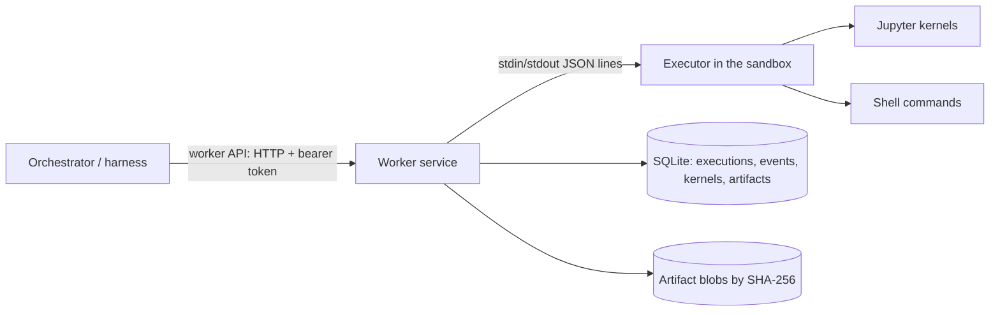

# Worker service

The worker service runs research code for the orchestrator. It is trusted infrastructure, one per worker pool, outside every research sandbox. It starts an executor inside each sandbox and talks to it. The orchestrator reaches it only through the worker API, so the harness has no local execution path ([architecture](ARCHITECTURE.md)). [Execution tools](specs/tools.md) defines the behavior. The code is in `packages/worker` (`sandbox_science.worker`), the shared types in `packages/contracts`, and the orchestrator's client in `packages/orchestrator`.

## Components



- **Worker service** (`app.py`, `manager.py`): the HTTP API, idempotent submission, event numbering and persistence, cancellation, watchdogs, file operations and publication.
- **Executor** (`executor.py`): one file that depends only on the standard library and, for kernels, `jupyter_client` and `ipykernel`, so the worker can copy it into any sandbox that has Python. It runs shell commands in sessions of their own and kernels through the Jupyter protocol (D41), ends what a command leaves running ([leftover processes](#leftover-processes)), and handles the file operations. It offers each language whose kernelspec its interpreter's Jupyter installation finds: `python3` for Python and `sagemath`, SageMath's own kernel, for Sage. Platform code never imports Sage; Sage's kernel preparses Sage syntax itself.
- **Backends** (`backends.py`) start executors:
  - **`openshell`** copies the executor into a configured sandbox with `openshell sandbox upload`, and runs it with `openshell sandbox exec --no-tty --no-login-shell`. Its required `isolation_tier` setting declares the tier the gateway's driver gives: 3 for the VM driver on babbage (D43).
  - **`local`** runs the executor as a plain subprocess of the worker. It has **no isolation**: it declares tier 0, and its probe shows why. It exists for development and tests, and the harness refuses it unless told otherwise (`--allow-unisolated`).

## Worker API

Every route needs `Authorization: Bearer <token>`: the pool's own token, which acts for every project, or a client's, which acts only for the projects its settings list ([clients](#clients-limited-to-projects)). Bodies are the JSON forms of the `sandbox_science.contracts` models. Errors return a `WorkerErrorResponse` carrying an error kind from the spec, with status 400, 403, 404, 409, 422, 500, 503 or 504 as the kind implies. The routes that name an execution or an artifact take an optional `project_id` query parameter; when it is given, an execution or artifact of another project is `not_found`.

| Route | Request → response |
| --- | --- |
| `GET /v1/capabilities?environment_id=…` | → `Capabilities`: kernel languages, features (`pdf` where the environment has pdf_oxide) and the location (pool, backend, sandbox, host, and the [isolation tier](#isolation-tiers) in effect, declared and probed). The ID must be an identifier |
| `POST /v1/executions` | `ShellRequest`, `CellRequest` or `PdfRequest` ([PDFs](#pdfs)) → `Execution`. Status is 201 when created, 200 when the project already has the operation ID with the same request, and 409 when it has it with a different one. Operation IDs are kept per project |
| `GET /v1/executions/{id}` | → `Execution`, with its result once terminal |
| `GET /v1/executions/{id}/events?after=N` | → NDJSON stream of `Event`s after sequence number `N`, ending with a `result` event, or at once if the execution has ended and `N` is its last event. While nothing happens, an empty line comes every 15 seconds. No line is longer than `MAX_EVENT_BYTES` (32 MiB) |
| `POST /v1/executions/{id}/cancel` | → `Execution`. A running shell call gets SIGTERM, then SIGKILL; a running cell is interrupted; a queued cell is dropped |
| `POST /v1/kernels/restart` | `KernelRestartRequest` → `KernelInfo`, with the new generation. A cell running on the kernel ends, `cancelled` |
| `POST /v1/sessions/close` | `SessionCloseRequest` → `SessionClosed`: stops the session's kernels in that environment and lists them. Running cells end `cancelled` ("the session was closed"), queued ones never start, and the next cell starts a new generation that reports `state_lost`. Files and shell calls are untouched, and an environment without an executor starts none |
| `POST /v1/files/read`, `/write`, `/list` | `ReadFileRequest` → `FileContent`; `WriteFileRequest` → `WriteFileResult`; `ListFilesRequest` → `FileListing` |
| `POST /v1/artifacts` | `PublishRequest` → `ArtifactRef` (201). A `media_type` must be `type/subtype`, with optional `; name=value` parameters |
| `GET /v1/artifacts/{id}`, `/content` | → `ArtifactRef`, or the bytes with `X-Content-SHA256`, as a download (`Content-Disposition: attachment`, `nosniff` and a sandboxing content security policy), so no media type turns them into a page |
| `POST /v1/environments` | `EnvironmentRequest` → `EnvironmentInfo`: 201 when created, 200 when the same environment exists, 409 when it exists with another project, profile or policy ([environments](#environments)) |
| `GET /v1/environments/{id}` | → `EnvironmentInfo` |
| `POST /v1/environments/{id}/policy` | `PolicyRevisionRequest` → `EnvironmentInfo` under the new revision |
| `DELETE /v1/environments/{id}` | → `EnvironmentInfo` in state `deleted` |
| `POST /v1/environments/{id}/admissions` | `AdmissionRequest` (up to 32 hosts and ports) → `AdmissionResult`: each host admitted or refused with the reason, and the environment ([ahead of use](#admission-on-demand)) |

### Clients limited to projects

A pool can serve several orchestrators, each with a token of its own that acts only for some projects (D78). The settings name each client's token by its SHA-256 in a `[[clients]]` entry, never the token itself. `sandbox-science-worker token --out FILE` writes a new token and prints the line the entry takes; `token --sha256 FILE` prints it for an existing token. The pool's own token acts for every project, and no client may have it.

For such a client:

- A request that names another project, in its context or body, is `policy_denied`.
- An execution, artifact or environment of another project is `not_found`, whatever the route: its state, events, results, files and policy are out of reach, and so is cancelling it.
- The client may use only the environments the worker created for its projects, and not once they are deleted. An environment of another project, or a sandbox made by hand, is `not_found`. Clients therefore need `[openshell.environments]`: only the environments the worker creates are known to belong to a project.
- Its projects may have at most `max_environments` environments at once (8 unless the entry says otherwise), deleted ones aside, since each is a sandbox, a VM with the VM driver. Beyond that, creating one is `policy_denied` until one is deleted. Concurrent requests cannot pass the limit together.
- It may create or revise environments only under the policy revisions an operator granted to the project: `sandbox-science-worker policy add --project p1 policy.yaml`. A revision not granted gets the same `not_found` as one never stored, so a client learns nothing of other projects' revisions, and cannot borrow another project's credential providers by naming its revision.

An environment ID stays with the project that first created it, even once the environment is deleted: creating it for another project is a `conflict`, from any token, with the same answer as for a sandbox made by hand, which names no project. Before an executor runs in an environment's sandbox, the worker checks that the sandbox is still the one it created (its OpenShell ID), and gives the environment up otherwise. Whatever a request was checked against therefore belongs to the same project when it runs, however long it waits for the environment (a revision, a resume, a deletion). For the same reason, the worker never creates an environment under an ID the settings map to a sandbox made by hand, and an ID the worker created never falls back to that map. Only the pool's own token may use sandboxes made by hand; with it, a request that names a worker's environment with another project is a `conflict`. Operation IDs are kept per project, so no project meets, or takes, another's.

Environment IDs are still shared by the whole pool, so a client can take an ID before the project that would use it, and then keep it. It learns nothing of that project and reaches nothing of it: the ID never moves. The harness ends its environment IDs with a random tag (`p1-default-3f9c0a1b2d4e`), so no other orchestrator can predict one. Keeping environment IDs per project is in the backlog, as are limits per client on executions and requests.

Every request that may change something (all but `GET` and the file reads) is logged with the route it matched, the caller's name and the answer's status, never with the path it sent. Closing a session where no environment of the project is left stops nothing and answers with no kernels.

## Behavior worth knowing

- **Durability.** An execution is stored before it is dispatched, and each event before it is delivered. A client that loses its stream asks again with `after`, and receives each event once; a replay reads the store a page at a time. An execution's last two events (its terminal state and its result) and its final record are checked and stored in one transaction.
- **Restarts.** When the worker starts, it reports attempts a previous run left unfinished as `lost`, numbering their last events after the highest stored one. It never runs them again. A record that no longer validates is logged, no longer counted as unfinished, and reads as an `internal` error; it does not stop the start. SIGTERM and SIGINT stop the worker cleanly: executors stop, and attempts still running end as `lost` ("the worker stopped").
- **Untrusted executors.** Research code shares the executor's sandbox and can take it over, so the worker trusts nothing it sends:
  - Each line is decoded on its own: at most 16 MiB and 100,000 objects and arrays, invalid UTF-8 and lone surrogates replaced, non-finite numbers made null. A line that does not decode is dropped and the connection carries on. Events count only from the executor an execution was sent to.
  - Results are checked and bounded by the attempt's output limit (stream texts, outputs, errors, `written_files`), and must survive a round trip through JSON in one event line, or they are shrunk. Malformed replies to file operations are `internal` errors.
  - Each execution may store stream text and rich output up to four times its output limit, and 100,000 events. Past the event count, further events are dropped; past the byte budget, which an honest executor never reaches, the attempt is also cancelled.
  - Whatever happens, an execution ends: an unexpected failure while dispatching it fails it as `internal`, and the watchdog ends one whose executor goes quiet. When reading from an executor ends, for any reason, the worker stops the executor (closing its stdin, then killing it after 15 seconds), as it does every executor when it closes.
- **Event streams.** A stream that fails once it has started is dropped, so the client reconnects; a client leaving a stream is not an error. The harness's client accepts event lines up to `MAX_EVENT_BYTES`, counts a stream with nothing, not even an empty line, for 60 seconds as dropped, and gives up on an execution 300 seconds after its own limit.
- **Output.** A stream event carries at most 65,536 characters. A cell returns at most 10,000 rich outputs, within its output limit; one note stands for those left out. An executor keeps each line under 16 MiB: an end event too large for one line keeps less of its output, marked as truncated.
- **Environment revisions** (W3). An environment's installed packages have a revision: `0` when the worker first sees them, one more for each change.
  - After every call the executor reports a fingerprint of the packages installed for its interpreter: Conda's `conda-meta` records and pip's `dist-info` and `egg-info` directories, in the prefix's and the user's site-packages.
  - A different fingerprint counts the revision up, recorded against the attempt that reported it.
  - Every execution's location gives the revision it started under, and its result the revision it ended under, so an install shows as a change; the harness tells the model so.
  - With two calls running at once, the change counts against the first to report it.
  - Files the packages own, and installs into other Conda environments under `envs/`, do not count. Changes are recorded, not serialized; serialized installs come with the provisioning tool (Conda provisioning spec).
- **Kernel generations.** Kernels die with their executor. When the worker starts a new executor for an environment, the next result reports `state_lost`, and the generation keeps counting up from the last one the worker reported. A restart is never hidden.
- **Kernels.** An interrupted cell ends `cancelled` (or `timed_out`), with the kernel's own error, `KeyboardInterrupt` for Python. A cell cancelled while its kernel starts never runs. A restart does not wait for the running cell: that cell ends `cancelled`, and queued cells run on the new kernel.
- **Watchdog.** An execution still running 30 seconds past its own limit is cancelled by the worker. If no result follows within another 60 seconds, it is reported `lost`.
- **Written files.** The executor lists the regular files in the session workspace and the shared area before and after each attempt. The result names those the attempt created or changed (`written_files`, at most 1,000). An attempt running at the same time in the session may contribute some of them. The lists come from the executor, so research code that takes it over can name the wrong attempt.
- **Publication** reads the file through the executor in ranges. The executor hashes the whole file once, with the first range. The ranges must start where asked and add up to exactly the size first reported, within the size limit, the size must not change between ranges, and the stored bytes must hash as first reported. `produced_by` names the last finished attempt that wrote the file. Session files count only that session's attempts, shared files any session's. A file written through the file API has no producer. (Modification times could not do this: in lab 4, the guest kernel's coarse clock gave a cell and the next shell call the same time.)
- **Paths.**
  - Session workspaces are `<project root>/sessions/<session>`; the shared area is `<project root>/shared`.
  - The file tools refuse absolute paths, `..` and paths through symlinks. They open one directory at a time, relative to the last, without following a symlink, the workspace and the shared area themselves included.
  - Reads refuse anything but a regular file without waiting for it (a FIFO, say), and hash in a thread, so a large file does not hold up other sessions.
  - Writes to the shared area need `expected_sha256` or `create_only`.

## Leftover processes

A shell call may not leave processes running (tools spec, Shell 8). The executor finds a call's processes through `/proc` and signals them one by one, since OpenShell refuses signals to process groups:
- **Marks.** Every command and kernel runs with `SANDBOX_SCIENCE_OWNER` in its environment, naming the call or kernel. Children inherit it, and `/proc/<pid>/environ` keeps it even after a process unsets it.
- **Adoption.** The executor makes itself a child subreaper (`prctl(PR_SET_CHILD_SUBREAPER)`), so a process whose parent exits stays below the executor instead of going to the sandbox's init. It reaps the adopted processes it kills.
- **Attribution.** A process belongs to a call if it is in the session the call's command began, carries the call's mark, or descends from such a process without a mark of its own. Below the executor, a process with no mark at all has replaced its environment to get away; the next call to end takes it.

When a call ends, times out or is cancelled, everything that belongs to it gets SIGTERM (on a timeout or cancel), then SIGKILL, in a few rounds that catch processes forked meanwhile. Each process's start time is checked again just before its signal, so a process ID reused since the scan is left alone. Kernels and their processes carry their own marks and survive other calls; when a kernel stops or restarts, what it started ends with it. When stdin closes, the executor ends everything below it.

What is guaranteed, and what is not:
- **Guaranteed:** processes that stay in the call's session or keep its mark, wherever in the sandbox's `/proc` they are, including those that left its process group with `setsid` or job control (`set -m`), and orphans of the call.
- **With a subreaper:** also processes that replaced their environment and left the session, as long as they are below the executor. The executor reports in its `hello` whether `prctl` let it become a subreaper, and the worker logs a warning if not.
- **Not guaranteed:** a process that research code deliberately disguises, by copying another owner's mark or, without a subreaper, by clearing its environment and leaving the session. Research code controls its sandbox; these checks catch accidents and ordinary daemons, not a determined attacker, whom only the sandbox contains.

## Isolation tiers

Each backend declares an isolation tier ([threat model](THREAT-MODEL.md#isolation-tiers), D43): `local` declares 0, and `openshell` declares its `isolation_tier` setting, which has no default. Whenever the worker starts an executor, it checks the declared tier against evidence (`isolation.py`):
- The executor reports what it sees in the sandbox, reading files only: the kernel release, the boot ID, the host name, `/etc/machine-id`, `Seccomp`, `NoNewPrivs` and `CapEff` from `/proc/self/status`, its uid, the CPU's `hypervisor` flag, and the DMI vendor and product name. A value it cannot read is unknown.
- The worker reads the same facts on its own host. It also writes a file with a random name in its state directory, and the executor looks for it at the same path.

Evidence only lowers the declared tier, never raises it:
- **Kernel.** The worker host's boot ID means the same running kernel: tier 1 at most, and 1 only if the executor runs under a seccomp filter with no-new-privs and no effective capabilities (the threat model's hardened container), else 0. A boot ID that either side cannot read counts the same way, so tiers 2 and 3 need a kernel of their own.
- **Files.** A sentinel file the sandbox can see, or one it cannot check for, means tier 0.
- **Failure.** If the probe fails, the tier is 0, never the declared one.

Results and capabilities report the tier in effect (`isolation_tier`), the declared tier and the evidence, so a lowered tier says why; the worker also logs a warning. The harness compares only the tier in effect with `--min-isolation-tier`, and refuses a worker that reports no evidence.

What the probe cannot do:
- **Prove tier 3.** Nothing seen from inside one sandbox shows that it has a VM to itself rather than sharing one with other sandboxes. A declared tier 3 stands when nothing contradicts it.
- **Withstand a hostile sandbox.** A compromised sandbox can give the answers a well-isolated one would. Since answers only lower the tier, the probe catches a misconfigured backend, such as a container driver declared as a VM, not a hostile sandbox.
- **See beyond the worker's host.** It compares the sandbox with the worker's host only.

## Running under OpenShell

Labs 4 and 5 ran the worker against a real gateway ([lab 4](../.agents/docs/agent-reports/babbage-openshell-lab-4-2026-10-11.md), [lab 5](../.agents/docs/agent-reports/babbage-openshell-lab-5-2026-10-11.md)). OpenShell v0.1.3's seccomp filter refuses two kinds of call that ordinary software makes. The worker works around both:
- **Scheduler calls on a thread.** libzmq aborts when `pthread_setschedparam` fails, so no Jupyter kernel or client could start.
  - The worker builds a small shim (`shim/sched_self.c`) with the host's C compiler (`cc`), uploads it beside the executor and preloads it with `LD_PRELOAD`. Every process the executor starts inherits it.
  - For the calling thread, the shim makes the equivalent `sched_setscheduler(0, …)`, which the filter allows. It needs only glibc 2.2.5 symbols.
  - The `sched_shim` setting turns it off.
- **Signals to process groups.** `kill(-pgid)` is refused. The executor never signals a group: it signals each process of a call, found through `/proc` ([leftover processes](#leftover-processes)).

The executor also calls `prctl` twice at startup:
- **Subreaper.** It becomes a child subreaper. OpenShell allows this (lab 8).
- **Not dumpable.** It tries to make itself not dumpable, which closes its `/proc` files (`fd`, `environ`, `mem`) and ptrace to research code running as the same user, so research code cannot write into the protocol or read other sessions' requests.
  - OpenShell's filter allows the call, but its supervisor then refuses every socket call from the process, even a loopback or Unix socket. That stops kernels from starting, since the executor is their client (lab 8).
  - So the executor checks that it can still bind a loopback socket, and otherwise becomes dumpable again.
  - Under OpenShell v0.1.3 it therefore stays dumpable, and research code in the same environment can reach its file descriptors. The worker treats everything the executor sends as untrusted, and sessions that share an environment are not isolated from each other anyway ([projects and sessions](PROJECTS-AND-SESSIONS.md)).
  - Its `hello` reports both results (`subreaper`, `not_dumpable`), and the worker logs when either is missing.

Other things to know:
- **Providers.** A sandbox compiled from a policy that names providers needs those providers attached; OpenShell refuses the policy otherwise.
- **Devices.** OpenShell's Landlock baseline does not include pseudo-terminals or `/dev/shm`, so without them Sage's pexpect interfaces and Python's `multiprocessing` fail. The compiled sandbox policy adds them ([policy](POLICY.md), "Mapping to enforcement"; [lab 5](../.agents/docs/agent-reports/babbage-openshell-lab-5-2026-10-11.md)).
- **Tools on `PATH`.** The executor puts its interpreter's directory first on `PATH` for commands and kernels, and sets `CONDA_PREFIX` for a Conda environment, so an environment's programs (`gp`, `gap`, compilers) are found.
- **Kernel environment.** The sandbox's Python environment needs `ipykernel` and `jupyter_client`. In lab 4 they came from conda-forge through the package cache, in 16 s. For Sage, the same environment needs SageMath, which installs the `sagemath` kernelspec. In lab 5, SageMath 10.9 (386 packages, 1.45 GB) installed in about 30 s and its kernel started in 2.3 s; a kernel gets 120 s to start.
- **Latency.** Median round trips through the worker API were 14 ms for a shell call, 20 ms for a Python cell and 36 ms for a Sage cell.
- **Performance.** Single-threaded mathematics (PARI, FLINT, M4RI, Singular, fpylll and plain Python) ran 0–7% slower in the VM sandbox than on the host, typically 3% (lab 5).

Both restrictions are described for upstream in `.agents/upstream/`.

## Environments

With an `[openshell.environments]` table, the worker creates the sandboxes behind logical environments itself (D73). The orchestrator holds no gateway credentials (threat model, Z2), so it asks the worker, naming an environment, a project, a base profile (D46) and a policy revision. The standard profiles' images, the interpreter they provide and the filesystem paths the targets file must list for them are in [base profile images](IMAGES.md).

- **Policy revisions** come from the pool's policy store, the policy middleware's state directory. Only an operator adds them, on the pool host:

  ```bash
  sandbox-science-worker policy add --settings worker.toml [--project p1] policy.yaml
  ```

  The command compiles each file to check it, then prints its revision (`sha256:…`) and the compiler's findings. The API cannot add a revision, so a compromised orchestrator can only choose among the stored ones, and a client limited to projects only among those granted to its projects (`--project`, [clients](#clients-limited-to-projects)).
- **Creating** an environment:
  1. The worker compiles the revision under the pool ceiling, with the deployment's targets file.
  2. It checks the providers. Every provider in `credentials.providers` must be registered in the gateway under the profile the policy names, and that profile must name no endpoints (D57). Otherwise it reports `unavailable`.
  3. It records the environment as `creating`, then creates a sandbox with a new random name, `ss-` and 16 hex digits, which the record keeps; no two records name one sandbox. (OpenShell takes at most 19 characters, too few for a name derived from the ID to be unique: a client could have chosen an ID whose name was another project's sandbox.) Creating an environment again deletes only the sandbox its own record left behind in a crash. The sandbox comes from the profile's image, with exactly those providers (`--no-auto-providers`) and the compiled document, filesystem section included.
  4. It waits until the sandbox is ready, then binds it to the revision in the middleware's store.

  If any step fails, the worker deletes the sandbox and records the environment as `deleted`. A sandbox left by a crash during creation is replaced on the next request.
- **Revising:**
  1. The worker compiles the new revision, deciding again every host it decided on demand under the old one ([admission on demand](#admission-on-demand)). It refuses a revision whose providers differ, since OpenShell attaches providers only when it creates a sandbox.
  2. It reads the sandbox's live filesystem section (`openshell policy get --base`), because OpenShell refuses a revision that removes any path from it.
  3. It applies the new document with `openshell policy set --wait`, then rebinds. Between those two steps the middleware denies the sandbox's requests as `policy_stale`, so the change fails closed.
- **Deleting:** the worker stops the environment's executor (running attempts end as `lost`), deletes the sandbox and removes its binding.

Sandboxes made outside the worker still work through the static `sandboxes` map.

## Admission on demand

A sandbox resolves only the host names its compiled policy names. A policy with `*` rules or a non-deny default reaches hosts nobody names in advance, so the worker admits them as they are needed (D69; [policy](POLICY.md), "Mapping to enforcement"):

1. Research code connects to a host the policy does not name. The lookup returns a placeholder address and OpenShell refuses the connection, which fails with `Permission denied`.
2. OpenShell drafts a proposal for that program, host and port. Drafts reach the gateway about every 10 s.
3. Every `admission_interval`, the worker lists each ready environment's pending drafts (`openshell rule get --status pending`) and decides each host and port with the policy library (`admission_refusal`):
   - the policy must reach hosts it does not name;
   - the host must be public and not a platform service host;
   - the port must be one the compiled policy admits;
   - some HTTP or git request to the host there must be allowed or escalated, after the hard floor (with the settings' `admin_hosts`), the pool ceiling and the reserved hosts.
4. It names the admitted hosts in one new compilation of the environment's revision, and applies the result with `openshell policy set --wait`. The policy middleware still decides every request.
   - Each admitted host gets an endpoint limited to the public address ranges, less the addresses the library always denies ([policy](POLICY.md), "Names, not addresses"). So a name that resolves to a private, metadata or administration address stays refused.
   - Hosts already in use keep their place, so a new batch or a revision never displaces them.
5. It rejects every draft it read, giving its decision as the reason, and records the decisions. It never approves a draft: a draft's rule is raw TCP for one program, which the fail-closed middleware could not inspect.

**Ahead of use.** The orchestrator can name hosts before code contacts them, so that the first connection does not fail and the reload comes before any transfer starts. `POST /v1/environments/{id}/admissions` decides up to 32 hosts and ports the same way, in one compilation, after starting a suspended environment, and answers with each decision. A host the policy names already is admitted without a reload. Capabilities list the `admission` feature for environments where this works, and the harness then offers the agent the `admit_hosts` tool ([execution tools](specs/tools.md#network)).

The environment's `admitted_hosts` lists the hosts admitted so far, and `sandbox-science-worker admissions --settings worker.toml --environment ID` prints every decision with its reason. A revision decides every recorded host again. Hosts the new policy no longer reaches are dropped, and hosts it now reaches are admitted.

Things to know:
- **Timing.** In [lab 10](../.agents/docs/agent-reports/babbage-openshell-lab-10-2026-10-11.md), a host was reachable 9 to 20 s after the first refused connection. OpenShell's 10 s draft flush and the sandbox's 10 s policy poll account for most of it. Research code, or the agent, retries.
- **Notices.** Each result carries what admission decided for its environment since the session's previous result (`notices`): which hosts were admitted, and which were refused and why. The harness passes them to the model as `platform_notices`. A host admitted again for another program is no news.
- **Reloads interrupt transfers.** When a sandbox loads a new compilation, OpenShell closes every connection opened under the old one, so an admission cuts downloads in progress.
- **Limits.**
  - An environment admits at most `max_admitted_hosts` hosts (64 by default). Each adds an endpoint of about 4 KiB of YAML, and OpenShell limits a sandbox's policy to 256 KiB.
  - Beyond that limit, or once the compiled policy would pass 320 KiB of YAML, new hosts are refused.
  - One check of an environment handles at most 32 drafts and 64 endpoints; real drafts beyond that wait for the next check.
  - The worker keeps at most 512 decisions per environment: every admitted one, then the newest refusals. It forgets them when the environment is deleted.
- **Failures.**
  - If an environment's check fails, the worker leaves its drafts pending and skips it for a minute. A failure in one environment never stops the others.
  - If the same batch fails three times because OpenShell refuses the revision, its hosts are refused with the error as the reason. A later revision of the policy decides them again.
- **Untrusted text.**
  - At v0.1.3, `openshell rule get` has no JSON output, so the worker reads its text.
  - The sandbox chooses the host names and program paths in it. A crafted path can add hosts to decide, which the sandbox could have tried anyway, or hide its own draft.
  - Such text is made printable before it reaches records, logs or the reasons OpenShell stores.
- **Leave OpenShell's approval mode manual.** With `proposal_approval_mode` set to `auto`, OpenShell would approve drafts itself and add its own raw-TCP rules. The fail-closed middleware would deny their traffic, but the policy would no longer be the worker's alone.

## Idle suspension

Environments persist, but need not keep running ([projects and sessions](PROJECTS-AND-SESSIONS.md), "Provisioning and persistence"). With `suspend_after` set, the worker stops the sandbox of an environment nobody is using, and starts it again on the next use (W3):

- **Idle** means three things for `suspend_after` seconds:
  - no execution ran there, and no other request was in flight (file operations, publication, kernel restarts, closing a session);
  - the environment did not change: it was not created, resumed, revised or given admitted hosts;
  - its kernels used almost no CPU: under 2% of one core, sampled from the executor (`usage`), so a computation left running in a kernel thread keeps the environment up. Two samples from the same executor are needed, and a counter that went down tells nothing.
- **Not seen as use:** work that waits rather than computes (a download, a remote job being polled), and the CPU of children a process reaps automatically by ignoring `SIGCHLD`. Such work ends with the suspension; the next cell reports the lost kernel state.
- **Suspending:**
  1. The worker checks again, under the execution manager's lock, that nothing started meanwhile. It forgets the executor before closing it, so a request arriving during the close starts afresh instead of using an executor nobody tracks.
  2. It records the environment as `stopped`, then runs `openshell sandbox stop`.
  3. OpenShell keeps a stopped sandbox's writable disk: the session workspaces, the shared area and installed tools survive. Its identity and policy survive too, including hosts admitted on demand and the middleware's binding.
  4. Kernels do not survive. The next cell in a session that had a kernel reports `state_lost`, as after any executor restart.
- **Resuming.** Any use of a stopped environment first resumes it: an execution, a file operation, capabilities, `create` with the same request, or a policy revision.
  - The worker reads the sandbox's phase. If a stop failed or was cut short, the sandbox is still ready, and it carries on. Otherwise it runs `openshell sandbox start` and waits up to three minutes for the sandbox to be ready.
  - Phases that cannot lead there (`Error`, `Deleting`, `Completed`) fail at once, and after a failed start the next minute's uses fail at once too.
  - A request that arrives while a suspension is stopping the sandbox waits for it, then starts it again.
  - If the sandbox is gone, or comes back with another ID, the worker stops it, records the environment as `deleted` and asks for it to be created again.
- **Cancelling.** A cancel goes only to the executor its execution was sent to, so it never starts a sandbox or an executor.
- **Trust.** The executor reports the CPU time, and research code may take the executor over. It can keep its own environment running, or let it be suspended, and nothing else:
  - each sample has a 15 s limit, and environments are sampled eight at a time;
  - a request waits at most 30 s to be written, so an executor that stopped reading its requests holds up no other environment.

## Shared data across environments

Each environment is its own sandbox, so the `shared/` area of a project's sessions is a separate directory in each of the project's environments. The worker keeps them in step (D79): it holds the project's copy of every shared file, in a blob store of the project's own, and syncs each environment with it.

- **After every call** in an environment (a shell call, a cell, a PDF operation), it copies the files that changed in that environment's `shared/` into the project's copy, before the call's result is reported. A later call anywhere in the project then sees them. Files the call deleted are deleted in the project's copy.
- **Steps are bounded.** A step starts no transfer 40 seconds after it got its locks, or after 1 GiB read, and all of one sync's steps stop starting transfers after 100 seconds, within the manager's 120. A step records what it copied in batches as it goes, so a large change arrives over several calls instead of never, and environments that wait for one another take turns.
- **Before every call**, it brings the environment's own unsynced changes up first, then writes into it the files whose project version is newer than its copy, and removes the ones the project deleted.
- **File requests** in `shared/` sync the same way. Reads and listings bring the environment up to date first. A write is made under the project's lock, after the environment was brought up to date, and goes up at once, so its `expected_sha256` names the project's version: of two writers in different environments expecting the same version, the second gets `conflict`. If the sync before a write fails, or leaves that file out of date, the write is not made (`unavailable`). What these syncs find is passed on with the results of the calls running in the environment, or with the requesting session's next result there.
- **Conflicts.** Every change to the project's copy takes the next value of a counter as its version, and each environment's record says which version its copy matches. A change an environment makes to a file another environment changed since is a conflict. The project's file keeps the version that arrived first, and the later one is kept beside it as a conflict copy named after its environment, `results.conflict-<environment>.csv` (shortened to fit 255 bytes). The environment's own file is renamed to that name in place, keeping its inode, so a call still writing to it goes on writing into the conflict copy; the project's version then takes the name at once. The call's result tells the agent (`notices`, which the harness passes on as `platform_notices`). A deletion that meets a change loses to it.
- **Files in use.** A file that a process in the environment has open for writing, or maps writable, is not replaced or removed until it is closed; the agent is told once, and a file request's write to it is refused with the reason. Readers do not hold a file back. The executor checks through `/proc` just before replacing or removing a file and again just after, putting it back if a writer appeared in between. Processes it may not inspect, such as non-dumpable ones, are not seen.
- **What an executor reports is checked.** Research code controls `shared/`, so paths must be plain paths below it, stamps and digests must be well formed, and a digest is never used as a path. Content is read from the environment and kept only if the bytes received hash to the digest it reported, unless the same project already holds that content: a digest of another project's file gets nothing.
- **An environment's directory is recognized by a mark**, `.sandbox-science-sync` beside `shared/`, which the worker writes. A sandbox made again under a known ID, or a mark removed, makes the environment's records unverified: nothing in it reads as deleted, files it lacks are written into it, the files it has are hashed again, and the deletions the project made still apply, so nothing deleted comes back. An environment's `shared/` is synced for the first project that uses it; another project using the same sandbox made by hand (with the pool's own token) is told it is not synced, and its sync leaves the directory alone.
- **Scans that miss files prove nothing.** A scan cut short (past 20,000 files or 4 MiB of paths) or with parts it could not read infers no deletions, and the agent is told once. A deletion the project made still reaches such an environment, since a file is removed only if its content is the one synced there. Names that cannot be synced (not text, a name over 255 bytes, a path over 4096 bytes) are left out and named once; they stop nothing else.
- **Cost.** The executor reports each file's stamp (modification time, size, inode); only files whose stamps changed are hashed and copied, and the executor gives a digest only for a file still as scanned. A file recorded within two seconds of its last change is hashed again at the next scan, since a clock coarser than a rewrite could leave a stamp unchanged. A scan hashes up to 256 MiB, and the rest waits for the next. A call that changes nothing in `shared/` costs two scans.
- **Limits.** Files over 32 MiB are not copied, and are not hashed again until they change. Changes that would take the project's copy past 2 GiB or 10,000 files are not copied either, and are not read: the size a scan reports is checked first, and a file larger than reported is dropped as soon as it is read. The agent is told once for each. Publish large files as artifacts.
- **Failures.** A file that cannot be written into an environment, such as one whose name is a directory there or one in a read-only directory, is tried again after ten minutes, and the agent is told once; the other files go on. Only a failing executor or a full disk stops a step. Files the sync writes into an environment while a call runs there, and that the call leaves as they were, are not counted among its `written_files`.
- **Storage.** Blobs are on disk before they are recorded, and checked against their digest whenever they are read; a damaged or missing one is not copied, and is read again from an environment that has the content. One that cannot be read for the moment (too many open files, say) is tried again later and kept. Blobs that no shared file uses any more are deleted at once; one that a cut-short step left is deleted at the project's next step, or when the worker next starts. The records are in `shared.sqlite3` in the state directory, and each project's blobs in `shared/<hash of the project ID>/`.
- **What it does not do.** It copies at call boundaries, so a file another session in the same environment is still writing can be copied in part, and is copied again when that session's call ends. The executable bit travels with a file's content; a change of the bit alone is not synced. Removing a file also removes the directories it leaves empty.

Apart from file requests' writes, a failed sync never fails the call: the call runs with `shared/` as it is, and its result says the sync failed. If the executor goes away while the shared files sync after a call, the call keeps the result it reported. The setting `shared_sync = false` turns the sync off.

## PDFs

A `PdfRequest` runs one operation of the [PDF sources spec](specs/pdf-sources.md): `info`, `pages`, `search` or `render`.
- **Where it runs.** The executor runs the PDF helper (`pdfhelper.py`) as a process of its own, with its own interpreter, through the same path as a shell call's argv. Time limits, output limits, cancellation and leftover-process cleanup therefore apply as they do to shell calls. PDFs are untrusted, and nothing parses them outside the sandbox.
- **The helper.** The OpenShell backend uploads it beside the executor. It needs only the standard library and pdf_oxide (D59).
- **Results.** The result's stdout is the helper's JSON. On an error the exit code is 3, and stdout holds `{"error": {"kind", "message"}}`.
- **Renders.** A render writes its PNG into the session workspace, so it appears in `written_files` and can be published like any output.
- **The feature.** The executor offers the `pdf` feature only when its interpreter can import pdf_oxide. Without it, a `PdfRequest` fails as `unsupported`. The harness offers its PDF tools (`pdf_info`, `pdf_pages`, `pdf_search`, `pdf_render`) only for an environment with the feature.

## Executor protocol

The worker sends one JSON object per line; each carries an `id` and an `op`. The operations are `hello`, `probe` (the [isolation probe](#isolation-tiers)), `configure`, `shell`, `cell`, `cancel`, `restart`, `read`, `write`, `list`, and for the shared files' sync, `shared` and `remove`.
- **Lines.** UTF-8 JSON, one object per line. The executor's lines stay under 16 MiB (`MAX_LINE`, the worker's limit too); it reads requests of up to 64 MiB.
- **Replies.** Each request gets exactly one reply: `{"type": "reply", "id": …, "ok": true, …}`, or `ok: false` with `{"error": {"kind", "message"}}`. The `hello` reply says whether the executor became a subreaper (`subreaper`). A `read` with `"hash": false` leaves out the whole file's SHA-256, for publication's later ranges.
- **Configuration.** `configure` writes files into the executor's configuration directory (`<project root>/.executor/config`) or the home directory. It adds variables to the environment of every later shell command and kernel: its `env`, and for each file with a `variable`, that variable set to the file's path. It records what it wrote, keeps a file that changed since or that it did not write, and names each one it kept in its reply (`skipped`). The OpenShell backend sends the package clients' configuration this way, right after `hello`.
- **The shared files' sync** ([above](#shared-data-across-environments)). `shared` lists the regular files below `shared/`, each with its modification time, size, inode and executable bit; hashes the files asked for, within a size limit per file and a budget per scan, giving a digest only for a file still as scanned; and writes the worker's mark when given one and reports it. `remove` deletes a file in `shared/` only if its SHA-256 is the one expected, then the directories it leaves empty. `move` gives a file a free name in `shared/`, keeping its inode. A `write` may set a file's executable bit, and reports the stamp the written file has; a write that names the expected SHA-256 swaps the new file in at once (`renameat2` with `RENAME_EXCHANGE`) and swaps it back if the old one changed after its check. With `if_unused`, a `write` or `remove` leaves alone a file another process is writing and replies `busy`. Errors on the file itself come back as `invalid_request` or `policy_denied`; a full disk or an exhausted executor (no file descriptors or memory) as `unavailable`.
- **Events.** `shell` and `cell` reply when they are accepted, then send events: `{"type": "event", "execution": …, "event": "state" | "stream" | "output" | "end", …}`. The `end` event carries the terminal state and the result fields of `Result`.
- **Hygiene.** The executor keeps the protocol on its own file descriptor and sends anything else that writes to stdout to stderr. Where the sandbox allows it, the executor is not dumpable, so research code cannot open that descriptor through `/proc` (not under OpenShell v0.1.3; see "Running under OpenShell").
- **Shutdown.** When stdin closes, it stops every command and kernel, and anything left below it, and exits. It sends no `end` for the attempts it stops then: the worker reports them `lost`.

## Settings

```toml
listen = "127.0.0.1:8100"
token_file = "worker.token"          # the pool's own token: sandbox-science-worker token --out worker.token
state_dir = "state"
pool_id = "babbage"
kernel_idle_timeout = 28800          # optional: stop kernels unused for 8 hours
shared_sync = true                   # keep each project's shared/ in step across its environments (D79)

[openshell]
cli = "/home/andy/.local/opt/openshell-0.1.3/bin/openshell"
python = "/opt/sandbox-science/bin/python"   # with ipykernel and jupyter_client; the base images' interpreter
project_root = "/sandbox/project"
isolation_tier = 3                   # required: the tier the driver gives (D43); the probe can lower it
sched_shim = true                    # build and preload the scheduler shim (needs cc on this host)
package_cache = "http://host.openshell.internal:8090"   # the package cache, as sandboxes reach it
env = {XDG_CONFIG_HOME = "/home/andy/.local/state/openshell-lab/config"}
sandboxes = {"env-1" = "research-1"}   # sandboxes made by hand

[openshell.environments]             # optional: the worker creates sandboxes (D73)
policy_store = "/var/lib/sandbox-science/middleware"   # the policy middleware's state_dir
targets = "targets.yaml"             # OpenShell targets for the compiler
ceiling = "pool-ceiling.yaml"        # the same pool ceiling the middleware applies
profiles = {minimal = "sandbox-science/minimal:<sha>", crypto-base = "sandbox-science/crypto-base:<sha>"}   # base profile -> image (IMAGES.md)
create_timeout = 600                 # seconds for a sandbox to become ready
admission = true                     # admit hosts on demand (D69)
admin_hosts = ["10.0.0.2", "gateway.lab.internal"]   # the policy middleware's admin_hosts
admission_interval = 3               # seconds between checks of each environment's drafts
max_admitted_hosts = 64              # hosts admitted on demand per environment
suspend_after = 3600                 # optional: stop sandboxes idle for an hour (W3)

[[clients]]                          # optional: tokens limited to some projects (needs [openshell.environments])
name = "orchestrator-p1"
token_sha256 = "<64 hex digits>"     # printed by sandbox-science-worker token --out client.token
projects = ["p1"]
max_environments = 8                 # live environments across its projects
```

Run it with `sandbox-science-worker serve --settings worker.toml`. The sandbox's environment needs Python with `ipykernel` and `jupyter_client`. On babbage they come from conda-forge through the [package cache](PACKAGE-CACHE.md), like any other tool.

`package_cache` is optional. With it, the worker points pip, uv, conda, mamba, micromamba, Cargo, Go and npm in each sandbox at the cache whenever it starts an executor there ([client configuration](PACKAGE-CACHE.md#client-configuration)). Without it, nothing is written. It is one setting for the whole backend: sandboxes made by hand and those the worker creates reach the cache at the same address, whatever their profile. With an `[openshell.environments]` table, the worker refuses to start unless `package_cache` names the host and port the targets file gives the package cache, since the policies it compiles admit the cache only there. The local backend has no such setting, since its executor shares the worker user's home.

The harness's command line runs a task through the worker. A JSON script of model turns can stand in for the model:

```bash
sandbox-science-harness run --worker http://127.0.0.1:8100 --token-file worker.token --project p1 --session s1 --environment env-1 --script turns.json "the task"
```

## Conformance suite

`packages/worker/tests/test_conformance.py` runs the [execution-tools fixtures](specs/tools.md#acceptance-fixtures) through the worker API alone, so it checks any backend without the harness (D52). It covers shell calls, the location and the isolation probe, kernels (state, interrupt, restart, death, streaming, reconnection), output bounds, cancellation, the file tools' confinement and publication. A backend passes only if the probe leaves its declared tier standing. CI runs it against a worker with the local backend that the suite starts. To check a worker that is already running, such as one with the OpenShell backend in a lab, set:

| Variable | Value |
| --- | --- |
| `SS_CONFORMANCE_WORKER_URL` | The worker's base URL, such as `http://127.0.0.1:8100` |
| `SS_CONFORMANCE_TOKEN_FILE` | The file holding its bearer token |
| `SS_CONFORMANCE_ENVIRONMENT` | The logical environment to run in, which the worker maps to a sandbox. The suite acts for the project `conformance`, so a worker's own environment must have been created for that project; a sandbox made by hand needs the pool's own token |

```bash
SS_CONFORMANCE_WORKER_URL=http://127.0.0.1:8100 SS_CONFORMANCE_TOKEN_FILE=worker.token \
  SS_CONFORMANCE_ENVIRONMENT=env-1 uv run pytest packages/worker/tests/test_conformance.py
```

The local runs are then skipped; setting only some of the variables is an error. Each test works in a new session (`conformance-…`) of the project `conformance`. Its files stay in the sandbox, and its kernels run until the executor ends. Tests that need the local backend's internals, such as a killed executor or a crashed store, are in `test_service.py`; those for the adversarial review of 2026-10-11, some with a stand-in for an executor that research code took over (`hostile_executor.py`), are in `test_robustness.py`.

## Not yet done

- **Survival across worker restarts.** The executor serves one stdio connection, so it ends when the worker restarts, and kernels end with it. The planned fix is a daemon in the sandbox listening on a socket, with the worker reconnecting through `openshell sandbox exec`.
- **Environment lifecycle.** The worker creates, revises and deletes sandboxes ([environments](#environments)). Suspending and restoring them, and provisioning their tools, belong to the environment manager (W3). Policy revisions enter the store only through the operator's command; an approval path from the GUI, with re-authentication for widening (D54), comes later.
- **Data grants.** Scoped grants of project data, and session containers beside the project container.
- **Large outputs.** A rich output over the limit is replaced by a note; the spec's spill to a referenced file is not implemented.
- **Authentication.** Bearer tokens: the pool's own, and [clients' limited to projects](#clients-limited-to-projects). Environment IDs are still shared by the whole pool (see there). The outbound, worker-initiated channel for hosted control (architecture) comes later.
- **Monitoring.** No connection yet to the monitor or the event store with a hash chain.
- **Probes across sandboxes.** Two sandboxes with the same boot ID share a kernel, so neither is tier 3; the worker does not compare sandboxes with each other yet.
