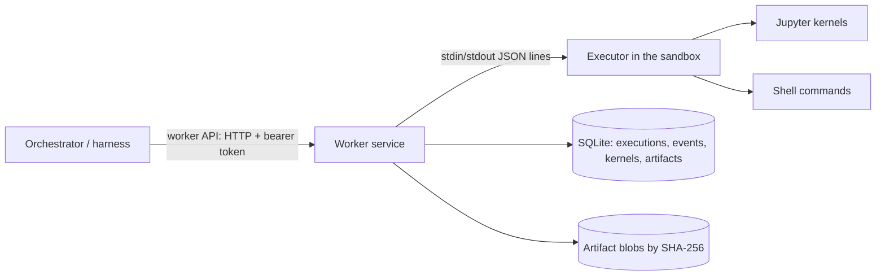

# Worker service

The worker service runs research code for the orchestrator. It is trusted infrastructure, one per worker pool, outside every research sandbox. It starts an executor inside each sandbox and talks to it. The orchestrator reaches it only through the worker API, so the harness has no local execution path ([architecture](ARCHITECTURE.md)). [Execution tools](specs/tools.md) defines the behavior. The code is in `packages/worker` (`sandbox_science.worker`), the shared types in `packages/contracts`, and the orchestrator's client in `packages/orchestrator`.

## Components



- **Worker service** (`app.py`, `manager.py`): the HTTP API, idempotent submission, event numbering and persistence, cancellation, watchdogs, file operations and publication.
- **Executor** (`executor.py`): one file that depends only on the standard library and, for kernels, `jupyter_client` and `ipykernel`, so the worker can copy it into any sandbox that has Python. It runs shell commands in their own process groups and Python kernels through the Jupyter protocol (D41), and handles the file operations.
- **Backends** (`backends.py`) start executors:
  - **`openshell`** copies the executor into a configured sandbox with `openshell sandbox upload`, and runs it with `openshell sandbox exec --no-tty --no-login-shell`. The VM driver on babbage gives isolation tier 3 (D43).
  - **`local`** runs the executor as a plain subprocess of the worker. It has **no isolation** and reports tier 0. It exists for development and tests, and the harness refuses it unless told otherwise (`--allow-unisolated`).

## Worker API

Every route needs `Authorization: Bearer <token>`. Bodies are the JSON forms of the `sandbox_science.contracts` models. Errors return a `WorkerErrorResponse` carrying an error kind from the spec, with status 400, 403, 404, 409, 422, 500, 503 or 504 as the kind implies.

| Route | Request → response |
| --- | --- |
| `GET /v1/capabilities?environment_id=…` | → `Capabilities`: kernel languages and the location (pool, backend, sandbox, host, isolation tier) |
| `POST /v1/executions` | `ShellRequest` or `CellRequest` → `Execution`. Status is 201 when created, 200 when the operation ID already exists with the same request, and 409 when it exists with a different one |
| `GET /v1/executions/{id}` | → `Execution`, with its result once terminal |
| `GET /v1/executions/{id}/events?after=N` | → NDJSON stream of `Event`s after sequence number `N`, ending with a `result` event |
| `POST /v1/executions/{id}/cancel` | → `Execution`. A running shell call gets SIGTERM, then SIGKILL; a running cell is interrupted; a queued cell is dropped |
| `POST /v1/kernels/restart` | `KernelRestartRequest` → `KernelInfo`, with the new generation |
| `POST /v1/files/read`, `/write`, `/list` | `ReadFileRequest` → `FileContent`; `WriteFileRequest` → `WriteFileResult`; `ListFilesRequest` → `FileListing` |
| `POST /v1/artifacts` | `PublishRequest` → `ArtifactRef` (201) |
| `GET /v1/artifacts/{id}`, `/content` | → `ArtifactRef`, or the bytes with `X-Content-SHA256` |

## Behavior worth knowing

- **Durability.** An execution is stored before it is dispatched, and each event before it is delivered. A client that loses its stream asks again with `after`, and receives each event once. When the worker starts, it reports attempts a previous run left unfinished as `lost`. It never runs them again.
- **Kernel generations.** Kernels die with their executor. When the worker starts a new executor for an environment, the next result reports `state_lost`, and the generation keeps counting up from the last one the worker reported. A restart is never hidden.
- **Watchdog.** An execution still running 30 seconds past its own limit is cancelled by the worker. If no result follows within another 60 seconds, it is reported `lost`.
- **Written files.** The executor lists the regular files in the session workspace and the shared area before and after each attempt. The result names those the attempt created or changed (`written_files`, at most 1,000). An attempt running at the same time in the session may contribute some of them.
- **Publication** reads the file through the executor in ranges, then checks that its hash and size did not change between ranges and that the stored bytes hash as reported. `produced_by` names the last finished attempt that wrote the file. Session files count only that session's attempts, shared files any session's. A file written through the file API has no producer. (Modification times could not do this: in lab 4, the guest kernel's coarse clock gave a cell and the next shell call the same time.)
- **Paths.**
  - Session workspaces are `<project root>/sessions/<session>`; the shared area is `<project root>/shared`.
  - The file tools refuse absolute paths, `..` and paths through symlinks.
  - Writes to the shared area need `expected_sha256` or `create_only`.

## Running under OpenShell

Lab 4 ran the worker against a real gateway ([report](../.agents/docs/agent-reports/babbage-openshell-lab-4-2026-10-11.md)). OpenShell v0.1.3's seccomp filter refuses two kinds of call that ordinary software makes. The worker works around both:
- **Scheduler calls on a thread.** libzmq aborts when `pthread_setschedparam` fails, so no Jupyter kernel or client could start.
  - The worker builds a small shim (`shim/sched_self.c`) with the host's C compiler (`cc`), uploads it beside the executor and preloads it with `LD_PRELOAD`. Every process the executor starts inherits it.
  - For the calling thread, the shim makes the equivalent `sched_setscheduler(0, …)`, which the filter allows. It needs only glibc 2.2.5 symbols.
  - The `sched_shim` setting turns it off.
- **Signals to process groups.** `kill(-pgid)` is refused. When it is, the executor signals each member of the group, found through `/proc`.

Other things to know:
- **Providers.** A sandbox compiled from a policy that names providers needs those providers attached; OpenShell refuses the policy otherwise.
- **Kernel environment.** The sandbox's Python environment needs `ipykernel` and `jupyter_client`. In the lab they came from conda-forge through the package cache, in 16 s.
- **Latency.** Median round trips through the worker API were 14 ms for a shell call and 20 ms for a cell.

Both restrictions are described for upstream in `.agents/upstream/`.

## Executor protocol

The worker sends one JSON object per line; each carries an `id` and an `op`. The operations are `hello`, `shell`, `cell`, `cancel`, `restart`, `read`, `write` and `list`.
- **Replies.** Each request gets exactly one reply: `{"type": "reply", "id": …, "ok": true, …}`, or `ok: false` with `{"error": {"kind", "message"}}`.
- **Events.** `shell` and `cell` reply when they are accepted, then send events: `{"type": "event", "execution": …, "event": "state" | "stream" | "output" | "end", …}`. The `end` event carries the terminal state and the result fields of `Result`.
- **Hygiene.** The executor keeps the protocol on its own file descriptor and sends anything else that writes to stdout to stderr.
- **Shutdown.** When stdin closes, it stops every command and kernel and exits.

## Settings

```toml
listen = "127.0.0.1:8100"
token_file = "worker.token"          # sandbox-science-worker token --out worker.token
state_dir = "state"
pool_id = "babbage"

[openshell]
cli = "/home/andy/.local/opt/openshell-0.1.3/bin/openshell"
python = "/sandbox/mamba/envs/tools/bin/python"   # an interpreter with ipykernel and jupyter_client
project_root = "/sandbox/project"
isolation_tier = 3
sched_shim = true                    # build and preload the scheduler shim (needs cc on this host)
env = {XDG_CONFIG_HOME = "/home/andy/.local/state/openshell-lab/config"}
sandboxes = {"env-1" = "research-1"}
```

Run it with `sandbox-science-worker serve --settings worker.toml`. The sandbox's environment needs Python with `ipykernel` and `jupyter_client`. On babbage they come from conda-forge through the [package cache](PACKAGE-CACHE.md), like any other tool.

The harness's command line runs a task through the worker. A JSON script of model turns can stand in for the model:

```bash
sandbox-science-harness run --worker http://127.0.0.1:8100 --token-file worker.token --project p1 --session s1 --environment env-1 --script turns.json "the task"
```

## Not yet done

- **Survival across worker restarts.** The executor serves one stdio connection, so it ends when the worker restarts, and kernels end with it. The planned fix is a daemon in the sandbox listening on a socket, with the worker reconnecting through `openshell sandbox exec`.
- **Environment lifecycle.** The worker maps environments to sandboxes that already exist. Creating, binding, suspending and restoring environments belongs to the environment manager (W3).
- **Data grants.** Scoped grants of project data, and session containers beside the project container.
- **Large outputs.** A rich output over the limit is replaced by a note; the spec's spill to a referenced file is not implemented.
- **Authentication.** A single bearer token; the outbound, worker-initiated channel for hosted control (architecture) comes later.
- **Monitoring.** No connection yet to the monitor or the event store with a hash chain.
