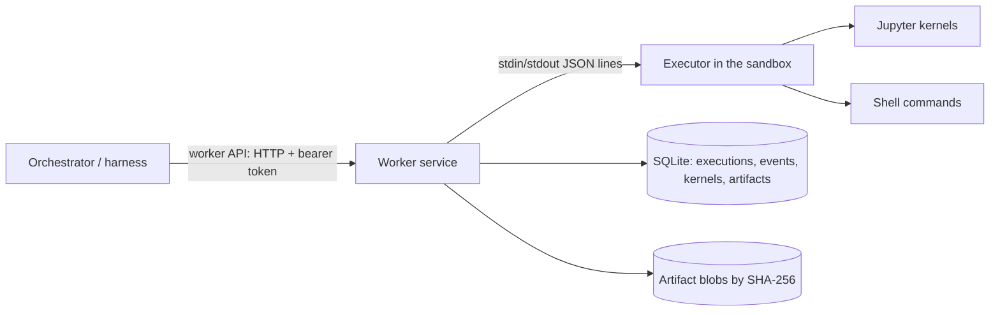

# Worker service

The worker service runs research code for the orchestrator. It is trusted infrastructure, one per worker pool, outside every research sandbox. It starts an executor inside each sandbox and talks to it. The orchestrator reaches it only through the worker API, so the harness has no local execution path ([architecture](ARCHITECTURE.md)). [Execution tools](specs/tools.md) defines the behavior. The code is in `packages/worker` (`sandbox_science.worker`), the shared types in `packages/contracts`, and the orchestrator's client in `packages/orchestrator`.

## Components



- **Worker service** (`app.py`, `manager.py`): the HTTP API, idempotent submission, event numbering and persistence, cancellation, watchdogs, file operations and publication.
- **Executor** (`executor.py`): one file that depends only on the standard library and, for kernels, `jupyter_client` and `ipykernel`, so the worker can copy it into any sandbox that has Python. It runs shell commands in their own process groups and kernels through the Jupyter protocol (D41), and handles the file operations. It offers each language whose kernelspec its interpreter's Jupyter installation finds: `python3` for Python and `sagemath`, SageMath's own kernel, for Sage. Platform code never imports Sage; Sage's kernel preparses Sage syntax itself.
- **Backends** (`backends.py`) start executors:
  - **`openshell`** copies the executor into a configured sandbox with `openshell sandbox upload`, and runs it with `openshell sandbox exec --no-tty --no-login-shell`. Its required `isolation_tier` setting declares the tier the gateway's driver gives: 3 for the VM driver on babbage (D43).
  - **`local`** runs the executor as a plain subprocess of the worker. It has **no isolation**: it declares tier 0, and its probe shows why. It exists for development and tests, and the harness refuses it unless told otherwise (`--allow-unisolated`).

## Worker API

Every route needs `Authorization: Bearer <token>`. Bodies are the JSON forms of the `sandbox_science.contracts` models. Errors return a `WorkerErrorResponse` carrying an error kind from the spec, with status 400, 403, 404, 409, 422, 500, 503 or 504 as the kind implies.

| Route | Request → response |
| --- | --- |
| `GET /v1/capabilities?environment_id=…` | → `Capabilities`: kernel languages and the location (pool, backend, sandbox, host, and the [isolation tier](#isolation-tiers) in effect, declared and probed) |
| `POST /v1/executions` | `ShellRequest` or `CellRequest` → `Execution`. Status is 201 when created, 200 when the operation ID already exists with the same request, and 409 when it exists with a different one |
| `GET /v1/executions/{id}` | → `Execution`, with its result once terminal |
| `GET /v1/executions/{id}/events?after=N` | → NDJSON stream of `Event`s after sequence number `N`, ending with a `result` event |
| `POST /v1/executions/{id}/cancel` | → `Execution`. A running shell call gets SIGTERM, then SIGKILL; a running cell is interrupted; a queued cell is dropped |
| `POST /v1/kernels/restart` | `KernelRestartRequest` → `KernelInfo`, with the new generation |
| `POST /v1/files/read`, `/write`, `/list` | `ReadFileRequest` → `FileContent`; `WriteFileRequest` → `WriteFileResult`; `ListFilesRequest` → `FileListing` |
| `POST /v1/artifacts` | `PublishRequest` → `ArtifactRef` (201) |
| `GET /v1/artifacts/{id}`, `/content` | → `ArtifactRef`, or the bytes with `X-Content-SHA256` |
| `POST /v1/environments` | `EnvironmentRequest` → `EnvironmentInfo`: 201 when created, 200 when the same environment exists, 409 when it exists with another project, profile or policy ([environments](#environments)) |
| `GET /v1/environments/{id}` | → `EnvironmentInfo` |
| `POST /v1/environments/{id}/policy` | `PolicyRevisionRequest` → `EnvironmentInfo` under the new revision |
| `DELETE /v1/environments/{id}` | → `EnvironmentInfo` in state `deleted` |

## Behavior worth knowing

- **Durability.** An execution is stored before it is dispatched, and each event before it is delivered. A client that loses its stream asks again with `after`, and receives each event once. When the worker starts, it reports attempts a previous run left unfinished as `lost`. It never runs them again.
- **Kernel generations.** Kernels die with their executor. When the worker starts a new executor for an environment, the next result reports `state_lost`, and the generation keeps counting up from the last one the worker reported. A restart is never hidden.
- **Watchdog.** An execution still running 30 seconds past its own limit is cancelled by the worker. If no result follows within another 60 seconds, it is reported `lost`.
- **Written files.** The executor lists the regular files in the session workspace and the shared area before and after each attempt. The result names those the attempt created or changed (`written_files`, at most 1,000). An attempt running at the same time in the session may contribute some of them.
- **Publication** reads the file through the executor in ranges, then checks that its hash and size did not change between ranges and that the stored bytes hash as reported. `produced_by` names the last finished attempt that wrote the file. Session files count only that session's attempts, shared files any session's. A file written through the file API has no producer. (Modification times could not do this: in lab 4, the guest kernel's coarse clock gave a cell and the next shell call the same time.)
- **Paths.**
  - Session workspaces are `<project root>/sessions/<session>`; the shared area is `<project root>/shared`.
  - The file tools refuse absolute paths, `..` and paths through symlinks.
  - Writes to the shared area need `expected_sha256` or `create_only`.

## Isolation tiers

Each backend declares an isolation tier ([threat model](THREAT-MODEL.md#isolation-tiers), D43): `local` declares 0, and `openshell` declares its `isolation_tier` setting, which has no default. Whenever the worker starts an executor, it checks the declared tier against evidence (`isolation.py`):
- The executor reports what it sees in the sandbox, reading files only: the kernel release, the boot ID, the host name, `/etc/machine-id`, `Seccomp`, `NoNewPrivs` and `CapEff` from `/proc/self/status`, its uid, the CPU's `hypervisor` flag, and the DMI vendor and product name. A value it cannot read is unknown.
- The worker reads the same facts on its own host. It also writes a file with a random name in its state directory, and the executor looks for it at the same path.

Evidence only lowers the declared tier, never raises it:
- **Kernel.** The worker host's boot ID means the same running kernel: tier 1 at most, and 1 only if the executor runs under a seccomp filter with no-new-privs, else 0. A boot ID that either side cannot read counts the same way, so tiers 2 and 3 need a kernel of their own.
- **Files.** A sentinel file the sandbox can see, or one it cannot check for, means tier 0.
- **Failure.** If the probe fails, the tier is 0, never the declared one.

Results and capabilities report the tier in effect (`isolation_tier`), the declared tier and the evidence, so a lowered tier says why; the worker also logs a warning. The harness compares only the tier in effect with `--min-isolation-tier`, and refuses a worker that reports no evidence.

What the probe cannot do:
- **Prove tier 3.** Nothing seen from inside one sandbox shows that it has a VM to itself rather than sharing one with other sandboxes. A declared tier 3 stands when nothing contradicts it.
- **Withstand a hostile sandbox.** A compromised sandbox can give the answers a well-isolated one would. Since answers only lower the tier, the probe catches a misconfigured backend, such as a container driver declared as a VM, not a hostile sandbox.
- **See beyond the worker's host.** It compares the sandbox with the worker's host only.

## Running under OpenShell

Labs 4 and 5 ran the worker against a real gateway ([lab 4](../.agents/docs/agent-reports/babbage-openshell-lab-4-2026-10-11.md), [lab 5](../.agents/docs/agent-reports/babbage-openshell-lab-5-2026-10-11.md)). OpenShell v0.1.3's seccomp filter refuses two kinds of call that ordinary software makes. The worker works around both:
- **Scheduler calls on a thread.** libzmq aborts when `pthread_setschedparam` fails, so no Jupyter kernel or client could start.
  - The worker builds a small shim (`shim/sched_self.c`) with the host's C compiler (`cc`), uploads it beside the executor and preloads it with `LD_PRELOAD`. Every process the executor starts inherits it.
  - For the calling thread, the shim makes the equivalent `sched_setscheduler(0, …)`, which the filter allows. It needs only glibc 2.2.5 symbols.
  - The `sched_shim` setting turns it off.
- **Signals to process groups.** `kill(-pgid)` is refused. When it is, the executor signals each member of the group, found through `/proc`.

Other things to know:
- **Providers.** A sandbox compiled from a policy that names providers needs those providers attached; OpenShell refuses the policy otherwise.
- **Devices.** OpenShell's Landlock baseline does not include pseudo-terminals or `/dev/shm`, so without them Sage's pexpect interfaces and Python's `multiprocessing` fail. The compiled sandbox policy adds them ([policy](POLICY.md), "Mapping to enforcement"; [lab 5](../.agents/docs/agent-reports/babbage-openshell-lab-5-2026-10-11.md)).
- **Tools on `PATH`.** The executor puts its interpreter's directory first on `PATH` for commands and kernels, and sets `CONDA_PREFIX` for a Conda environment, so an environment's programs (`gp`, `gap`, compilers) are found.
- **Kernel environment.** The sandbox's Python environment needs `ipykernel` and `jupyter_client`. In lab 4 they came from conda-forge through the package cache, in 16 s. For Sage, the same environment needs SageMath, which installs the `sagemath` kernelspec. In lab 5, SageMath 10.9 (386 packages, 1.45 GB) installed in about 30 s and its kernel started in 2.3 s; a kernel gets 120 s to start.
- **Latency.** Median round trips through the worker API were 14 ms for a shell call, 20 ms for a Python cell and 36 ms for a Sage cell.
- **Performance.** Single-threaded mathematics (PARI, FLINT, M4RI, Singular, fpylll and plain Python) ran 0–7% slower in the VM sandbox than on the host, typically 3% (lab 5).

Both restrictions are described for upstream in `.agents/upstream/`.

## Environments

With an `[openshell.environments]` table, the worker creates the sandboxes behind logical environments itself (D73). The orchestrator holds no gateway credentials (threat model, Z2), so it asks the worker, naming an environment, a project, a base profile (D46) and a policy revision.

- **Policy revisions** come from the pool's policy store, the policy middleware's state directory. Only an operator adds them, on the pool host:

  ```bash
  sandbox-science-worker policy add --settings worker.toml policy.yaml
  ```

  The command compiles each file to check it, then prints its revision (`sha256:…`) and the compiler's findings. The API cannot add a revision, so a compromised orchestrator can only choose among the stored ones.
- **Creating** an environment:
  1. The worker compiles the revision under the pool ceiling, with the deployment's targets file.
  2. It checks the providers. Every provider in `credentials.providers` must be registered in the gateway under the profile the policy names, and that profile must name no endpoints (D57). Otherwise it reports `unavailable`.
  3. It records the environment as `creating`, then creates the sandbox `ss-<environment>-<hash>`. The sandbox comes from the profile's image, with exactly those providers (`--no-auto-providers`) and the compiled document, filesystem section included.
  4. It waits until the sandbox is ready, then binds it to the revision in the middleware's store.

  If any step fails, the worker deletes the sandbox and records the environment as `deleted`. A sandbox left by a crash during creation is replaced on the next request.
- **Revising:**
  1. The worker compiles the new revision. It refuses one whose providers differ, since OpenShell attaches providers only when it creates a sandbox.
  2. It reads the sandbox's live filesystem section (`openshell policy get --base`), because OpenShell refuses a revision that removes any path from it.
  3. It applies the new document with `openshell policy set --wait`, then rebinds. Between those two steps the middleware denies the sandbox's requests as `policy_stale`, so the change fails closed.
- **Deleting:** the worker stops the environment's executor (running attempts end as `lost`), deletes the sandbox and removes its binding.

Sandboxes made outside the worker still work through the static `sandboxes` map.

## Executor protocol

The worker sends one JSON object per line; each carries an `id` and an `op`. The operations are `hello`, `probe` (the [isolation probe](#isolation-tiers)), `configure`, `shell`, `cell`, `cancel`, `restart`, `read`, `write` and `list`.
- **Replies.** Each request gets exactly one reply: `{"type": "reply", "id": …, "ok": true, …}`, or `ok: false` with `{"error": {"kind", "message"}}`.
- **Configuration.** `configure` writes files into the executor's configuration directory (`<project root>/.executor/config`) or the home directory. It adds variables to the environment of every later shell command and kernel: its `env`, and for each file with a `variable`, that variable set to the file's path. It records what it wrote, keeps a file that changed since or that it did not write, and names each one it kept in its reply (`skipped`). The OpenShell backend sends the package clients' configuration this way, right after `hello`.
- **Events.** `shell` and `cell` reply when they are accepted, then send events: `{"type": "event", "execution": …, "event": "state" | "stream" | "output" | "end", …}`. The `end` event carries the terminal state and the result fields of `Result`.
- **Hygiene.** The executor keeps the protocol on its own file descriptor and sends anything else that writes to stdout to stderr.
- **Shutdown.** When stdin closes, it stops every command and kernel and exits.

## Settings

```toml
listen = "127.0.0.1:8100"
token_file = "worker.token"          # sandbox-science-worker token --out worker.token
state_dir = "state"
pool_id = "babbage"

[openshell]
cli = "/home/andy/.local/opt/openshell-0.1.3/bin/openshell"
python = "/sandbox/mamba/envs/tools/bin/python"   # an interpreter with ipykernel and jupyter_client
project_root = "/sandbox/project"
isolation_tier = 3                   # required: the tier the driver gives (D43); the probe can lower it
sched_shim = true                    # build and preload the scheduler shim (needs cc on this host)
package_cache = "http://host.openshell.internal:8090"   # the package cache, as sandboxes reach it
env = {XDG_CONFIG_HOME = "/home/andy/.local/state/openshell-lab/config"}
sandboxes = {"env-1" = "research-1"}   # sandboxes made by hand

[openshell.environments]             # optional: the worker creates sandboxes (D73)
policy_store = "/var/lib/sandbox-science/middleware"   # the policy middleware's state_dir
targets = "targets.yaml"             # OpenShell targets for the compiler
ceiling = "pool-ceiling.yaml"        # the same pool ceiling the middleware applies
profiles = {minimal = "docker.io/library/python:3.13-slim"}   # base profile -> image
create_timeout = 600                 # seconds for a sandbox to become ready
```

Run it with `sandbox-science-worker serve --settings worker.toml`. The sandbox's environment needs Python with `ipykernel` and `jupyter_client`. On babbage they come from conda-forge through the [package cache](PACKAGE-CACHE.md), like any other tool.

`package_cache` is optional. With it, the worker points pip, uv, conda, mamba, micromamba, Cargo, Go and npm in each sandbox at the cache whenever it starts an executor there ([client configuration](PACKAGE-CACHE.md#client-configuration)). Without it, nothing is written. It is one setting for the whole backend: sandboxes made by hand and those the worker creates reach the cache at the same address, whatever their profile. With an `[openshell.environments]` table, the worker refuses to start unless `package_cache` names the host and port the targets file gives the package cache, since the policies it compiles admit the cache only there. The local backend has no such setting, since its executor shares the worker user's home.

The harness's command line runs a task through the worker. A JSON script of model turns can stand in for the model:

```bash
sandbox-science-harness run --worker http://127.0.0.1:8100 --token-file worker.token --project p1 --session s1 --environment env-1 --script turns.json "the task"
```

## Conformance suite

`packages/worker/tests/test_conformance.py` runs the [execution-tools fixtures](specs/tools.md#acceptance-fixtures) through the worker API alone, so it checks any backend without the harness (D52). It covers shell calls, the location and the isolation probe, kernels (state, interrupt, restart, death, streaming, reconnection), output bounds, cancellation, the file tools' confinement and publication. A backend passes only if the probe leaves its declared tier standing. CI runs it against a worker with the local backend that the suite starts. To check a worker that is already running, such as one with the OpenShell backend in a lab, set:

| Variable | Value |
| --- | --- |
| `SS_CONFORMANCE_WORKER_URL` | The worker's base URL, such as `http://127.0.0.1:8100` |
| `SS_CONFORMANCE_TOKEN_FILE` | The file holding its bearer token |
| `SS_CONFORMANCE_ENVIRONMENT` | The logical environment to run in, which the worker maps to a sandbox |

```bash
SS_CONFORMANCE_WORKER_URL=http://127.0.0.1:8100 SS_CONFORMANCE_TOKEN_FILE=worker.token \
  SS_CONFORMANCE_ENVIRONMENT=env-1 uv run pytest packages/worker/tests/test_conformance.py
```

The local runs are then skipped; setting only some of the variables is an error. Each test works in a new session (`conformance-…`) of the project `conformance`. Its files stay in the sandbox, and its kernels run until the executor ends. Tests that need the local backend's internals, such as a killed executor or a crashed store, are in `test_service.py`.

## Not yet done

- **Survival across worker restarts.** The executor serves one stdio connection, so it ends when the worker restarts, and kernels end with it. The planned fix is a daemon in the sandbox listening on a socket, with the worker reconnecting through `openshell sandbox exec`.
- **Environment lifecycle.** The worker creates, revises and deletes sandboxes ([environments](#environments)). Suspending and restoring them, and provisioning their tools, belong to the environment manager (W3). Policy revisions enter the store only through the operator's command; an approval path from the GUI, with re-authentication for widening (D54), comes later.
- **Data grants.** Scoped grants of project data, and session containers beside the project container.
- **Large outputs.** A rich output over the limit is replaced by a note; the spec's spill to a referenced file is not implemented.
- **Authentication.** A single bearer token; the outbound, worker-initiated channel for hosted control (architecture) comes later.
- **Monitoring.** No connection yet to the monitor or the event store with a hash chain.
- **Probes across sandboxes.** Two sandboxes with the same boot ID share a kernel, so neither is tier 3; the worker does not compare sandboxes with each other yet.
